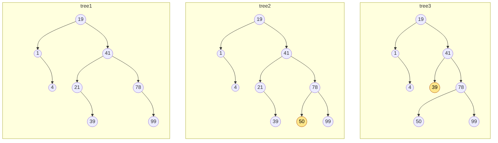
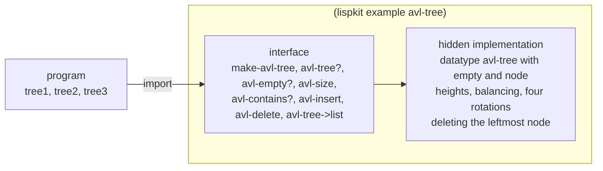
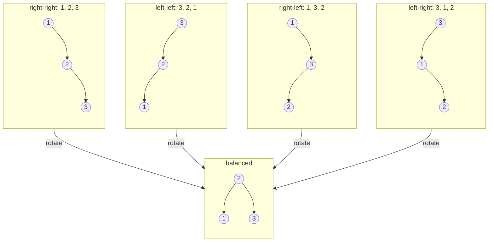
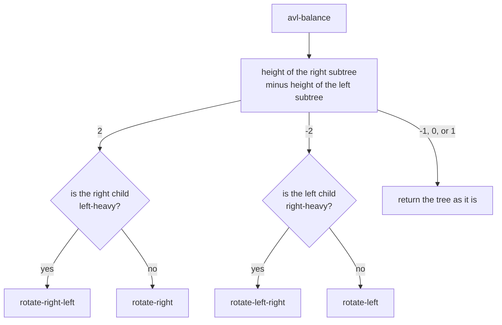
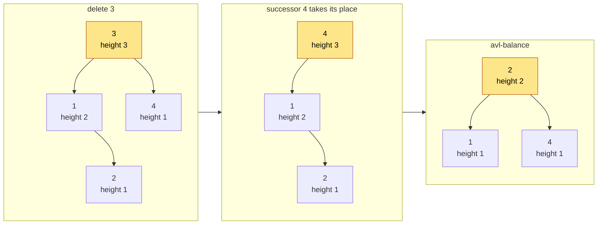

# AVL Trees

A binary search tree finds an element by comparing it with the root and then continuing in the left or in the right subtree, so a search can ignore about half of the tree in every step. This only works as long as the tree is balanced. Insert the numbers 1, 2, 3, and so on in this order into a plain search tree, and the tree degenerates into a list. An _AVL tree_ repairs itself: after every insertion and deletion, it rotates a few nodes, so that the two subtrees of every node differ in height by at most one. This example implements AVL trees as a library of its own, `(lispkit example avl-tree)`, which the program defines in the same file in which it uses it. The program only sees the interface of the library. Inside, a tree is an algebraic datatype with two variants, and the balancing is done with pattern matching. The trees are _purely functional_: inserting or deleting an element does not change a tree, but returns a new one.

:::info

**Program:** [`AvlTrees.scm`](https://github.com/objecthub/swift-lispkit/blob/master/Sources/LispKit/Resources/Examples/AvlTrees.scm), in the `Examples` folder of LispKit\
**Libraries:** `(lispkit base)`, `(lispkit datatype)`, and `(lispkit example avl-tree)`, which the program defines itself\
**Techniques:** local libraries, an abstract data type, algebraic datatypes, nested pattern matching, purely functional data structures, self-balancing trees, rotations

:::

## What the program does

The program creates a tree from nine numbers, adds another number, removes one, and prints a few facts about the three trees it has then:

```
tree1 is a subset of tree2: #t
tree1 is a subset of tree3: #f
elements in tree1: 8
elements in tree2: 9
elements in tree3: 8
```

The nine numbers contain 21 twice. A tree is a set, so `tree1` has only eight elements. `tree2` is `tree1` with 50 added, and `tree3` is `tree2` without 21. This is why `tree1` is not a subset of `tree3` any more. The first tree is not changed by the second and third: `tree1` still has its eight elements after the other two trees have been created.

The program does not print the trees themselves. This is what they look like. Every tree is balanced: the subtrees of each node differ in height by at most one. Element 50 is new in `tree2`. In `tree3`, 39 took the place of the deleted element 21:



The section about variations shows how to get these shapes out of the library.

## Running the program

Build LispKit from a clone of the [GitHub repository](https://github.com/objecthub/swift-lispkit) and load the program into the LispKit REPL:

```
swift build -c release -Xswiftc "-D" -Xswiftc "SPM"
.build/release/LispKitRepl -r Sources/LispKit/Resources -d LispKit \
    -p Sources/LispKit/Resources/Examples/AvlTrees.scm
```

The option `-p` runs the program as the _prelude_ of the REPL. The REPL stays open afterwards, and the definitions of the program are available at the prompt. Without `-p`, `LispKitRepl` runs the program and ends. Leave the REPL with `(exit)`.

The program prints the five lines above. Then the three trees can be explored. Their elements are:

```scheme
(avl-tree->list tree1)
  ; ⇒ (1 4 19 21 39 41 78 99)
(avl-tree->list tree2)
  ; ⇒ (1 4 19 21 39 41 50 78 99)
(avl-tree->list tree3)
  ; ⇒ (1 4 19 39 41 50 78 99)
```

## How it works in a nutshell

The program consists of a library and the code that uses it. The library hides how trees are represented and exports eight procedures. All other definitions, such as the datatype with its variants, the height of a tree, the rotations, and the helpers for deleting, are internal.



| Procedure | Result |
| --- | --- |
| `(make-avl-tree x ...)` | a tree with the elements `x ...`; an element that occurs several times is stored once |
| `(avl-tree? obj)` | `#t` if `obj` is an AVL tree |
| `(avl-empty? tree)` | `#t` if `tree` has no elements |
| `(avl-size tree)` | the number of elements |
| `(avl-contains? x tree)` | `#t` if `x` is an element of `tree` |
| `(avl-insert x tree)` | a tree with all elements of `tree` and `x` |
| `(avl-delete x tree)` | a tree with all elements of `tree` except for `x` |
| `(avl-tree->list tree)` | the elements in ascending order |

The elements have to be numbers: the library compares them with `=`, `<`, and `>`.

## Libraries

| Library | What the program uses it for |
| --- | --- |
| [`(lispkit base)`](../../libraries/lispkit/lispkit-base.md) | the language, including fixnum arithmetic (`fx+`, `fx-`, and `fx1+`), `apply`, and `every?` |
| [`(lispkit datatype)`](../../libraries/lispkit/lispkit-datatype.md) | `define-datatype`, which defines the type of trees, and `match`, which takes trees apart with patterns |
| `(lispkit example avl-tree)` | the AVL tree library, which the program defines with `define-library` |

LispKit lets a program define libraries directly. R7RS only knows libraries in files of their own. A local library hides internal definitions and documents the interface of a data type in one place. The [Maze](maze.md) example is built the same way.

## Design

### AVL trees

In a binary search tree, every node holds an element, the elements of its left subtree are smaller, and the elements of its right subtree are greater. A search follows one path from the root to a leaf, so it takes as many steps as the tree is high. A tree with 1000 elements can have a height of 10, but also a height of 1000.

Georgy Adelson-Velsky and Evgenii Landis invented AVL trees in 1962 to rule out the bad case. The _AVL property_ says that the heights of the left and the right subtree of every node differ by at most one. A tree with this property is never much higher than a perfectly balanced tree: its height is at most about 1.44 × log₂(_n_ + 2) for _n_ elements. So searching, inserting, and deleting take a time that grows with the logarithm of the number of elements. The price is that an insertion or a deletion has to restore the property when it is lost.

### The datatype

A tree is either empty, or it is a node with an element, a left and a right subtree, and a height:

| Variant | Meaning |
| --- | --- |
| `(empty)` | the tree without elements |
| `(node elem left right height)` | a node; `height` is the height of the tree whose root is this node |

Every node stores its height. The balancing needs the heights of subtrees all the time, and this way, it does not have to count nodes to find them. Only two procedures create nodes: `make-leaf` creates a node without subtrees, and `make-tree` creates a node with two subtrees. `make-tree` computes the height from the stored heights of the subtrees, so creating a node costs a constant amount of work.

### Hiding the representation

The program that uses the library cannot create or take apart a node: the variants `empty` and `node` are not exported. All it can do is to call the procedures of the interface. This is what makes the tree an _abstract data type_. The library could keep the size in every node, or switch to another kind of balanced tree, and no program that imports it would notice.

### Purely functional trees

`avl-insert` and `avl-delete` return trees and leave their arguments alone. This is cheap, because the new tree shares most of its nodes with the old tree. Only the nodes on the path from the root to the place of the change have to be created again, which are about as many as the tree is high. The other subtrees are reused as they are, so there can be several trees that share nodes. Nobody can change a node, so sharing is safe. It also makes the old versions available for free: the program above still has `tree1` after it has created `tree3`.

An element that is in the tree already, or an element that is not in the tree when it is to be deleted, changes nothing, and so the procedures return the tree they got:

```scheme
(eq? tree1 (avl-insert 39 tree1))
  ; ⇒ #t
(eq? tree3 (avl-delete 1000 tree3))
  ; ⇒ #t
(avl-size (make-avl-tree 5 5 5))
  ; ⇒ 1
```

### Rotations

If the heights of the two subtrees of a node differ by two after an insertion or a deletion, `avl-balance` restores the AVL property with one or two _rotations_. A rotation moves a node up and some of its subtrees to new parents. The order of the elements stays the same, so the tree is still a search tree afterwards.

There are four cases, depending on where the new height comes from. The diagram shows the four trees that would result from inserting 1, 2, 3, in this order, and the other three orders of the numbers 1, 2, and 3 if nothing was balanced. Every one of them is out of balance at the root, and every one is turned into the same tree:



The library does build the same tree in all four cases:

```scheme
(import (scheme list))
(map (lambda (order) (avl-structure (fold avl-insert (make-avl-tree) order)))
     '((1 2 3) (3 2 1) (1 3 2) (3 1 2)))
  ; ⇒ ((2 (1 () ()) (3 () ())) (2 (1 () ()) (3 () ())) (2 (1 () ()) (3 () ())) (2 (1 () ()) (3 () ())))
```

The procedure `avl-structure` is not part of the example. The section about variations adds it to the library. It returns a tree as nested lists `(element left right)`, with `()` for the empty tree.

The first two cases are fixed by a _single rotation_: the root becomes a child of its own child on the high side. The other two cases need a _double rotation_, because the extra height is on the inner side: first the grandchild moves up to the position of the child, then up again. The procedure `avl-balance` looks at the difference between the heights of the subtrees and, for a difference of two, also at the child on the high side:



The names of the rotations tell which node moves up: `rotate-left` moves the left child up, and `rotate-right` moves the right child up. `rotate-left-right` moves the right child of the left child up, and `rotate-right-left` moves the left child of the right child up. Many textbooks use the opposite names for the single rotations; they call the rotation that moves the left child up a _right rotation_.

### Insertion

`avl-insert` first asks whether the element is in the tree already, and returns the tree if it is. Otherwise, `avl-insert-internal` walks down the tree, comparing the element with the elements of the nodes, until it reaches an empty tree, where it creates a leaf. On the way back, every node on the path is created again with `make-tree` and its new subtree, and `avl-balance` repairs a node if its subtrees differ by two. After an insertion, at most one rotation is needed.

### Deletion

`avl-delete` also starts by asking whether the element is in the tree. Then `avl-delete-internal` walks down to the node with the element. If one of its subtrees is empty, the node is replaced by the other subtree. If both subtrees are there, the node is replaced by its _successor_, the smallest element of the right subtree, which is its leftmost node. `avl-delete-leftmost` finds the leftmost node and removes it. It returns a value that is not a tree of its own: a node with the leftmost element in its root, an empty left subtree, and the rest of the right subtree, in balance again, as its right subtree. The caller takes the element and the rest apart. On the way back, every node on the path is created again and balanced, as for insertion. Deletion can need a rotation on every level of the path.

Removing the successor can make the right subtree one lower than before, and then the node that takes the place of the deleted one can be out of balance. Here is the smallest case. The tree of the elements 1, 2, 3, and 4 has a left subtree of height 2 and a right subtree of height 1. After 3 is replaced by 4, the right subtree is empty, and the heights 2 and 0 differ by two. `avl-balance` fixes this with a double rotation:



The same example with the library:

```scheme
(define small (fold avl-insert (make-avl-tree) '(1 3 4 2)))
(avl-structure small)
  ; ⇒ (3 (1 () (2 () ())) (4 () ()))
(avl-structure (avl-delete 3 small))
  ; ⇒ (2 (1 () ()) (4 () ()))
```

### The main ideas

**Keep every subtree balanced.** One rule, the heights of subtrees differ by at most one, guarantees a logarithmic height. Everything else follows from keeping the rule after every change.

**Rebuild on the way back.** Insertion and deletion are recursive procedures that walk down to the place of the change. On the way back, they create each node on the path again and let `avl-balance` repair it. There is no code for a tree that is balanced after the change, and no code for walking up from a node.

**Only two ways to create a node.** `make-leaf` and `make-tree` set the stored height. All other code calls them, so the heights cannot get out of date.

**Patterns instead of accessors.** A pattern like `(node e l (node re rl rr _) _)` names the parts of a node and of its right child in one go. The four rotations are four patterns and four constructor calls, and they are short enough to read at a glance.

**Hide the representation.** The interface has eight procedures. The datatype, the heights, and the rotations are not visible to the program.

**Share instead of copy.** The trees are values. An operation that changes a tree returns a new one that shares most of its nodes with the old one.

## Walkthrough

The following sections go through the program from top to bottom. Together, the code blocks make up the complete source of `AvlTrees.scm`.

### Header

<details>

<summary>Description, credits, and license</summary>

```scheme
;;; Sample AVL Tree Library
;;;
;;; This is an example showcasing the usage of libraries to implement
;;; abstract data types. As opposed to the R7RS standard, LispKit allows
;;; for the definition of libraries in programs directly. Such "local
;;; libraries" can be defined and imported just like globally installed
;;; libraries in .sld files. They are useful to hide internal functions
;;; and to document the official interface of a datatype.
;;;
;;; The AVL tree library example below implements purely functional AVL
;;; trees: inserting or deleting an element from an AVL tree results in a
;;; new AVL tree. Internally, AVL trees are implemented using algebraic
;;; datatypes. Algebraic datatypes usually don't exist in Scheme
;;; implementations. LispKit provides a lightweight algebraic datatype
;;; implementation via library `(lispkit datatype)`.
;;;
;;; The end of the file shows how to use the AVL tree library and access
;;; functionality defined by the library in the same file.
;;;
;;; Author: Matthias Zenger
;;; Copyright © 2017 Matthias Zenger. All rights reserved.
;;;
;;; Licensed under the Apache License, Version 2.0 (the "License"); you may
;;; not use this file except in compliance with the License. You may obtain
;;; a copy of the License at
;;;
;;;   http://www.apache.org/licenses/LICENSE-2.0
;;;
;;; Unless required by applicable law or agreed to in writing, software
;;; distributed under the License is distributed on an "AS IS" BASIS,
;;; WITHOUT WARRANTIES OR CONDITIONS OF ANY KIND, either express or implied.
;;; See the License for the specific language governing permissions and
;;; limitations under the License.
```

</details>

### The library

`define-library` defines the library `(lispkit example avl-tree)`. The `export` declaration lists the eight procedures of the interface, and the `import` declaration lists the libraries that the definitions use. `(lispkit base)` provides the language and `(lispkit datatype)` provides `define-datatype` and `match`.

```scheme
(define-library (lispkit example avl-tree)

  (export make-avl-tree
          avl-tree?
          avl-empty?
          avl-size
          avl-contains?
          avl-insert
          avl-delete
          avl-tree->list)

  (import (lispkit base)
          (lispkit datatype))
```

### The datatype

The definitions are in a `begin` block. `define-datatype` defines the type `avl-tree`, the predicate `avl-tree?`, and two variants: `empty` and `node`. Each variant defines a constructor and a pattern. `(empty)` creates the empty tree, and `(node elem left right height)` creates a node.

```scheme
  (begin

    ;; Define data type. AVL trees are implemented as an algebraic datatype with two
    ;; constructors: `empty` and `node`, for representing an empty AVL tree and AVL
    ;; trees of at least one element.
    (define-datatype avl-tree avl-tree?
      (empty)
      (node elem left right height))
```

### Creating trees

`make-avl-tree` creates a tree with the given elements. If there are none, the result is the empty tree. Otherwise, it makes a tree from the rest of the elements, and inserts the first one. This way, the elements are inserted from the last to the first. Since `avl-insert` ignores an element that is in the tree already, duplicates are dropped.

```scheme
    ;;; Make a new AVL tree containing the given elements.
    (define (make-avl-tree . elems)
      (if (null? elems)
          empty-tree
          (avl-insert (car elems) (apply make-avl-tree (cdr elems)))))
```

The empty tree is created once and shared by all trees:

```scheme
    ;; Constant defining the empty AVL tree.
    (define empty-tree (empty))
```

`make-leaf` creates a tree with a single element, which has the height 1 and two empty subtrees:

```scheme
    ;; Constructor creating an AVL tree with one element.
    (define (make-leaf elem)
      (node elem empty-tree empty-tree 1))
```

`make-tree` creates a tree from an element and two subtrees. The height of the new tree is one more than the greater height of the subtrees. `fx1+` adds one to a fixnum.

```scheme
    ;; Constructor creating an AVL tree with a left and right subtree.
    (define (make-tree elem left right)
      (node elem left right (fx1+ (max (height left) (height right)))))
```

### Heights

`height` returns the stored height of a tree, and the height of the empty tree is 0. The wildcard `_` in a pattern matches any value without naming it:

```scheme
    ;; Returns the height of the given tree.
    (define (height tree)
      (match tree
        ((empty)         0)
        ((node _ _ _ h)  h)))
```

`height-diff` computes the _balance_ of a tree: the height of the right subtree minus the height of the left subtree. It is positive if the right side is higher, and negative if the left side is higher:

```scheme
    ;; Computes the height difference between the left and right subtrees of the given tree.
    (define (height-diff tree)
      (match tree
        ((empty)         0)
        ((node _ l r _)  (fx- (height r) (height l)))))
```

### Queries

`avl-empty?` matches the pattern `(empty)`. The case `else` matches everything else:

```scheme
    ;; Returns #t if the given tree is an empty tree.
    (define (avl-empty? tree)
      (match tree
        ((empty)  #t)
        (else     #f)))
```

`avl-size` counts the nodes: one for the root plus the sizes of the subtrees. The tree does not store its size, so this takes time proportional to the number of elements.

```scheme
    ;; Returns the number of elements in the given AVL tree.
    (define (avl-size tree)
      (match tree
        ((empty)        0)
        ((node _ l r _) (fx1+ (fx+ (avl-size l) (avl-size r))))))
```

`avl-contains?` searches the tree. At every node, it compares the element with the element of the node, and it continues in the left or right subtree if they differ. An empty tree contains nothing.

```scheme
    ;; Returns #t if the AVL tree contains the given element.
    (define (avl-contains? x tree)
      (match tree
        ((empty)        #f)
        ((node e l r _) (cond ((= x e) #t)
                              ((< x e) (avl-contains? x l))
                              ((> x e) (avl-contains? x r))))))
```

### Balancing

`avl-balance` looks at the difference of the heights of the subtrees of a node. Only the values 2 and -2 need work, and after a single insertion or deletion, no other difference can be out of range. The extra height is either on the outer or on the inner side, which the balance of the high child tells: if it leans the other way, a double rotation is needed.

```scheme
    ;; Returns a balanced version of the given AVL tree.
    (define (avl-balance tree)
      (match tree
        ((empty)         tree)
        ((node _ l r _)  (case (fx- (height r) (height l))
                           ((2)   (if (negative? (height-diff r))
                                      (rotate-right-left tree)
                                      (rotate-right tree)))
                           ((-2)  (if (positive? (height-diff l))
                                      (rotate-left-right tree)
                                      (rotate-left tree)))
                           (else  tree)))))
```

The rotations take a node apart with a pattern that is two levels deep, and put the pieces back together with `make-tree`, which recomputes the heights. In `rotate-left`, the left child `le` becomes the new root. It keeps its left subtree `ll`. Its old right subtree `lr` and the right subtree `r` of the old root become the subtrees of the old root, which is now the right child of `le`. The case `empty` is there for completeness, and the program never calls `rotate-left` with an empty tree.

```scheme
    (define (rotate-left tree)
      (match tree
        ((empty)                         tree)
        ((node e (node le ll lr _) r _)  (make-tree le ll (make-tree e lr r)))))
```

`rotate-right` is the mirror image:

```scheme
    (define (rotate-right tree)
      (match tree
        ((empty)                         tree)
        ((node e l (node re rl rr _) _)  (make-tree re (make-tree e l rl) rr))))
```

`rotate-left-right` is for a left child that leans to the right. The right child `lre` of the left child moves up to the root. Its subtrees `lrl` and `lrr` go to the two nodes that become its children:

```scheme
    (define (rotate-left-right tree)
      (match tree
        ((node e (node le ll (node lre lrl lrr _) _) r _)
          (make-tree lre (make-tree le ll lrl) (make-tree e lrr r)))))
```

`rotate-right-left` is the mirror image:

```scheme
    (define (rotate-right-left tree)
      (match tree
        ((node e l (node re (node rle rll rlr _) rr _) _)
          (make-tree rle (make-tree e l rll) (make-tree re rlr rr)))))
```

### Insertion

`avl-insert` returns the tree itself if it contains the element already. Otherwise, it calls `avl-insert-internal`.

```scheme
    ;; Returns a new AVL tree with the given element inserted.
    (define (avl-insert x tree)
      (if (avl-contains? x tree) tree (avl-insert-internal x tree)))
```

`avl-insert-internal` returns a leaf for an empty tree. For a node, it inserts the element into the subtree on the side where it belongs, makes a new node with the new subtree and the old one on the other side, and balances the new node. The last case, `else`, is for the element of the node itself, and it cannot occur after `avl-insert` has checked that the element is not in the tree.

```scheme
    (define (avl-insert-internal x tree)
      (match tree
        ((empty)         (make-leaf x))
        ((node e l r h)  (cond ((< x e)  (avl-balance (make-tree e (avl-insert-internal x l) r)))
                               ((> x e)  (avl-balance (make-tree e l (avl-insert-internal x r))))
                               (else     tree)))))
```

### Deletion

`avl-delete` returns the tree if the element is not in it. Otherwise, it calls `avl-delete-internal`.

```scheme
    ;; Returns a new AVL tree with the given element removed.
    (define (avl-delete x tree)
      (if (avl-contains? x tree) (avl-delete-internal x tree) tree))
```

`avl-delete-internal` descends to the node of the element, rebuilding and balancing the nodes on the way back, like the insertion. For the node that has the element, there are three cases. If the right subtree is empty, the node is replaced by its left subtree, and if the left subtree is empty, it is replaced by its right subtree. If both exist, `avl-delete-leftmost` takes the leftmost node out of the right subtree. The result has the successor `lme` in its root and the rest of the right subtree, `lmr`, as its right subtree. The new node holds `lme` with the old left subtree and `lmr`. The subtree `lmr` can be one lower than the right subtree was, so the new node is balanced like any other.

```scheme
    (define (avl-delete-internal x tree)
      (match tree
        ((node e l r _)
          (cond ((< x e) (avl-balance (make-tree e (avl-delete-internal x l) r)))
                ((> x e) (avl-balance (make-tree e l (avl-delete-internal x r))))
                ((= x e) (cond ((avl-empty? r) l)
                               ((avl-empty? l) r)
                               (else           (match (avl-delete-leftmost r)
                                                 ((node lme _ lmr _)
                                                   (avl-balance (make-tree lme l lmr)))))))))))
```

`avl-delete-leftmost` finds the leftmost node of a tree. A node without a left subtree is the leftmost node, and the procedure returns it as it is, together with its right subtree. For any other node, it takes the leftmost node out of the left subtree, and it puts the rest together again: the right subtree of the result is the node with the rest of the left subtree and the old right subtree, balanced, and the leftmost element is the root.

```scheme
    (define (avl-delete-leftmost tree)
      (match tree
        ((node _ (empty) _ _) tree)
        ((node e l r _)       (match (avl-delete-leftmost l)
                                ((node lme _ lmr _)
                                  (make-tree lme empty-tree (avl-balance (make-tree e lmr r))))))))
```

### Converting a tree to a list

`avl-tree->list` visits the left subtree, the element, and the right subtree, in this order, which delivers the elements in ascending order:

```scheme
    ;; Returns the elements of the given AVL tree as a list in sorted order.
    (define (avl-tree->list tree)
      (match tree
        ((empty)         '())
        ((node e l r _)  (append (avl-tree->list l) (list e) (avl-tree->list r)))))
```

The last two lines end the `begin` block and the library:

```scheme
  )
)
```

### The program

The program imports the library together with `(lispkit base)`:

```scheme
(import (lispkit base)
        (lispkit example avl-tree))
```

It creates `tree1` from nine numbers. Since `make-avl-tree` inserts from the right, the elements are inserted in the order 21, 41, 78, 19, 1, 4, 99, 21, 39, where the second 21 is ignored. `tree2` is a new tree with 50 added:

```scheme
(define tree1 (make-avl-tree 39 21 99 4 1 19 78 41 21))
(define tree2 (avl-insert 50 tree1))
```

The program checks that all elements of `tree1` are in `tree2`. `every?` applies a test to every element of a list, here to the sorted elements of `tree1`:

```scheme
(display "tree1 is a subset of tree2: ")
(display (every? (lambda (x) (avl-contains? x tree2)) (avl-tree->list tree1)))
(newline)
```

`tree3` is `tree2` without 21. Then the program checks if the elements of `tree1` are in `tree3`, which they are not, since 21 is missing:

```scheme
(define tree3 (avl-delete 21 tree2))
```

```scheme
(display "tree1 is a subset of tree3: ")
(display (every? (lambda (x) (avl-contains? x tree3)) (avl-tree->list tree1)))
(newline)
```

Finally, the program prints the sizes of the three trees:

```scheme
(display "elements in tree1: ")
(display (avl-size tree1))
(newline)

(display "elements in tree2: ")
(display (avl-size tree2))
(newline)

(display "elements in tree3: ")
(display (avl-size tree3))
(newline)
```

## Variations

The definitions of the program are available at the prompt of the REPL, which was started with the option `-p`.

**Looking inside.** The library hides the trees, so the shapes in the diagrams above cannot be seen from the outside. To see them, add the names `height`, `avl-structure`, and `avl-balanced?` to the `export` declaration of the library, and add these definitions at the end of the `begin` block, after `avl-tree->list`:

```scheme
    ;; Returns the structure of the given AVL tree as nested lists `(element left right)`.
    ;; The empty tree is represented by the empty list.
    (define (avl-structure tree)
      (match tree
        ((empty)         '())
        ((node e l r _)  (list e (avl-structure l) (avl-structure r)))))

    ;; Returns #t if the heights of the subtrees of every node differ by at most one
    ;; and if every node stores the correct height.
    (define (avl-balanced? tree)
      (match tree
        ((empty)         #t)
        ((node _ l r h)  (and (avl-balanced? l)
                              (avl-balanced? r)
                              (<= (abs (height-diff tree)) 1)
                              (= h (fx1+ (max (height l) (height r))))))))
```

With these changes, the shapes of the three trees are available, and so are their heights:

```scheme
(avl-structure tree1)
  ; ⇒ (19 (1 () (4 () ())) (41 (21 () (39 () ())) (78 () (99 () ()))))
(avl-structure tree2)
  ; ⇒ (19 (1 () (4 () ())) (41 (21 () (39 () ())) (78 (50 () ()) (99 () ()))))
(avl-structure tree3)
  ; ⇒ (19 (1 () (4 () ())) (41 (39 () ()) (78 (50 () ()) (99 () ()))))
(list (height tree1) (height tree2) (height tree3))
  ; ⇒ (4 4 4)
(list (avl-balanced? tree1) (avl-balanced? tree2) (avl-balanced? tree3))
  ; ⇒ (#t #t #t)
```

**The height of a larger tree.** The numbers from 1 to 1000, inserted in ascending order, are the worst case for a plain search tree, which would get a height of 1000. The AVL tree has a height of 10, which is the height of a perfectly balanced tree with this many elements:

```scheme
(height (fold avl-insert (make-avl-tree) (iota 1000 1)))
  ; ⇒ 10
```

**Testing with random data.** A tree that contains the right elements can still be out of balance. A test should check both properties. This one inserts 40 random numbers and removes 40 random numbers. It compares the elements of the tree with the elements of a list, which is easy to get right, and it checks the balance of the tree. It repeats this for 200 random trees:

```scheme
(import (scheme list) (lispkit math))

(define (random-numbers n)
  (map (lambda (i) (random 100)) (iota n)))

(define (check-random-tree)
  (let* ((added (random-numbers 40))
         (removed (random-numbers 40))
         (tree (fold avl-delete (fold avl-insert (make-avl-tree) added) removed))
         (model (sort < (lset-difference = (delete-duplicates added) removed))))
    (and (avl-balanced? tree)
         (equal? (avl-tree->list tree) model))))

(every? (lambda (i) (check-random-tree)) (iota 200))
  ; ⇒ #t
```

A test like this found a bug in an earlier version of the example. When a deleted node with two subtrees was replaced by its successor, the new node was not balanced. The tree still had the right elements, but it could be out of balance. The smallest case is the tree above: deleting 3 from the tree of 1, 2, 3, and 4 gave a node with the subtrees of the heights 2 and 0.

**More ideas.** The library only works for numbers. A version that takes the comparison procedure as an argument of `make-avl-tree` would work for strings and symbols, and a version that stores a key and a value in every node would be a dictionary. A tree could store the number of elements in every node, which makes `avl-size` a constant-time operation and allows to ask for the element with a given rank. Procedures for the union and the intersection of two trees, and for folding over the elements, would turn the library into a set library.

## Further reading

* [`(lispkit datatype)`](../../libraries/lispkit/lispkit-datatype.md): algebraic datatypes and pattern matching
* [Maze](maze.md): another example that defines a library of its own, an abstract data type for mazes
* [AVL tree](https://en.wikipedia.org/wiki/AVL_tree) on Wikipedia: the algorithms, the four cases of rotations, and the bounds for the height
* [R7RS small](https://small.r7rs.org): the report that defines `define-library` for Scheme
