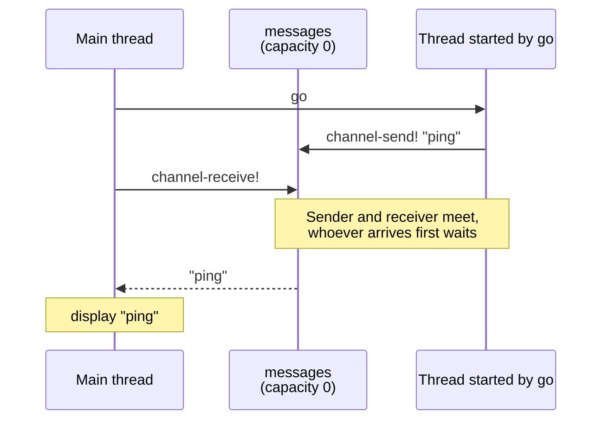
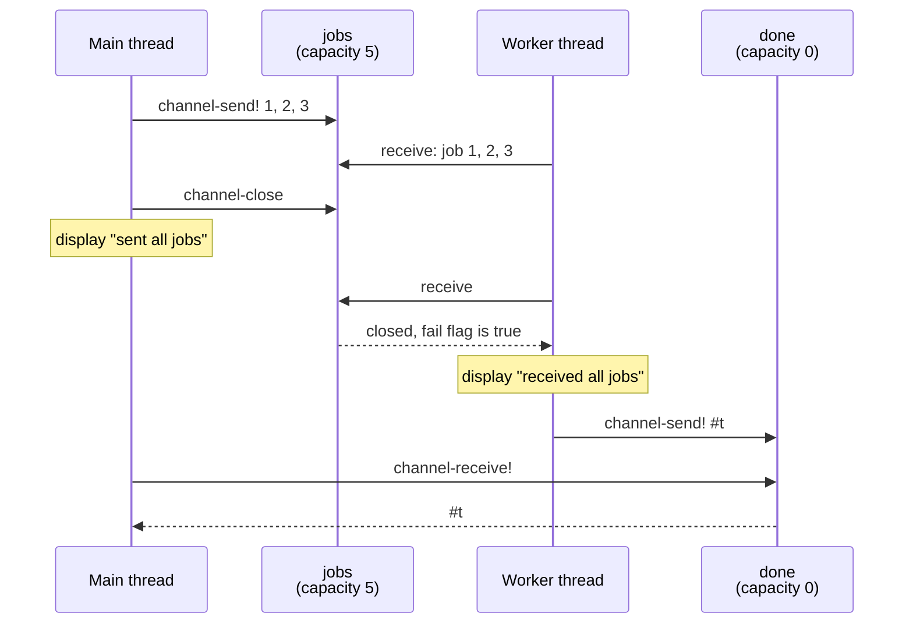
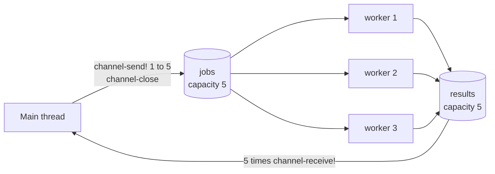
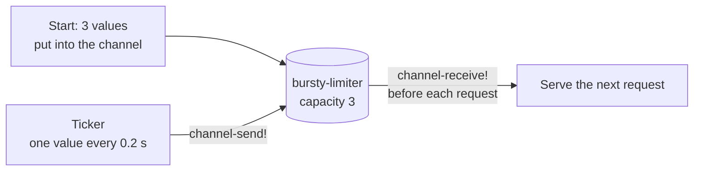

# Channels

Threads that share variables need locks to keep their data consistent. Threads that communicate through _channels_ often need no locks at all: one thread sends a value into a channel, and another thread receives it. This example is a tutorial for channels in LispKit. It consists of ten short, independent programs. They start with a single message sent from one thread to another and end with a worker pool and a rate limiter.

:::info

**Program:** [`Channels.scm`](https://github.com/objecthub/swift-lispkit/blob/master/Sources/LispKit/Resources/Examples/Channels.scm), in the `Examples` folder of LispKit\
**Libraries:** `(lispkit base)`, `(lispkit iterate)`, `(lispkit thread)`, `(lispkit thread channel)`, `(lispkit date-time)`\
**Techniques:** threads, synchronous and buffered channels, `channel-select`, timers and tickers, worker pools\
**Attribution:** The examples are adapted from [Go by Example](https://github.com/mmcgrana/gobyexample) by Mark McGranaghan and Eli Bendersky, licensed under [Creative Commons Attribution 3.0 Unported](https://creativecommons.org/licenses/by/3.0/). They were adapted to LispKit by Matthias Zenger. See the file header for the complete credits.

:::

## The ten examples

Each example is a short program that prints its results. The programs run one after the other when the file is loaded. Most of the 11 seconds the whole file takes are spent waiting: the examples use `thread-sleep!` to simulate slow work.

| Example | What it shows | Main operations | Takes |
| --- | --- | --- | --- |
| Channels | Sending a value from one thread to another | `make-channel`, `go`, `channel-send!`, `channel-receive!` | instant |
| Channel buffering | Channels that hold a few values | `(make-channel 2)` | instant |
| Channel synchronization | Waiting for a thread to finish | a `done` channel | 1 s |
| Channel select | Waiting for several channels at once | `channel-select` | 2 s |
| Timeouts | Giving up on a slow operation | `timer` in `channel-select` | 3 s |
| Non-blocking channel operations | Sending and receiving without waiting | `else` clause of `channel-select` | instant |
| Closing channels | Telling receivers that nothing more will come | `channel-close`, the `fail` flag | instant |
| Tickers | Doing something at regular intervals | `ticker`, `ticker-stop!` | 1.6 s |
| Worker pools | Distributing work to several threads | `channel-range` | 2.1 s |
| Rate limiting | Serving requests at a fixed pace, with bursts | tickers and buffered channels | 1.4 s |

## Running the program

Build LispKit from a clone of the [GitHub repository](https://github.com/objecthub/swift-lispkit) and load the program into the LispKit REPL:

```bash
swift build -c release -Xswiftc "-D" -Xswiftc "SPM"
.build/release/LispKitRepl -r Sources/LispKit/Resources -d LispKit \
    -p Sources/LispKit/Resources/Examples/Channels.scm
```

The option `-p` runs the program as the _prelude_ of the REPL. The REPL stays open afterwards, and the definitions of the program are available at the prompt. Without `-p`, `LispKitRepl` runs the program and ends. Leave the REPL with `(exit)`.

The examples print their results as they run. This is the output of one run:

```
---- CHANNELS
ping
---- CHANNEL BUFFERING
buffered
channel
---- CHANNEL SYNCHRONIZATION
working...done
---- CHANNEL SELECT
received one
received two
---- TIMEOUTS
timeout 1
result 2
---- NON-BLOCKING CHANNEL OPERATIONS
no message received
no message sent
no activity
---- CLOSING CHANNELS
sent job 1
received job 1
sent job 2
received job 2
sent job 3
sent all jobs
received job 3
received all jobs
---- TICKERS
Tick at 23/10/2026, 23:06:51
Tick at 23/10/2026, 23:06:52
Tick at 23/10/2026, 23:06:52
Ticker stopped
---- WORKER POOLS
worker 1 started job 1
worker 3 started job 2
worker 2 started job 3
worker 1 finished job 1
worker 2 finished job 3
worker 3 finished job 2
worker 2 started job 4
worker 1 started job 5
worker 2 finished job 4
worker 1 finished job 5
---- RATE LIMITING
request 1 210ms
request 2 409ms
request 3 610ms
request 4 811ms
request 5 1010ms
request 1 1019ms
request 2 1020ms
request 3 1022ms
request 4 1217ms
request 5 1420ms
```

The output of examples with several threads depends on how the threads are scheduled. In the examples _Closing channels_ and _Worker pools_, the order of some lines, and the numbers of the workers, can be different every time. The times in _Rate limiting_ vary by a few milliseconds.

## Threads and channels in a nutshell

A _thread_ is a computation that runs concurrently with other threads. `(go stmt ...)` creates a new thread that executes the statements and starts it. A _channel_ is a thread-safe queue that threads use to hand values to each other. How a channel behaves depends on its _capacity_:

* A channel with capacity 0, as created by `(make-channel)`, is _synchronous_. `channel-send!` blocks until another thread calls `channel-receive!` for the same channel, and the other way round. A synchronous channel is a meeting point of two threads: whoever arrives first waits for the other.
* A channel with a capacity larger than 0, as created by `(make-channel 5)`, is _buffered_. It stores up to that many values. A send only blocks when the buffer is full, a receive only when it is empty. The values are received in the order they were sent.

The library provides these operations:

| Operation | Effect |
| --- | --- |
| `(go stmt ...)` | Starts a new thread that executes the statements. |
| `(make-channel)`, `(make-channel capacity)` | Creates a channel. |
| `(channel-send! channel msg)` | Sends a message and blocks if there is no room. Returns the _fail flag_: `#f` if the message was sent. |
| `(channel-receive! channel)` | Receives a message and blocks if there is none. Returns `#f` if the channel is closed and empty. |
| `(channel-select clause ...)` | Waits for several channel operations and executes the clause of the first one that is ready. A clause is `((chan -> msg) body ...)` for a receive and `((chan <- msg) body ...)` for a send; `else` makes the select non-blocking. |
| `(channel-range chan -> msg body ...)` | Executes the body for every message until the channel is closed. |
| `(channel-close channel)` | Closes the channel. No more values can be sent, and receivers get the fail flag. |
| `(timer seconds)` | A channel that delivers one value after the given time. |
| `(ticker seconds)`, `(ticker-stop! ticker)` | A channel that delivers a value at regular intervals, until it is stopped. |

Messages can be any value; unlike in Go, channels have no element type. The design follows the channels of the Go programming language with a few differences: sending to a closed channel does not raise an error but returns a true fail flag, closing a channel twice is allowed, and `channel-select*` chooses the channels at runtime.

## Libraries

| Library | Used for |
| --- | --- |
| [`(lispkit base)`](../../libraries/lispkit/lispkit-base.md) | The language itself: `let`, `let*`, `begin`, `define`, `cond`, `unless`, `display`, `display*`, `newline`, `current-second`, `round`, and `exact`. |
| [`(lispkit thread)`](../../libraries/lispkit/lispkit-thread.md) | Threads: `go` and `thread-sleep!`. The library also provides mutexes and condition variables for the cases where channels are not the right tool. |
| [`(lispkit thread channel)`](../../libraries/lispkit/lispkit-thread-channel.md) | The channels: `make-channel`, `channel-send!`, `channel-receive!`, `channel-select`, `channel-range`, `channel-close`, `timer`, `ticker`, and `ticker-stop!`. |
| [`(lispkit iterate)`](../../libraries/lispkit/lispkit-iterate.md) | The loop `dotimes`. |
| [`(lispkit date-time)`](../../libraries/lispkit/lispkit-date-time.md) | `seconds->date-time` and `date-time->string`, which format the time of a tick in the example _Tickers_. |

The channel library is a port of a library written by Kristian Lein-Mathisen for Chicken Scheme. LispKit adapted it, and its API follows the channels of Go.

## Walkthrough

The following sections go through the program from top to bottom. The comments of the program explain each example. The text after each example adds what happens when it runs. Together, the code blocks make up the complete source of `Channels.scm`.

### Header and imports

<details>

<summary>Description, credits, and license</summary>

```scheme
;;; LispKit Channel Tutorial
;;;
;;; LispKit supports multi-threading via library `(lispkit thread)`.
;;; The library provides access to threads and low-level synchronization
;;; abstractions such as mutexes and condition variables. Library
;;; `(lispkit thread channel)` implements synchronous and asynchronous
;;; channels facilitating communication between threads. The design is
;;; based on channels as provided by the Go programming language.
;;;
;;; This file introduces LispKit channels. The material is based on
;;; content created by Mark McGranaghan and Eli Bendersky for the Go
;;; programming language. The original content ("Go by Example") can
;;; be found here: https://github.com/mmcgrana/gobyexample
;;;
;;; This work is copyright by Mark McGranaghan and licensed under a
;;; Creative Commons Attribution 3.0 Unported License. See
;;; https://creativecommons.org/licenses/by/3.0/
;;;
;;; Adaptation to LispKit
;;;   Copyright © 2022 Matthias Zenger. All rights reserved.
```

</details>

```scheme
(import (lispkit base)
        (lispkit iterate)
        (lispkit thread)
        (lispkit thread channel)
        (lispkit date-time))
```

### Channels

```scheme
;;; CHANNELS

;; Channels can be seen as the pipes that connect concurrent threads. You can
;; send values into channels from one thread and receive those values on another
;; thread.
;;
;; The following snippet creates a new channel with `(make-channel)`. Unlike
;; channels in the Go programming language, LispKit channels are not typed.
;; A value is sent into a channel using the `channel-send!` procedure. Below,
;; we send "ping" to the messages channel from a new thread created via `go`.
;; The `channel-receive!` procedure receives a value from the channel. Below,
;; we’ll receive the "ping" message we sent above in the other thread and
;; print it out. By default, sends and receives block until both the sender
;; and receiver are ready. This property allowed us to wait at the end of our
;; program for the "ping" message to arrive without having to use any other
;; synchronization.

(display "---- CHANNELS\n")
(let ((messages (make-channel)))
  (go (channel-send! messages "ping"))
  (let ((msg (channel-receive! messages)))
    (display msg)
    (newline)))

;; Output:
;; ping
```

The main thread starts a thread with `go` and then waits for a message on the channel. The channel is synchronous, so the sender and the receiver meet: whichever thread gets to its operation first waits for the other.



### Channel buffering

```scheme
;;; CHANNEL BUFFERING

;; By default, channels are unbuffered, meaning that they will only accept
;; `channel-send!` if there is a corresponding `channel-receive!` ready to
;; receive the sent value. Buffered channels accept a limited number of values
;; without a corresponding receiver for those values.
;;
;; In the code below, we make a channel buffering up to 2 values. Because this
;; channel is buffered, we can send values into the channel without a
;; corresponding concurrent receive. Later we can receive these two values as
;; usual asynchronously.

(display "---- CHANNEL BUFFERING\n")
(let ((messages (make-channel 2)))
  (channel-send! messages "buffered")
  (channel-send! messages "channel")
  (display (channel-receive! messages))
  (newline)
  (display (channel-receive! messages))
  (newline))

;; Output:
;; buffered
;; channel
```

This example has no second thread. The channel has room for two values, so both sends return immediately, and the values are received afterwards in the same order. A third send would have blocked the program forever, because nobody could ever receive a value.

### Channel synchronization

```scheme
;;; CHANNEL SYNCHRONIZATION

;; We can use channels to synchronize execution across threads. Here is an
;; example of using a blocking receive to wait for a thread to finish. The done
;; channel will be used to notify another thread that the thread's work is done.

(display "---- CHANNEL SYNCHRONIZATION\n")
(begin
  ; This is the procedure we execute in a separate thread.
  (define (worker done)
    (display "working...")
    (thread-sleep! 1)
    (display "done")
    (newline)
    ; Send value to notify we are done.
    (channel-send! done #t))
  (define done (make-channel 1))
  ; Start a new thread, passing the channel to notify on.
  (go (worker done))
  ; Block until we receive a notification from the worker on the channel.
  (channel-receive! done))

;; If you removed the `channel-receive!` call from this program, the program
;; would exit before the worker even started.
;; Output:
;; working...done
```

The worker prints `working...`, sleeps for a second, prints `done`, and then sends to `done`. The main thread waits for this message with `channel-receive!`, so it continues only after the worker has finished. The value of the message does not matter. The channel has a capacity of 1, so the worker never has to wait for the main thread when it sends the message.

The comment at the end of the example says that the program would exit before the worker started if the receive was missing. When the program is run as a script, as above, this is what happens: the program ends and the worker is cut off. In a quick test without `channel-receive!`, the output was `main finished` and `working...`, but never `done`.

### Channel select

```scheme
;;; CHANNEL SELECT

;; The `channel-select` form lets you wait on multiple channel operations.
;; Combining threads and channels with `channel-select` is a powerful feature
;; of library `(lispkit thread channel)`.
;;
;; For our example below, we will select across two channels `c1` and `c2`.
;; Each channel will receive a value after some amount of time from two
;; separate threads, to simulate e.g. blocking RPC operations
;; executing in concurrent threads. We will use `channel-select` to await
;; both of these values simultaneously, printing each one as it arrives.

(display "---- CHANNEL SELECT\n")
(let ((c1 (make-channel))
      (c2 (make-channel)))
  (go (thread-sleep! 1)
      (channel-send! c1 "one"))
  (go (thread-sleep! 2)
      (channel-send! c2 "two"))
  (dotimes (i 2)
    (channel-select
      ((c1 -> msg1)
        (display* "received " msg1 "\n"))
      ((c2 -> msg2)
        (display* "received " msg2 "\n")))))

;; Note that the total execution time is only ~2 seconds since both the 1 and
;; 2 second concurrent `thread-sleep!` calls.
;; Output:
;; received one
;; received two
```

`channel-select` waits for the first of its clauses that can proceed. The two threads sleep at the same time, so the example takes two seconds, not three:

| Time | What happens |
| --- | --- |
| 0 s | Two threads are started. One sends `"one"` on `c1` after one second, the other `"two"` on `c2` after two seconds. The main thread enters its first `channel-select`. |
| 1 s | `"one"` arrives on `c1`. The first clause prints `received one`. The loop enters its second `channel-select`. |
| 2 s | `"two"` arrives on `c2`. The second clause prints `received two`. |

The values `msg1` and `msg2` are bound only in the body of their own clauses. `dotimes` repeats the select twice, once for each message.

### Timeouts

```scheme
;;; TIMEOUTS

;; Timeouts are important for programs that connect to external resources
;; or that otherwise need to bound execution time. Implementing timeouts
;; via library `(lispkit thread channel)` is easy and elegant thanks to
;; channels and `channel-select`.
;;
;; For our example, suppose we are executing an external call that returns
;; its result on a channel `c1` after 2 seconds. Note that the channel is
;; buffered, so the send in the thread is non-blocking. This is a common
;; pattern to prevent thread leaks in case the channel is never read.
;;
;; The first `channel-select` statement below is implementing a timeout.
;; `(c1 -> res)` awaits the result and `(timer 1)` awaits a value to
;; be sent after the timeout of 1 second. Since select proceeds with the
;; first receive that is ready, we will take the timeout case if the
;; operation takes more than the allowed 1s.
;;
;; In the second `channel-select` we allow a longer timeout of 3 seconds.
;; In this case, the receive from `c2` will succeed and we will print
;; the result.

(display "---- TIMEOUTS\n")
(let ((c1 (make-channel 1))
      (c2 (make-channel 1)))
  (go (thread-sleep! 2)
      (channel-send! c1 "result 1"))
  (channel-select
    ((c1 -> res)
      (display* res "\n"))
    (((timer 1) -> _)
      (display "timeout 1\n")))
  (go (thread-sleep! 2)
      (channel-send! c2 "result 2"))
  (channel-select
    ((c2 -> res)
      (display* res "\n"))
    (((timer 3) -> _)
      (display "timeout 2\n"))))

;; Output:
;; timeout 1
;; result 2
```

`(timer 1)` is a channel that delivers a value after one second, so a `channel-select` with a timer clause gives up on the other clauses after that time. The variable `_` receives the value of the timer, which the example does not need. In this example, the first select is a timeout, and the second one succeeds:

| Select | Clauses | What happens |
| --- | --- | --- |
| First | `c1` and a timer of 1 s | The result arrives on `c1` after 2 s, which is too late. The timer wins after 1 s: `timeout 1`. |
| Second | `c2` and a timer of 3 s | A new thread is started right before the select, and its result arrives after 2 s. The result wins: `result 2`. |

The channels have a capacity of 1. Sending the late `"result 1"` on `c1` therefore does not block its thread, although nobody receives it, and the thread ends.

### Non-blocking channel operations

```scheme
;;; NON-BLOCKING CHANNEL OPERATIONS

;; Basic sends and receives on channels are blocking. However, we can use
;; `channel-select` with a default clause to implement non-blocking sends,
;; receives, and even non-blocking multi-way selects.
;;
;; The first `channel-select` statement below shows a non-blocking receive.
;; If a value is available on messages then `channel-select` will take the
;; `(messages -> msg)` clause with that value. If not, it will immediately
;; take the default clause.
;;
;; The second `channel-select` statement explains how a non-blocking send
;; works. Here `msg` cannot be sent to the messages channel because the
;; channel has no buffer and there is no receiver. Therefore, the default
;; clause is selected.
;;
;; Finally, the third `channel-select` statement uses multiple read clauses
;; above the default clause to implement a multi-way, non-blocking select.
;; Here we attempt non-blocking receives on both `messages` and `signals`
;; channels.

(display "---- NON-BLOCKING CHANNEL OPERATIONS\n")
(let ((messages (make-channel))
      (signals (make-channel))
      (msg "hi"))
  (channel-select
    ((messages -> msg)
      (display* "received message " msg "\n"))
    (else
      (display "no message received\n")))
  (channel-select
    ((messages <- msg)
      (display* "sent message " msg "\n"))
    (else
      (display "no message sent\n")))
  (channel-select
    ((messages -> msg)
      (display* "received message " msg "\n"))
    ((signals -> sig)
      (display* "received signal " sig "\n"))
    (else
      (display "no activity\n"))))

;; Output:
;; no message received
;; no message sent
;; no activity
```

Without an `else` clause, `channel-select` waits until a clause is ready. With an `else` clause, it never waits: if no other clause can run immediately, `else` runs. All three selects take the `else` branch, because no other thread is sending, receiving, or buffering anything. The first select tries to receive, the second one tries to send, and the third one tries two receives at once.

### Closing channels

```scheme
;;; CLOSING CHANNELS

;; Closing a channel indicates that no more values will be sent on it.
;; This can be useful to communicate completion to the channel’s receivers.
;;
;; In the example code below, we will use a `jobs` channel to communicate
;; work to be done from the main thread to a worker thread started via `go`.
;; When we have no more jobs for the worker, we will close the `jobs`
;; channel.
;;
;; The worker thread repeatedly receives messages from `jobs` via
;; `(jobs -> j fail)`. In this special 2-value form of receive, the `fail`
;; value will be true if `jobs` has been closed and all values in the
;; channel have already been received. We use this to notify on channel
;; `done` when we have worked all our jobs.
;;
;; The main thread sends 3 jobs to the worker over the `jobs` channel,
;; then closes it and uses the `done` channel to wait for the worker to
;; complete its job.

(display "---- CLOSING CHANNELS\n")
(let ((jobs (make-channel 5))
      (done (make-channel)))
  (go (let loop ()
        (channel-select
          ((jobs -> j fail)
            (cond (fail
                    (display "received all jobs\n")
                    (channel-send! done #t))
                  (else
                    (display* "received job " j "\n")
                    (loop)))))))
  (dotimes (j 3)
    (channel-send! jobs (+ j 1))
    (display* "sent job " (+ j 1) "\n"))
  (channel-close jobs)
  (display "sent all jobs\n")
  (channel-receive! done))

;; Output (the actual output might differ dependent on thread scheduling):
;; sent job 1
;; received job 1
;; sent job 2
;; received job 2
;; sent job 3
;; sent all jobs
;; received job 3
;; received all jobs
```

`channel-close` tells receivers that no more values are coming. Values that are already in the buffer can still be received. Only when the buffer is empty, receivers get the _fail flag_, the second variable of a clause like `(jobs -> j fail)`. The worker uses it to find the end of its work:



Closed channels behave like this in LispKit:

* `channel-receive!` returns `#f`, or the second argument if there is one, when the channel is closed and empty.
* In a `channel-select` clause, the message is `#f` and the fail flag is `#t`.
* `channel-send!` never blocks on a closed channel. It returns `#f` if the message was sent and `#t` if the channel is closed, or the fail value that was passed to `channel-close`, if there is one.

### Tickers

```scheme
;;; TICKERS

;; Timers are for when you want to do something once in the future. Tickers
;; are for when you want to do something repeatedly at regular intervals.
;; Below is an example of a ticker that ticks periodically until we stop it.
;;
;; Tickers use a similar mechanism to timers: a channel that is sent values.
;; Here we will use the `channel-select` on the channel to await the values
;; as they arrive every 0.5 seconds. Tickers can be stopped. Once a ticker
;; is stopped, it won’t receive any more values on its channel. We will
;; stop ours after 1600ms. When we run the program below, the ticker should
;; tick 3 times before we stop it.

(display "---- TICKERS\n")
(let ((tick (ticker 0.5))
      (done (make-channel)))
  (go (let loop ()
        (channel-select
          ((done -> _)
            (void))
          ((tick -> t)
            (display* "Tick at " (date-time->string (seconds->date-time t)) "\n")
            (loop)))))
  (thread-sleep! 1.6)
  (ticker-stop! tick)
  (channel-send! done #t)
  (display "Ticker stopped\n"))

;; Output:
;; Tick at 23/01/22, 22:05:11
;; Tick at 23/01/22, 22:05:11
;; Tick at 23/01/22, 22:05:12
;; Ticker stopped
```

A ticker is a channel that gets a new value at regular intervals. Each value is the time of the tick in seconds, which `seconds->date-time` turns into a date and `date-time->string` into text. The thread started with `go` waits for either a tick or the signal on `done`. After 1.6 seconds, the main thread stops the ticker and sends the signal that ends the thread. Ticks happened after 0.5, 1, and 1.5 seconds, so there are three of them. The time stamps in the output are only precise to the second, so two ticks can show the same time.

### Worker pools

```scheme
;;; WORKER POOLS

;; In the example below, we will look at how to implement a worker pool
;; using threads and channels.
;;
;; Procedure `make-worker` spawns a new thread implementing a worker. We
;; will run several concurrent instances of it. These workers will receive
;; work on the `jobs` channel and send the corresponding results on channel
;; `results`. We will sleep a second per job to simulate an expensive task.
;;
;; In order to use our pool of workers, we need to send them work and
;; collect their results. We make two channels for this: `jobs` and
;; `results`. Channel `results` is used to collect all the results of the
;; workers. This also ensures that the worker threads have finished.

(display "---- WORKER POOLS\n")
(begin
  (define (make-worker id jobs results)
    (go (channel-range jobs -> j
          (display* "worker " id " started job " j "\n")
          (thread-sleep! 1)
          (display* "worker " id " finished job " j "\n")
          (channel-send! results (* j 2)))))
  (let* ((num-jobs 5)
         (jobs (make-channel num-jobs))
         (results (make-channel num-jobs)))
    (dotimes (w 3)
      (make-worker (+ w 1) jobs results))
    (dotimes (j num-jobs)
      (channel-send! jobs (+ j 1)))
    (channel-close jobs)
    (dotimes (a num-jobs)
      (channel-receive! results))))

;; Output (this can look very different when executed, due to differences
;; in thread scheduling):
;; worker 1 started job 1
;; worker 2 started job 2
;; worker 3 started job 3
;; worker 1 finished job 1
;; worker 2 finished job 2
;; worker 3 finished job 3
;; worker 2 started job 4
;; worker 3 started job 5
;; worker 3 finished job 5
;; worker 2 finished job 4

;; We are using `channel-range` above to iterate through available elements
;; in channel `jobs` in procedure `make-worker`. An alternative approach is to
;; use `channel-select` directly:

(define (make-worker id jobs results)
  (go (let loop ()
        (channel-select
          ((jobs -> j fail)
            (unless fail
              (display* "worker " id " started job " j "\n")
              (thread-sleep! 1)
              (display* "worker " id " finished job " j "\n")
              (channel-send! results (* j 2))
              (loop)))))))
```

Three workers share the work of five jobs. Each job takes one second. A worker takes the next job from the `jobs` channel when it has finished the last one:



The first three jobs run at the same time. The other two jobs start when the first workers become free, so the five jobs take two seconds instead of five. Which worker takes which job depends on scheduling. The channels have the same capacity as the number of jobs, so neither the main thread nor the workers have to wait when they send. `channel-range` makes a worker take jobs until `jobs` is closed. Receiving five results in the main thread makes sure that all workers have finished. The program ignores the results, which are the doubled job numbers.

The second definition of `make-worker` at the end does the same with `channel-select` instead of `channel-range`. It replaces the first definition.

### Rate limiting

```scheme
;;; RATE LIMITING

;; Rate limiting is an important mechanism for controlling resource
;; utilization and maintaining quality of service. It is possible to
;; support rate limiting elegantly via threads, channels and tickers.
;;
;; First we’ll look at basic rate limiting. Suppose we want to limit our
;; handling of incoming requests. We’ll serve these requests off a channel
;; of the same name. This `limiter` channel will receive a value every
;; 200 milliseconds. This is the regulator in our rate limiting scheme.
;; By blocking on a receive from the `limiter` channel before serving each
;; request, we limit ourselves to 1 request every 200 milliseconds.
;;
;; We may want to allow short bursts of requests in our rate limiting
;; scheme while preserving the overall rate limit. We can accomplish this
;; by buffering our limiter channel. This `bursty-limiter` channel will
;; allow bursts of up to 3 events. First, we fill up the channel to represent
;; allowed bursting. Then, every 200 milliseconds we’ll try to add a new
;; value to `bursty-limiter`, up to its limit of 3. We then simulate 5 more
;; incoming requests. But only the first 3 of these will benefit from
;; the burst capability of `bursty-limiter`.

(display "---- RATE LIMITING\n")
(let ((start (current-second))
      (requests (make-channel 5)))
  (define (current-time)
    (exact (round (* (- (current-second) start) 1000.0))))
  (dotimes (i 5)
    (channel-send! requests (+ i 1)))
  (channel-close requests)
  (let ((bursty-limiter (make-channel 3))
        (bursty-requests (make-channel 5))
        (limiter (ticker 0.2)))
    (channel-range requests -> req
      (channel-receive! limiter)
      (display* "request " req " " (current-time) "ms\n"))
    (dotimes (i 3)
      (channel-send! bursty-limiter (current-second)))
    (go (channel-range (ticker 0.2) -> t
          (channel-send! bursty-limiter t)))
    (dotimes (i 5)
      (channel-send! bursty-requests (+ i 1)))
    (channel-close bursty-requests)
    (channel-range bursty-requests -> req
      (channel-receive! bursty-limiter)
      (display* "request " req " " (current-time) "ms\n"))))

;; Running our program we see the first batch of requests handled once
;; every ~200 milliseconds as desired. For the second batch of requests we
;; serve the first 3 immediately because of the burstable rate limiting,
;; then serve the remaining 2 with ~200ms delays each.
;;
;; Output:
;; request 1 216ms
;; request 2 416ms
;; request 3 617ms
;; request 4 816ms
;; request 5 1017ms
;; request 1 1036ms
;; request 2 1039ms
;; request 3 1040ms
;; request 4 1236ms
;; request 5 1436ms
```

A ticker can pace a loop: waiting for the next tick before each request lets at most one request pass every 200 milliseconds. In the second part, `bursty-limiter` is a buffered channel that starts with three values, so the first three requests can pass immediately. The ticker refills the buffer, one value every 200 milliseconds, up to its capacity of 3. This is how a token bucket works:



The times in the output of the run above show both limiters at work:

| Request | Without burst (ms) | With burst (ms) |
| --- | --- | --- |
| 1 | 210 | 1019 |
| 2 | 409 | 1020 |
| 3 | 610 | 1022 |
| 4 | 811 | 1217 |
| 5 | 1010 | 1420 |

The first batch is served at a pace of about 200 milliseconds. In the second batch, the first three requests find values waiting in `bursty-limiter` and are served within a few milliseconds. The remaining two have to wait for the ticker again. The program does not stop its two tickers, because it ends right afterwards. A long-running program should stop tickers it no longer needs with `ticker-stop!`.

## Variations

**A pipeline.** Channels are values, so procedures can create and return them. Each stage of this pipeline runs in its own thread, reads from the previous channel, and closes its own channel when its input is closed. The closing of the channel travels through the pipeline. Enter the definitions after loading the program, which imports the libraries they need:

```scheme
(define (generate n)
  (let ((out (make-channel)))
    (go (dotimes (i n)
          (channel-send! out i))
        (channel-close out))
    out))

(define (square in)
  (let ((out (make-channel)))
    (go (channel-range in -> x
          (channel-send! out (* x x)))
        (channel-close out))
    out))

(channel-range (square (generate 5)) -> x
  (display* x " "))
(newline)
```

```
0 1 4 9 16
```

**More ideas.** Run the worker pool with more workers or more jobs and watch how the total time changes. Use a `timer` in the worker pool to give up on a job that takes too long. Use `channel-select*` to select from a list of channels that is only known at runtime. Add a second ticker to the example _Tickers_ and select over both.

## Further reading

* [`(lispkit thread channel)`](../../libraries/lispkit/lispkit-thread-channel.md): reference documentation of the channel library
* [`(lispkit thread)`](../../libraries/lispkit/lispkit-thread.md): threads, mutexes, and condition variables
* [Go by Example](https://github.com/mmcgrana/gobyexample): the Go tutorial that this program is based on
