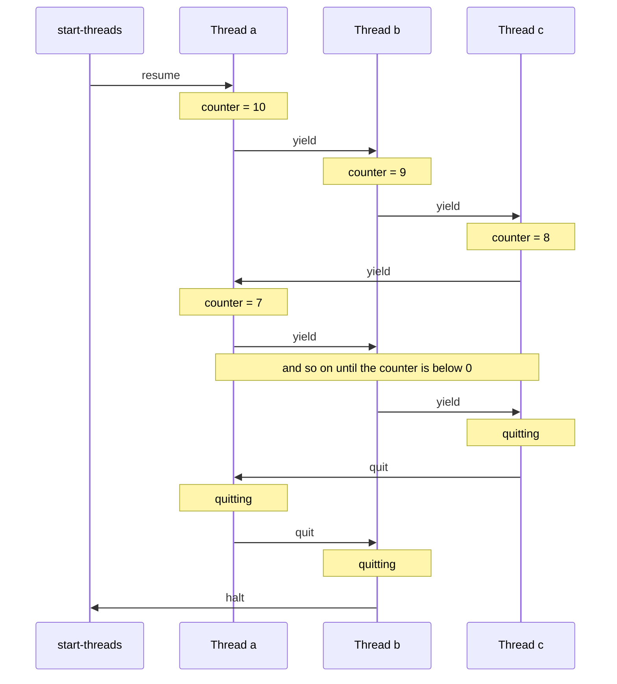
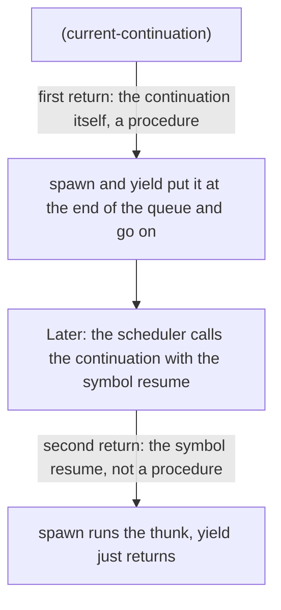

# Coroutines

A coroutine is a computation that can pause and be resumed later at the point where it stopped. This example builds a small system of cooperative threads out of nothing but `call-with-current-continuation` and a list. Its procedures `spawn`, `yield`, `quit`, and `start-threads` take about 30 lines of Scheme code. Then three coroutines take turns counting down from 10. Nothing runs in parallel and no operating system threads are involved: the program itself decides when one thread stops and the next one starts.

:::info

**Program:** [`Coroutines.scm`](https://github.com/objecthub/swift-lispkit/blob/master/Sources/LispKit/Resources/Examples/Coroutines.scm), in the `Examples` folder of LispKit\
**Libraries:** `(lispkit base)`, `(srfi 31)`\
**Techniques:** first-class continuations, cooperative scheduling, queues\
**Attribution:** The code is by Matt Might. It is based on his article [Continuations by example](https://matt.might.net/articles/programming-with-continuations--exceptions-backtracking-search-threads-generators-coroutines/).

:::

## The result

When the program is loaded, it creates three coroutines named `a`, `b`, and `c`. Each of them prints its name and the value of a shared counter, decreases the counter, and lets the next coroutine go. When the counter is below zero, a coroutine announces that it is quitting and ends. The output is the same every time:

```
in thread a; counter = 10
in thread b; counter = 9
in thread c; counter = 8
in thread a; counter = 7
in thread b; counter = 6
in thread c; counter = 5
in thread a; counter = 4
in thread b; counter = 3
in thread c; counter = 2
in thread a; counter = 1
in thread b; counter = 0
quitting thread c
quitting thread a
quitting thread b
```

The coroutines take turns in the order `a`, `b`, `c`, `a`, `b`, `c`, and so on. The counter is shared, so the counter values are handed out in that order, too. After `b` has printed 0, it is `c`'s turn to see that the counter is negative. Then `a` and `b` follow, and all threads have ended.

## Running the program

Build LispKit from a clone of the [GitHub repository](https://github.com/objecthub/swift-lispkit) and load the program into the LispKit REPL:

```
swift build -c release -Xswiftc "-D" -Xswiftc "SPM"
.build/release/LispKitRepl -r Sources/LispKit/Resources -d LispKit \
    -p Sources/LispKit/Resources/Examples/Coroutines.scm
```

The option `-p` runs the program as the _prelude_ of the REPL. The REPL stays open afterwards, and the definitions of the program are available at the prompt. Without `-p`, `LispKitRepl` runs the program and ends. Leave the REPL with `(exit)`.

The program starts its coroutines right away, so the output appears when the file is loaded. Afterwards, `spawn`, `yield`, `quit`, and `start-threads` are defined in the REPL, so you can start your own coroutines. See [Variations](#variations).

## Continuations in a nutshell

`(call-with-current-continuation f)`, usually abbreviated to `call/cc`, calls procedure `f` with the _current continuation_. A continuation represents everything that remains to be done from the point of the call. It can be used like a procedure: calling it with a value abandons the current computation and continues from the point where the continuation was captured, as if the `call/cc` expression had returned that value.

This works even after the original call has long returned, and it works any number of times. A continuation is therefore a bookmark in the execution of a program. The coroutines of this example are exactly that: a suspended coroutine is nothing but the continuation of the point where it stopped, and resuming it means calling that continuation.

The program implements a scheduler with this API, which is also described in its header:

| Procedure | Effect |
| --- | --- |
| `(spawn thunk)` | Creates a new thread for `thunk` and puts it at the end of the queue. The caller continues right away. |
| `(yield)` | Hands control from the current thread to the thread at the front of the queue. The current thread waits at the end of the queue until it is resumed. |
| `(quit)` | Ends the current thread and resumes the thread at the front of the queue. |
| `(start-threads)` | Runs the threads in the queue until all of them have ended. |
| `(halt)` | Leaves the scheduler right away. It is defined by `start-threads`; `quit` calls it when no threads are left. |

## Libraries

| Library | Used for |
| --- | --- |
| [`(lispkit base)`](../../libraries/lispkit/lispkit-base.md) | The language: `define`, `let`, `if`, `begin`, `set!`, `append`, `car`, `cdr`, `display`, `newline`, and above all `call-with-current-continuation`. |
| [`(srfi 31)`](../../libraries/srfi.md) | The special form `rec`. `(rec (loop) body ...)` creates a procedure without parameters that can call itself under the name `loop`. |

The program defines the names `spawn`, `yield`, `quit`, and `halt` itself. They do not come from a library. Note that `spawn` is also the name of a procedure of library [`(lispkit thread)`](../../libraries/lispkit/lispkit-thread.md), which starts real threads; see the example [Channels](channels.md). If both are in scope, the later definition wins.

## Design

### Threads are continuations

A thread that is waiting for its turn is represented by a continuation, and the scheduler is a queue of such continuations. The queue is a plain list in the global variable `*thread-queue*`. It contains the threads that are waiting, but not the thread that is running. `yield` puts the continuation of the running thread at the end of the queue, takes the continuation from the front, and calls it. This is called _round-robin scheduling_: everybody gets a turn in a fixed order.

The following table shows what happens in the example, starting with the call of `start-threads`. After the three calls of `spawn`, the queue is `a, b, c`:

| Event | Running thread | Waiting threads |
| --- | --- | --- |
| `start-threads` resumes the first thread | `a` | `b`, `c` |
| `a` calls `yield` | `b` | `c`, `a` |
| `b` calls `yield` | `c` | `a`, `b` |
| `c` calls `yield` | `a` | `b`, `c` |
| ... | | |
| `b` calls `yield` after printing 0 | `c` | `a`, `b` |
| `c` finds the counter below 0 and calls `quit` | `a` | `b` |
| `a` calls `quit` | `b` | |
| `b` calls `quit`: no thread is left, so `halt` is called | | |

The same story as a diagram:



### Returning twice

The trick behind `spawn` and `yield` is a procedure that returns twice. `(current-continuation)` captures the current continuation `cc` and immediately calls it with `cc` itself. So the first time, `current-continuation` returns the continuation. When the scheduler calls this continuation later with the symbol `resume`, execution continues at the same point, and `current-continuation` returns for a second time, now with `resume`. The two cases can be told apart with `procedure?`:



### The main ideas

**A thread is a suspended continuation.** There is no thread object. Suspending a thread means capturing its continuation, and resuming it means calling that continuation.

**Switching happens in two places only.** Control moves from one thread to another in `yield` and in `quit`, and when `start-threads` starts the first thread. The code between two calls of `yield` cannot be interrupted. This is why the coroutines can change the shared variable `counter` without any lock.

**Everything is a list.** The queue is a list. `append` puts a thread at the end of it, `car` and `cdr` take the first one. This is simple and fine for a handful of threads.

**One continuation ends the scheduler.** `start-threads` captures its own continuation and stores a procedure in `halt` that calls it. Calling `halt` therefore returns from `start-threads`, from wherever in the program it is called, and it abandons all that is left to do in the other threads.

## Walkthrough

The following sections go through the program from top to bottom. Together, the code blocks make up the complete source of `Coroutines.scm`.

### Header and imports

<details>

<summary>Description and credits</summary>

```scheme
;;; Coroutines
;;;
;;; This is a simple example explaining how to implement coroutines in Scheme using
;;; call/cc. The code is based on Matt Might's blog post on "Continuations by example:
;;; Exceptions, time-traveling search, generators, threads, and coroutines" at his
;;; site http://matt.might.net/. The article can be found here:
;;; https://matt.might.net/articles/programming-with-continuations--exceptions-backtracking-search-threads-generators-coroutines/
;;;
;;; The code below introduces the following API for implementing simple coroutine-based
;;; applications:
;;;
;;;   - (spawn thunk) puts a thread for thunk into the thread queue.
;;;   - (quit) kills the current thread and removes it from the thread queue.
;;;   - (yield) hands control from the current thread to another thread.
;;;   - (start-threads) starts executing threads in the thread queue.
;;;   - (halt) exits all threads.
;;;
;;; Author: Matt Might (might@uab.edu)
```

</details>

```scheme
(import (lispkit base)
        (srfi 31))
```

### The state of the scheduler

```scheme
; *thread-queue* : list[continuation]
(define *thread-queue* '())

; halt : continuation
(define halt #f)
```

`*thread-queue*` holds the continuations of the waiting threads. `halt` is a variable that `start-threads` fills with a procedure. Once `start-threads` has run, `halt` holds a procedure, and the program calls it as `(halt)`.

### Capturing the current continuation

```scheme
;; (current-continuation) -> continuation | any value
;; This procedure returns the continuation in which it was evaluated. A conditional
;; pattern can be used to detect whether the continuation was just created, or the
;; continuation has been invoked from some later point:
;; ```
;; (let ((cc (current-continuation)))
;;   (cond ((procedure? cc)    body)
;;         ((future-value? cc) handling-body)
;;         (else               (error "contract violation!"))))
;; ```
(define (current-continuation)
  (call-with-current-continuation (lambda (cc) (cc cc))))
```

`call-with-current-continuation` calls its argument with the current continuation. The argument `(lambda (cc) (cc cc))` calls the continuation with itself, so that the continuation becomes the value of the `call/cc` expression. This is what the first return of `current-continuation` gives you: the continuation `cc`. After a later call `(cc 'resume)`, the same expression returns `resume`. The comment contains the pattern for a `cond` that handles both cases. The example uses the simpler form with `if` and `procedure?`.

### Spawning a thread

```scheme
;; (spawn thunk)
;; Puts a thread for thunk into the thread queue.
(define (spawn thunk)
  (let ((cc (current-continuation)))
    (if (procedure? cc)
        (set! *thread-queue* (append *thread-queue* (list cc)))
        (begin (thunk)
               (quit)))))
```

`spawn` captures its own continuation. In the first case, `cc` is a procedure, and `spawn` appends it to the queue. Then it returns to its caller, which goes on with the next expression, so three calls of `spawn` create three waiting threads in a row. A new thread has not started to run yet. Its continuation is "return from `current-continuation` inside `spawn`". When the scheduler resumes it, `cc` is `resume`, so the `else` branch is taken: it calls the `thunk` of the thread and, if the thunk returns, calls `quit` to end the thread. In other words, a new thread starts its life inside `spawn`.

### Yielding

```scheme
;; (yield)
;; Hands control from the current thread to another thread.
(define (yield)
  (let ((cc (current-continuation)))
    (if (and (procedure? cc) (pair? *thread-queue*))
        (let ((next-thread (car *thread-queue*)))
          (set! *thread-queue* (append (cdr *thread-queue*) (list cc)))
          (next-thread 'resume)))))
```

`yield` does the same in reverse. If there is another thread in the queue, the current continuation goes to the end of the queue, and the continuation at the front is called with `resume`. When another thread calls the saved continuation later, `current-continuation` returns `resume`, the `if` does nothing, and `yield` returns to its caller: the thread goes on after its `yield`. If no other thread is waiting, `yield` has nothing to do and returns right away.

### Quitting

```scheme
;; (quit)
;; Kills the current thread and removes it from the thread queue.
(define (quit)
  (if (pair? *thread-queue*)
      (let ((next-thread (car *thread-queue*)))
        (set! *thread-queue* (cdr *thread-queue*))
        (next-thread 'resume))
      (halt)))
```

`quit` does not save the current continuation, so the current thread can never run again. It resumes the next thread. If there is none, `quit` calls `halt`.

### Starting the threads

```scheme
;; (start-threads)
;; Starts executing threads in the thread queue. As a side effect, this function
;; initializes `halt`.
(define (start-threads)
  (let ((cc (current-continuation)))
    (if cc
        (begin
          (set! halt (lambda () (cc #f)))
          (if (pair? *thread-queue*)
              (begin
                (let ((next-thread (car *thread-queue*)))
                  (set! *thread-queue* (cdr *thread-queue*))
                  (next-thread 'resume))))))))
```

`start-threads` captures its own continuation, too. The first time, `cc` is a procedure. Then `start-threads` stores `(lambda () (cc #f))` in `halt` and resumes the first thread of the queue, if there is one. When `halt` is called, the continuation returns from `current-continuation` with `#f`. The `if` finds that `cc` is false, nothing more happens, and `start-threads` returns to its caller. When the last thread has quit, `halt` ends the scheduler, and the program continues after the call of `start-threads`.

### The example

```scheme
;; Example of a simple program using three coroutines

(define counter 10)

(define (make-coroutine name)
  (rec (loop)
    (if (< counter 0)
      (begin (display "quitting thread ")
             (display name)
             (newline)
             (quit)))
    (display "in thread ")
    (display name)
    (display "; counter = ")
    (display counter)
    (newline)
    (set! counter (- counter 1))
    (yield)
    (loop)))
```

Every coroutine runs the same procedure, with a different name. `rec` makes a procedure `loop` without parameters which calls itself at the end. In every round, the coroutine checks the shared `counter`. If it is negative, the coroutine announces that it quits and calls `quit`. Otherwise, it prints its name and the counter, decreases the counter, and yields. Since a coroutine is only interrupted when it calls `yield`, the three lines that print and change the counter are never mixed with the lines of another coroutine.

```scheme
(spawn (make-coroutine 'a))
(spawn (make-coroutine 'b))
(spawn (make-coroutine 'c))

(start-threads)
```

`spawn` creates the three threads, and `start-threads` runs them until they have all quit. The program prints its result while `start-threads` runs.

## Variations

**A producer and a consumer.** Coroutines can pass values to each other through shared variables, without locks, as long as they hand over control at the right moments. The producer below stores the first ten Fibonacci numbers in `current-value`, one at a time, and yields after each one. The consumer prints each value and yields. Enter the definitions after loading the program:

```scheme
(define current-value #f)
(define finished #f)

(spawn (lambda ()
         (let loop ((a 0) (b 1) (n 0))
           (if (< n 10)
               (begin (set! current-value a)
                      (yield)
                      (loop b (+ a b) (+ n 1)))
               (set! finished #t)))))

(spawn (lambda ()
         (let loop ()
           (if (not finished)
               (begin (display* current-value " ")
                      (yield)
                      (loop))))))

(start-threads)
(newline)
```

```
0 1 1 2 3 5 8 13 21 34
```

**More things to try**

* A thread can create more threads: `spawn` appends the new thread to the queue, and it starts when its turn comes.
* If a thread yields while no other thread is waiting, `yield` returns immediately. A single thread that yields in a loop simply continues.
* Change the order of the three calls of `spawn`, or add more coroutines, and watch how the output changes.
* Make `spawn` accept a priority and keep the queue sorted by it, or add a procedure `sleep` that keeps a thread out of the queue for some rounds.
* Turn a coroutine into a generator: a procedure that returns the next value of a sequence each time it is called.

The scheduler is _cooperative_: a thread that never calls `yield` or `quit` keeps the processor to itself. Threads that are scheduled by the system can be interrupted at any time. LispKit has those, too. See the example [Channels](channels.md), which uses library `(lispkit thread)` and channels for communication.

## Further reading

* [Continuations by example](https://matt.might.net/articles/programming-with-continuations--exceptions-backtracking-search-threads-generators-coroutines/): the article by Matt Might on which the code is based. It develops exceptions, backtracking, generators, threads, and coroutines with continuations.
* [SRFI 31](https://srfi.schemers.org/srfi-31/srfi-31.html): the special form `rec`
* [Channels](channels.md): threads and channels in LispKit
