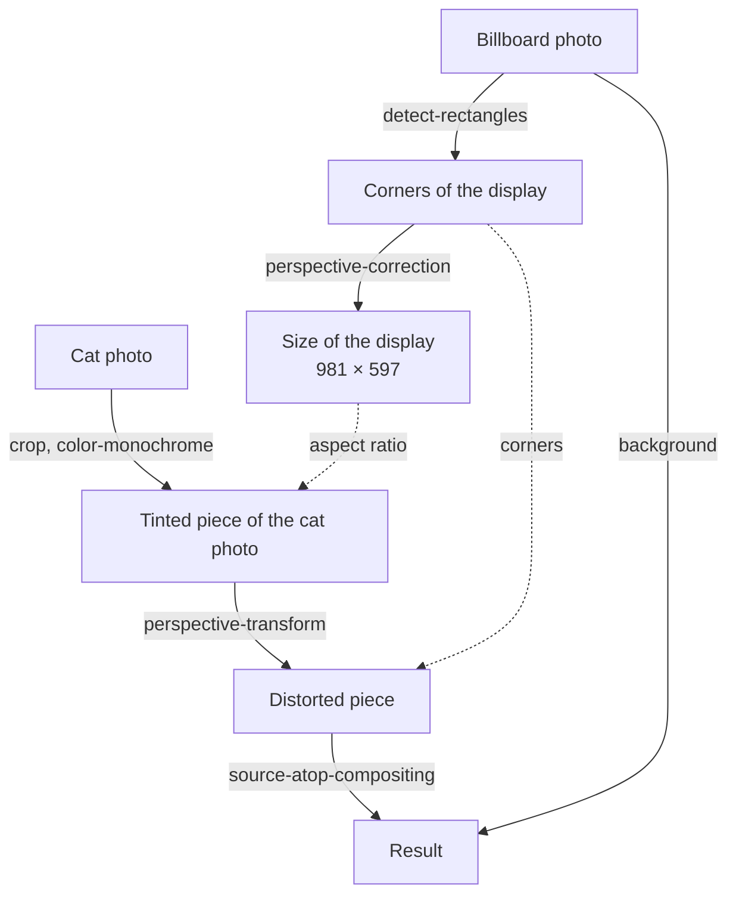

# Image Composition

What would a photo of a cat look like on a billboard in Las Vegas? This example answers the question with a handful of image processing steps. The program loads two photos: a billboard with a blank display and a snapshot of Inga, a cat. It finds the display in the first photo, works out how the second photo has to be distorted to fit onto it, and puts the distorted photo on top of the billboard.

<div class="gallery"><figure><figcaption><p>The billboard</p></figcaption></figure> <figure><figcaption><p>The cat</p></figcaption></figure></div>

<figure><figcaption><p>The result created by the program</p></figcaption></figure>

:::info

**Program:** [`ImageComposition.scm`](https://github.com/objecthub/swift-lispkit/blob/master/Sources/LispKit/Resources/Examples/ImageComposition.scm), in the `Examples` folder of LispKit\
**Libraries:** `(lispkit base)`, `(lispkit draw)`, `(lispkit vision)`, `(lispkit image)`, `(lispkit image process)`, and `(lispkit thread future)`\
**Techniques:** rectangle detection, futures, abstract images, image processors, perspective correction, perspective transformation, compositing\
**Platforms:** macOS and iOS, because the program relies on Apple's _Vision_ and _Core Image_ frameworks

:::

## What the program does

The program has no user interface. When it runs, it goes through these steps:

1. It loads the photo of the billboard and looks for rectangles in it. The detector finds two: the outline of the whole sign and the display within the frame. The program uses the display.
2. It measures the display. Perspective correction turns the display, which is a distorted quadrilateral in the photo, into a rectangle of 981 × 597 pixels. Only the size of this rectangle is used.
3. It cuts a piece with the aspect ratio of the display out of the cat photo and tints it a little.
4. It distorts the piece so that its corners end up on the corners of the display.
5. It puts the distorted piece on top of the billboard photo, saves the result as a JPEG file in the _Documents_ folder, and opens the file.

The most interesting step is the first one. The rectangle detector of the _Vision_ framework returns the corners of the display, and all other steps are built on these four points.

<figure><figcaption><p>The two rectangles found by the detector. The dashed outline is the first result and surrounds the whole sign. The red rectangle surrounds the display; its corners are numbered in the order in which the detector reports them. The program uses the red rectangle.</p></figcaption></figure>

## Running the program

Build LispKit from a clone of the [GitHub repository](https://github.com/objecthub/swift-lispkit) and load the program into the LispKit REPL:

```
swift build -c release -Xswiftc "-D" -Xswiftc "SPM"
.build/release/LispKitRepl -r Sources/LispKit/Resources -d LispKit \
    -p Sources/LispKit/Resources/Examples/ImageComposition.scm
```

The option `-p` runs the program as the _prelude_ of the REPL. The REPL stays open afterwards, and the definitions of the program are available at the prompt. Without `-p`, `LispKitRepl` runs the program and ends. Leave the REPL with `(exit)`.

The program needs the two photos `Billboard.jpg` and `Inga.jpg`, which are part of LispKit's assets in the folder `Images`; the option `-r` makes LispKit find them. The program takes less than a second. It prints a few lines about its progress, saves the result in `cat-on-billboard.jpg` in the _Documents_ folder, and opens this file with the default application for JPEG files. The last line is the value of the final expression of the program, the path of the file:

```
loaded billboard image
loaded cat image
detected billboard polygon: ((713.302731513977 . 224.267578125) (1500.0396966934204 . 88.83981704711914) (1542.4318313598633 . 635.2211952209473) (676.6530871391296 . 708.5670471191406))
processed images and created output with bounds ((0.0 . 0.0) 2000.0 . 1600.0)
"/Users/me/Documents/cat-on-billboard.jpg"
```

The coordinates of the polygon come from the _Vision_ framework and may differ slightly between versions of macOS and iOS. On the Mac used for this page, the detector returned the same two rectangles, in the same order, in twelve runs.

## How it works in a nutshell

Every step either produces a new image or measures something. This is the flow of data from the two photos to the result:



Solid arrows are image processing steps; dotted arrows show which results the next step needs as parameters. The billboard photo is used three times: for the detection, for the measurement, and as the background of the result.

## Libraries

The program combines six libraries. The procedures of `(lispkit system)` and `(lispkit list)` come with `(lispkit base)`.

| Library | What the program uses it for |
| --- | --- |
| [`(lispkit base)`](../../libraries/lispkit/lispkit-base.md) | the language; `sort` of [`(lispkit list)`](../../libraries/lispkit/lispkit-list.md); `asset-file-path`, `system-directory`, `path`, and `open-file` of [`(lispkit system)`](../../libraries/lispkit/lispkit-system.md) |
| [`(lispkit draw)`](../../libraries/lispkit/lispkit-draw.md) | images and geometry: `load-image`, `save-bitmap`, `rect` and its accessors, `size-ratio`, `move-point`, `color` |
| [`(lispkit vision)`](../../libraries/lispkit/lispkit-vision.md) | `detect-rectangles`, which finds rectangular shapes in an image |
| [`(lispkit image)`](../../libraries/lispkit/lispkit-image.md) | abstract images: `image->abstract-image`, `abstract-image->image`, `abstract-image-bounds`, and `map-image-point` |
| [`(lispkit image process)`](../../libraries/lispkit/lispkit-image-process.md) | image processors that wrap filters of Core Image (`perspective-correction`, `crop`, `color-monochrome`, `perspective-transform`, `source-atop-compositing`) and `process-abstract-image`, which applies them |
| [`(lispkit thread future)`](../../libraries/lispkit/lispkit-thread-future.md) | `future-get`, which returns the result of the detection |

## Design

### Two kinds of coordinates

The program deals with two coordinate systems. Mixing them up is the easiest way to get a wrong picture, so the program converts explicitly between them with `map-image-point`.

| | Origin | Direction of the y-axis | Used by |
| --- | --- | --- | --- |
| Image coordinates | upper-left corner | down | the results of `detect-rectangles` |
| Abstract image coordinates | lower-left corner | up | `perspective-correction`, `perspective-transform`, `crop`, and `abstract-image-bounds` |

The billboard photo is 2000 × 1600 points large, so the upper-left corner of the display, which the detector reports at (713.3, 224.3), is at (713.3, 1375.7) in abstract image coordinates: the y-coordinate becomes 1600 − 224.3. These are the corners of the display in both systems:

| Corner | Image coordinates | Abstract image coordinates |
| --- | --- | --- |
| 0 (upper left) | (713.3, 224.3) | (713.3, 1375.7) |
| 1 (upper right) | (1500.0, 88.8) | (1500.0, 1511.2) |
| 2 (lower right) | (1542.4, 635.2) | (1542.4, 964.8) |
| 3 (lower left) | (676.7, 708.6) | (676.7, 891.4) |

### Finding the display

The future returned by `detect-rectangles` holds a list with one entry per rectangle: its bounding box, the confidence, and the four corners. For the billboard photo, the detector finds two rectangles with full confidence:

| Rectangle | Bounding box (x, y, width, height) | Confidence |
| --- | --- | --- |
| The outline of the whole sign, including the frame and the underside | 638, 46, 953, 756 | 1.0 |
| The display within the frame | 677, 89, 866, 620 | 1.0 |

The two rectangles are nested. The detector does not know which one is meant, and the documentation does not promise an order of the results. The program therefore picks one by a rule: the display is the rectangle with the smaller bounding box. If the program took the first result instead, the photo would cover the frame and the underside of the sign as well:

<figure><figcaption><p>The result for the outline of the sign instead of the display</p></figcaption></figure>

### Abstract images and image processors

The processing is done with Core Image. A Core Image image is not a grid of pixels. It is a description of how to compute an image from other images and filters, and the pixels are computed when the image is rendered. LispKit calls these objects _abstract images_. An abstract image has an extent, the rectangle it covers, which `abstract-image-bounds` returns. Nothing gets computed until `abstract-image->image` turns an abstract image into a bitmap, so a long chain of filters costs almost nothing until then.

The library `(lispkit image process)` wraps the filters of Core Image into _image processors_. An image processor is a procedure that takes an abstract image and returns a new one. `(crop r)`, `(color-monochrome c 0.5)`, and the other filter procedures do not process anything themselves; they return such a procedure. `process-abstract-image` takes an abstract image and any number of processors and applies them in order. It is the same as calling `((filter-pipeline proc ...) image)`.

### Measuring with perspective correction

How large is the display? The photo cannot tell directly, because the display is drawn as a distorted quadrilateral. The program asks Core Image to undo the distortion: `perspective-correction` takes the four corners of the quadrilateral and returns the image warped such that the quadrilateral becomes a rectangle. With the last argument `#t`, the result is cropped to this rectangle, so its bounds are exactly the size of the display. With `#f`, the bounds would cover the whole warped photo, which is a rectangle of 2807 × 2104 pixels.

The program only keeps the size of the rectangle, 981 × 597, and with it the aspect ratio 1.643 of the display. It uses it to cut a piece of the right shape out of the cat photo, so that the photo does not look squeezed or stretched on the display. The distortion can be undone for the result as well. Applying the same perspective correction to the final image shows the cat as a clean rectangle again:

<figure><figcaption><p>The result seen head-on: perspective correction applied to the composed image</p></figcaption></figure>

### The main ideas

**Let the detector find the target.** The program does not know where the display is. The _Vision_ framework finds rectangles in a photo, and the program only decides which of them it wants.

**Describe first, render last.** All processing steps work on abstract images and are cheap. The pixels are only computed once, when the result is saved.

**Processors are functions.** Because an image processor is just a procedure, a list of processors can be applied one after the other, composed into a new processor with `filter-pipeline`, or built by ordinary Scheme code.

**Fit before you distort.** The photo is cropped to the shape of the display first and distorted afterwards. The four corners of the cropped photo are then exactly the points that are moved onto the four corners of the display.

## Walkthrough

The following sections go through the program from top to bottom. Together, the code blocks make up the complete source of `ImageComposition.scm`.

### Header and imports

<details>

<summary>Description, credits, and license</summary>

```scheme
;;; Transform, process and compose two photos
;;;
;;; This is a demo of libraries (lispkit image), (lispkit image process),
;;; and (lispkit vision). It loads two images from the LispKit asset
;;; directory and projects one processed image onto a part of another image.
;;;
;;; Author: Matthias Zenger
;;; Copyright © 2025 Matthias Zenger. All rights reserved.
;;;
;;; Licensed under the Apache License, Version 2.0 (the "License"); you may
;;; not use this file except in compliance with the License. You may obtain
;;; a copy of the License at
;;;
;;;   http://www.apache.org/licenses/LICENSE-2.0
;;;
;;; Unless required by applicable law or agreed to in writing, software
;;; distributed under the License is distributed on an "AS IS" BASIS,
;;; WITHOUT WARRANTIES OR CONDITIONS OF ANY KIND, either express or implied.
;;; See the License for the specific language governing permissions and
;;; limitations under the License.
```

</details>

```scheme
(import (lispkit base)
        (lispkit draw)
        (lispkit vision)
        (lispkit image)
        (lispkit image process)
        (lispkit thread future))
```

The program imports six libraries; the table above describes what each of them contributes.

### Fitting a rectangle

```scheme
;; Returns the biggest rect of the given aspect ratio `ratio` that is contained
;; in rect `rct`
(define (fit-rect rct ratio)
  (let ((width (* ratio (rect-height rct))))
    (if (<= width (rect-width rct))
        (rect (+ (rect-x rct) (/ (- (rect-width rct) width) 2.0))
              (rect-y rct)
              width
              (rect-height rct))
        (rect (rect-x rct)
              (+ (rect-y rct)
                 (/ (- (rect-height rct) (/ (rect-width rct) ratio)) 2.0))
              (rect-width rct)
              (/ (rect-width rct) ratio)))))
```

`fit-rect` returns the largest rectangle with the aspect ratio `ratio` (the width divided by the height) that fits into the rectangle `rct`, centered in the direction in which there is room left. If the rectangle needs the full height, its width is `ratio` times the height. If this is not wider than `rct`, the result has the full height and is centered horizontally. Otherwise, the result has the full width and a height of width divided by `ratio`, and it is centered vertically.

```scheme
(fit-rect (rect 0 0 1200 1200) 2)    ; ⇒ ((0.0 . 300.0) 1200.0 . 600.0)
(fit-rect (rect 0 0 1200 1200) 0.5)  ; ⇒ ((300.0 . 0.0) 600.0 . 1200.0)
(fit-rect (rect 0 0 1200 1200) 1)    ; ⇒ ((0.0 . 0.0) 1200.0 . 1200.0)
```

Rectangles are created with `(rect x y width height)` and are written as `((x . y) width . height)`.

### Loading the billboard

```scheme
;; Load the billboard image
(define billboard-image
  (load-image (asset-file-path "Billboard" "jpg" "Images")))
(display "loaded billboard image")
(newline)
```

`asset-file-path` searches the asset paths of LispKit for the file `Billboard.jpg` in the folder `Images`, and `load-image` loads it as an image. The messages that the program prints are the output shown above.

```scheme
;; Maps the given billboard image point onto the corresponding
;; abstract image
(define (billboard-point pnt)
  (map-image-point pnt billboard-image))
```

The detector reports points in image coordinates. `billboard-point` converts such a point into the corresponding point of the abstract image that is made from the billboard photo. The filters below only understand abstract image coordinates.

### Detecting the display

```scheme
;; Detect the billboard surface
(define detection-result
  (detect-rectangles billboard-image #f #f '(0.5 . 1.0) #f 0.3 0.5))
```

`detect-rectangles` takes the image followed by up to six optional arguments. The program passes:

| Argument | Value | Meaning |
| --- | --- | --- |
| _area_ | `#f` | search in the whole image |
| _num_ | `#f` | no limit on the number of rectangles |
| _aratio_ | `(0.5 . 1.0)` | shorter side divided by longer side between 0.5 and 1.0 |
| _tolerance_ | `#f` | the default, corner angles may deviate by 20° from 90° |
| _msize_ | `0.3` | the rectangle is at least 30% of the smaller dimension of the image |
| _mconf_ | `0.5` | only results with a confidence of at least 0.5 |

The procedure does not return the rectangles but a _future_: an object that stands for a result that may not be available yet. The _Vision_ request runs in the background, so the call returns almost immediately, and the program can do other work while the rectangles are detected. The code that follows calls `future-get` when it needs the result; `future-get` waits until the result is available. If the request fails, `future-get` raises the error.

### Loading the cat photo

```scheme
;; In the meantime, load an image of Inga
(define cat-image (load-image (asset-file-path "Inga" "jpg" "Images")))
(display "loaded cat image")
(newline)
```

While the detection runs in the background, the program loads the second photo. For these two photos, the overlap is short: the detection takes a few tens of milliseconds, and in a test run it had not finished yet when the cat photo was loaded. With larger photos or slower requests, such as text recognition, the overlap saves real time.

### Choosing the display

```scheme
;; Returns the area of the bounding box of a detected rectangle
(define (detection-area detection)
  (let ((size (cdar detection)))
    (* (car size) (cdr size))))
```

`detection-area` returns the area of the bounding box of a detection. A detection is a list `(bounding-box confidence polygon)`, and the bounding box is `((x . y) . (width . height))`. So `(cdar detection)` is the pair `(width . height)`.

```scheme
;; Wait for the billboard surface to be determined. The detector finds the outline of
;; the whole sign as well as the display within it. Use the smaller one, the display.
(define polygon
  (caddr (car (sort (lambda (d1 d2) (< (detection-area d1) (detection-area d2)))
                    (future-get detection-result)))))
(display "detected billboard polygon: ")
(write polygon)
(newline)
```

`future-get` waits for the result of the detection. `sort` orders the detections by increasing area, `car` takes the first one, which is the smallest, and `caddr` takes the third element of it, the polygon. The polygon is the list of the four corners of the display, in the order top left, top right, bottom right, bottom left. The program prints it on a single line:

```
((713.302731513977 . 224.267578125) (1500.0396966934204 . 88.83981704711914)
 (1542.4318313598633 . 635.2211952209473) (676.6530871391296 . 708.5670471191406))
```

### Measuring the display

```scheme
;; Determine the boundary of the perspective corrected polygon
;; representing the billboard
(define billboard-rect
  (abstract-image-bounds
    (process-abstract-image
      (image->abstract-image billboard-image)
      (perspective-correction (billboard-point (list-ref polygon 0))
                              (billboard-point (list-ref polygon 1))
                              (billboard-point (list-ref polygon 2))
                              (billboard-point (list-ref polygon 3))
                              #t))))
```

This is the measurement described above. The billboard photo is turned into an abstract image, its perspective is corrected for the four corners, which have to be converted to abstract image coordinates first, and the bounds of the result are taken. Since the corrected image is cropped to the display, `billboard-rect` is the rectangle `((0.0 . 0.0) 981.0 . 597.0)`. The variable is not called `rect`, because this would hide the constructor of rectangles that `fit-rect` uses.

### Composing the photos

```scheme
;; Create an abstract image from the loaded cat image
(define cat-input (image->abstract-image cat-image))
```

The cat photo becomes an abstract image, so that it can be processed.

```scheme
;; Process the cat image and overlay it on top of the billboard image
(define output
  ; Put the perspective corrected cat image on top of a billboard image
  (process-abstract-image
    ; Start with the cat image
    cat-input
    ; Crop the cat image to a rect that has the needed aspect ratio
    (crop (fit-rect (abstract-image-bounds cat-input) (size-ratio (rect-size billboard-rect))))
    ; Turn the image into a bit more monochrome image
    (color-monochrome (color 0.82 0.74 0.59) 0.5)
    ; Transform the image into the given perspective moving it into the right spot
    (perspective-transform (move-point (billboard-point (list-ref polygon 0)) 0 5)
                           (move-point (billboard-point (list-ref polygon 1)) 0 5)
                           (billboard-point (list-ref polygon 2))
                           (billboard-point (list-ref polygon 3)))
    ; Put the billboard image underneath
    (source-atop-compositing (image->abstract-image billboard-image))))
```

The processors in `output` run in the order in which they are written. Each step produces a new abstract image:

**1. Crop.** The photo of the cat is 1200 × 1200 pixels. `fit-rect` computes the largest centered rectangle with the aspect ratio of the display, 1.643, that fits into the photo, and `crop` cuts it out. Core Image rounds the rectangle outward to whole pixels, so the extent of the cropped image is `((0.0 . 234.0) 1200.0 . 732.0)`.

**2. Tint.** `(color-monochrome color 0.5)` mixes the colors of the photo half-way with shades of the given color, a sepia brown. The cat gets the faded look of an old photograph.

<div class="gallery"><figure><figcaption><p>1. The cropped photo</p></figcaption></figure> <figure><figcaption><p>2. The tinted photo</p></figcaption></figure></div>

**3. Distort.** `perspective-transform` is the opposite of the perspective correction. It takes four target points, which are the corners of the display in the order top left, top right, bottom right, bottom left, and maps the corners of the image to them. The result is the photo of the cat as a distorted quadrilateral. The extent of the result is `((676.0 . 891.0) 867.0 . 626.0)`, the smallest rectangle around the quadrilateral. Outside of the quadrilateral, the image is transparent. The two upper corners are moved by 5 pixels with `(move-point point 0 5)`, which adds 0 to the x-coordinate and 5 to the y-coordinate; since the y-axis of abstract image coordinates points up, they move up.

<figure><figcaption><p>3. The distorted photo (shown on white, it is transparent around the quadrilateral)</p></figcaption></figure>

**4. Compose.** `(source-atop-compositing background)` puts the distorted photo on top of the background, which is the billboard photo. It shows the background and only those parts of the source that are over visible parts of the background. The result has the extent of the billboard photo, `((0.0 . 0.0) 2000.0 . 1600.0)`.

The five pixels are a correction. The detected upper edge of the display lies a little below the real edge, so without the correction, a thin strip of the blank display stays visible between the dark border of the display and the photo:

<div class="gallery"><figure><figcaption><p>Without the correction</p></figcaption></figure> <figure><figcaption><p>With the correction</p></figcaption></figure></div>

```scheme
(display "processed images and created output with bounds ")
(write (abstract-image-bounds output))
(newline)
```

At this point, nothing has been rendered yet. `abstract-image-bounds` just asks `output` for its extent, which is known without computing any pixels.

### Saving the result

```scheme
;; Path to the generated JPG file
(define jpg-file-path
  (path (car (system-directory 'documents)) "cat-on-billboard.jpg"))

;; Save the output image in a JPG file
(save-bitmap jpg-file-path (abstract-image->image output) 'jpg)

;; Open the generated JPG file
(open-file jpg-file-path)

;; Return the path to the generated JPG file
jpg-file-path
```

`system-directory` returns a list of the paths of a system directory, and `path` appends the file name to the first one. `abstract-image->image` renders the abstract image: only now Core Image computes the pixels, and `save-bitmap` writes them into a JPEG file. `open-file` opens the file with the default application for JPEG files, and the last expression of the program returns the path of the file.

## Variations

The definitions of the program are available at the prompt of the REPL, which was started with the option `-p`.

**Straightening a document.** `perspective-correction` is also the kind of correction that document scanning apps apply. The asset `Page.jpg` is a photo of a printed page, taken from an angle. The same two steps as in the program, detecting the rectangle and correcting the perspective for its corners, turn the page into a rectangle:

```scheme
(define page (load-image (asset-file-path "Page" "jpg" "Images")))

(define page-polygon
  (caddr (car (future-get (detect-rectangles page #f 1 '(0.5 . 1.0) #f 0.3 0.5)))))

(define straightened
  (process-image page
    (apply perspective-correction
           (append (map (lambda (p) (map-image-point p page)) page-polygon)
                   '(#t)))))

(abstract-image-bounds straightened)   ; ⇒ ((0.0 . 0.0) 3802.0 . 5650.0)
(save-bitmap (path (car (system-directory 'documents)) "page.jpg")
             (abstract-image->image straightened)
             'jpg)
```

Argument `1` of `detect-rectangles` limits the result to a single rectangle. `process-image` is like `process-abstract-image`, but it takes an image and not an abstract image. The result is 3802 × 5650 pixels large.

<div class="gallery"><figure><figcaption><p>The photo</p></figcaption></figure> <figure><figcaption><p>The page after the perspective correction</p></figcaption></figure></div>

**Other filters.** Every filter of Core Image has a processor in `(lispkit image process)`. Replace the tint by `(color-invert)` or add `(gaussian-blur 4.0)` in front of `color-monochrome` in the list of processors of `output`, and the cat looks very different on the billboard.

**More ideas.** Make the program a procedure that takes the two file names. Detect several displays with `num` and put a different photo on each of them. Detect the display of a phone in a photo and replace its screen.

## Further reading

* [`(lispkit vision)`](../../libraries/lispkit/lispkit-vision.md): rectangle detection, text recognition, barcode recognition, and image classification
* [`(lispkit image)`](../../libraries/lispkit/lispkit-image.md): abstract images and filters
* [`(lispkit image process)`](../../libraries/lispkit/lispkit-image-process.md): image processors for the filters of Core Image
* [`(lispkit thread future)`](../../libraries/lispkit/lispkit-thread-future.md): futures
* [`(lispkit draw)`](../../libraries/lispkit/lispkit-draw.md): images, drawings, and geometry
