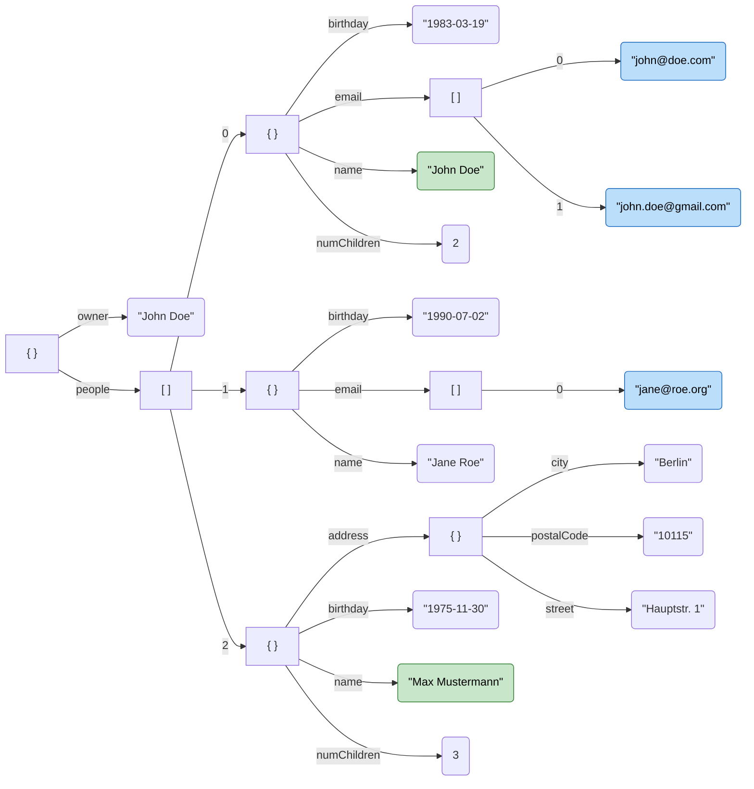
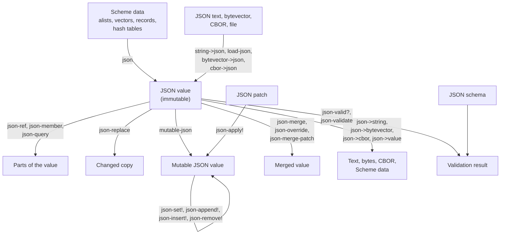

# JSON

JSON is the common language of data exchange, and LispKit has two libraries for it. `(lispkit json)` represents JSON values as a data type of their own and provides everything that is needed to work with them: parsing and writing, references, queries with _JSON Path_, changes with _JSON Patch_ and _JSON Merge Patch_, and merging. `(lispkit json schema)` validates JSON values against a _JSON schema_. This example is a guided tour through both libraries. It follows one small address book from its creation to its validation, so that every feature is shown at work on the same data.

:::info

**Program:** [`JSON.scm`](https://github.com/objecthub/swift-lispkit/blob/master/Sources/LispKit/Resources/Examples/JSON.scm), in the `Examples` folder of LispKit\
**Libraries:** `(lispkit base)`, `(lispkit hashtable)`, `(lispkit json)`, and `(lispkit json schema)`\
**Techniques:** JSON values, JSON Pointer, JSON Path, JSON Patch, JSON Merge Patch, CBOR, JSON Schema, a macro that traces evaluations\
**Standards:** [RFC 8259](https://datatracker.ietf.org/doc/html/rfc8259/) (JSON), [RFC 6901](https://datatracker.ietf.org/doc/html/rfc6901/) (JSON Pointer), [RFC 9535](https://datatracker.ietf.org/doc/html/rfc9535/) (JSON Path), [RFC 6902](https://datatracker.ietf.org/doc/html/rfc6902/) (JSON Patch), [RFC 7396](https://datatracker.ietf.org/doc/html/rfc7396/) (JSON Merge Patch), [RFC 8949](https://datatracker.ietf.org/doc/html/rfc8949/) (CBOR), and [JSON Schema 2020-12](https://json-schema.org/draft/2020-12)

:::

## What the program does

The program is a sequence of nine short sections. Each section prints a headline, and then it prints every expression together with its result. This is the address book it works with, shown as a tree:



The green values are the result of the JSON Path query `$.people[?@.numChildren > 0].name`, and the blue values are the result of `$..email[*]`. Both queries are part of the program.

| Section | What it shows | Main procedures |
| --- | --- | --- |
| Creating JSON values | JSON values from Scheme data, records, and hash tables; parsing | `json`, `json-object`, `make-json-array`, `string->json`, `json->value` |
| Inspecting JSON values | types, members, and children of values | `json-object?` and friends, `json-members`, `json-member`, `json-children-count`, `json-for-each-element`, `json-for-each-member` |
| JSON references | five kinds of references to the parts of a value | `json-ref`, `json-pointer`, `json-location`, `json-reference-segments` |
| Querying with JSON Path | selecting values with queries | `json-query`, `json-query-results`, `json-query-locations`, `json-path?` |
| Changing JSON values | copies with changes, and changes in place | `json-replace`, `json-replace-all`, `mutable-json`, `json-set!`, `json-append!`, `json-insert!`, `json-remove!` |
| JSON Patch | sequences of operations, applied as a whole | `json-patch`, `json-patch-append!`, `json-apply!`, `json-patch->json` |
| Merging JSON values | three ways of combining values | `json-merge`, `json-override`, `json-merge-patch`, `json-refinement?` |
| Reading and writing JSON data | text, bytes, CBOR, and files | `json->string`, `json->bytevector`, `json->cbor`, `bytevector->json`, `cbor->json`, `load-json` |
| Validating JSON with JSON schema | validation, errors, and defaults | `make-schema-registry`, `json-validate`, `json-valid?`, `validation-result-errors`, `validation-result-defaults` |

## Running the program

Build LispKit from a clone of the [GitHub repository](https://github.com/objecthub/swift-lispkit) and load the program into the LispKit REPL:

```
swift build -c release -Xswiftc "-D" -Xswiftc "SPM"
.build/release/LispKitRepl -r Sources/LispKit/Resources -d LispKit \
    -p Sources/LispKit/Resources/Examples/JSON.scm
```

The option `-p` runs the program as the _prelude_ of the REPL. The REPL stays open afterwards, and the definitions of the program are available at the prompt. Without `-p`, `LispKitRepl` runs the program and ends. Leave the REPL with `(exit)`.

The program only prints text, it does not write any file, and its output is the same for every run: JSON objects have no defined order of their members, so the program writes them with sorted members. The section headlines are `=== Creating JSON values ===`, `=== Inspecting JSON values ===`, and so on. The walkthrough below shows the output of every section after its code.

## How it works in a nutshell

All procedures revolve around the JSON value. The procedure `json` creates one from Scheme data, and text, bytes, CBOR, and files can be turned into one as well. A JSON value is immutable. There are procedures that read parts of it, that return a changed copy, that merge two values, that write it in some format, and that validate it. A mutable copy can be changed in place, and a JSON patch changes a mutable value:



## Libraries

| Library | What the program uses it for |
| --- | --- |
| [`(lispkit base)`](../../libraries/lispkit/lispkit-base.md) | the language: `define-syntax`, `define-record-type`, `sort`, `display*`, `guard`, and bytevectors; `asset-file-path` of [`(lispkit system)`](../../libraries/lispkit/lispkit-system.md) |
| [`(lispkit hashtable)`](../../libraries/lispkit/lispkit-hashtable.md) | a hash table that is converted into a JSON object |
| [`(lispkit json)`](../../libraries/lispkit/lispkit-json.md) | JSON values, references, JSON Path, JSON Patch, merging, and the conversion from and to text, bytes, and CBOR; the program uses every procedure of the library |
| [`(lispkit json schema)`](../../libraries/lispkit/lispkit-json-schema.md) | schema registries, schemas, and validation results |

## Design

### JSON values and Scheme values

A JSON value is one of six types: null, boolean, number, string, array, and object. The procedure `json` maps Scheme data to JSON values, and `json->value` maps them back:

| JSON | Scheme |
| --- | --- |
| null | the symbol `null` |
| boolean | `#t` and `#f` |
| number | fixnums for integers, flonums for floating-point numbers |
| string | strings; symbols other than `null` are converted into strings |
| array | vectors |
| object | association lists with symbols or strings as keys; records (the fields become members) and hash tables are converted into objects as well |

The mapping is not symmetrical. `json->value` returns association lists with symbols as keys, vectors for arrays, and the symbol `null` for null. An empty association list becomes the empty object `{}`. Records and hash tables are only converted into JSON; they do not come back. When JSON text is read, a number like `1.0` or `1e3` becomes the integer 1 or 1000, and an integer that does not fit into 64 bits becomes a floating-point number:

```scheme
(json->value (string->json "[1.0, 1e3, 12345678901234567890]"))
  ; ⇒ #(1 1000 1.2345678901234567e+19)
```

The members of a JSON object have no order. Every procedure that returns members, and the textual output of an object, would show them in an arbitrary order. The program therefore asks for sorted members whenever it prints an object, which is the third argument of `json->string`. Its helper `display-result` does this for every JSON value it prints.

### Immutable and mutable values

`json` and all procedures that return changed values create _immutable_ JSON values. `json-replace` and `json-replace-all` return a changed copy and leave the original as it is. A _mutable_ JSON value is created with `mutable-json` and can be changed in place with `json-set!`, `json-append!`, `json-insert!`, and `json-remove!`. `mutable-json` does not copy a value that is not referenced anywhere else, but in the program, `address-book` is still in use, so that the mutable `book` is a copy and the address book stays as it is. The optional second argument forces a copy. JSON patches can only be applied to mutable values. `json?` is true for both kinds, and with a second argument `#t`, only for immutable values.

### Referring to values

A _JSON reference_ identifies a value within a document. Five forms are supported, and they all work with the procedures that take a reference, `json-ref`, `json-replace`, `json-set!`, and the others:

| Form | Example | Refers to |
| --- | --- | --- |
| JSON Pointer (a string that starts with `/`) | `"/people/0/email/1"` | the second email of the first person |
| JSON location (a string that starts with `$`) | `"$.people[0].email[1]"` or `"$['people'][0]['email'][1]"` | the same value |
| list of symbols and numbers | `'(people 0 email 1)` | the same value |
| symbol | `'people` | the member `people` of an object |
| number | `0`, or `-1` for the last element | the element of an array |

The empty list, the empty string, and `"$"` refer to the whole document. With several references, as in `(json-ref address-book 'people -1 'name)`, the first reference is applied to the document, the second one to its result, and so on. A reference to something that does not exist yields `#f`. JSON locations are the better choice than JSON pointers, because a pointer cannot distinguish the member `"0"` of an object from the first element of an array.

```scheme
(map (lambda (ref) (json->value (json-ref address-book ref)))
     '("/people/0/email/1" "$.people[0].email[1]" "$['people'][0]['email'][1]" (people 0 email 1)))
  ; ⇒ ("john.doe@gmail.com" "john.doe@gmail.com" "john.doe@gmail.com" "john.doe@gmail.com")
```

`json-member` is a convenience procedure for objects. It returns Scheme values, whereas `json-ref` returns JSON values, so `(json-member john 'name)` is the string `"John Doe"`, and `(json-ref john 'name)` is a JSON string.

### Querying with JSON Path

JSON Path queries are strings. Every query starts with `$`, the root, followed by segments that select values:

| Segment | Meaning | Example from the program | Result |
| --- | --- | --- | --- |
| `.name` or `['name']` | member | `$.people[-1].address.city` | `"Berlin"` |
| `[0]`, `[-1]` | element; negative indices count from the end | `$.people[-1].address.city` (the last person) | `"Berlin"` |
| `[0:2]` | slice | `$.people[0:2].birthday` | two birthdays |
| `[*]`, `.*` | all children | `$.people[*].name` | all names |
| `..` | the segment applies to all descendants | `$..email[*]` | all emails |
| `[?...]` | filter with a condition on `@`, the current value | `$.people[?@.numChildren > 0].name` | names of people with children |
| `[0,3]`, `['name','numChildren']` | several selectors at once | `$.people[0:2]['name','numChildren']` | values of both members |
| functions `length`, `count`, `match`, `search`, `value` | inside filters | `$.people[?match(@.name, "J.*")].name` | names that match a regular expression |

`json-query-results` returns the matching values, `json-query-locations` their locations, and `json-query` both: every result is a list that starts with the value and continues with the segments of its location. The results come in the order in which the values occur in the document. A location is a list of strings and numbers, which is a valid reference again.

### Changing, patching, and merging

LispKit offers several ways of getting from one JSON value to another one:

| Approach | Procedures | Characteristics |
| --- | --- | --- |
| replacing parts | `json-replace`, `json-replace-all` | returns a changed copy; sets or adds the value at a reference; the parent of the value has to exist |
| changing in place | `json-set!`, `json-append!`, `json-insert!`, `json-remove!` | for mutable values; `json-set!` sets or adds a value, and the other procedures ignore references that do not fit |
| JSON Patch (RFC 6902) | `json-patch`, `json-apply!` | an ordered list of operations; all or nothing; fails if an operation fails |
| JSON Merge Patch (RFC 7396) | `json-merge-patch` | a document that mirrors the changes; `null` deletes a member; arrays are replaced |
| symmetrical merge | `json-merge` | combines two compatible values; `#f` if they contradict each other |
| overriding merge | `json-override` | the second value wins; arrays are combined element by element |

A JSON patch consists of the operations `add`, `remove`, `replace`, `move`, `copy`, and `test`. In the list form that the program uses, the location that is changed comes first: `(move path from)`, `(copy path from)`. In the JSON form, they are the members `path` and `from`. `test` is a precondition: if the value at a location differs, the whole patch fails. Applying a patch either changes the value completely or not at all.

### Reading and writing

A JSON value can be written as text with `json->string`, as a UTF-8 bytevector with `json->bytevector`, and as CBOR with `json->cbor`. The first two take the options _pretty?_, _sort?_, and _slash?_, and for `json->string`, a call like `(json->string value #t #t)` prints indented output with sorted members. CBOR (RFC 8949) is a compact binary format: Jane's entry takes 68 bytes as text and 55 bytes as CBOR. `string->json`, `bytevector->json`, `cbor->json`, and `load-json` read the formats back. A value is the same after the roundtrip, which `json=?` checks structurally.

### Validating with JSON schema

A JSON schema describes which values are valid. The schema of this example describes a person: `name` and `birthday` are required, the birthday is a date, `numChildren` is an integer, there are at most three emails, and the address is a string or an object with `city` and `postalCode`. A _schema registry_ knows the schemas by their URIs; the registry of the program finds `https://lisppad.app/schema/person` in the asset directory `JSON/Schema/custom`. `json-valid?` answers the question whether a value is valid. `json-validate` returns a _validation result_ with the errors, each with a message and the location of the affected value, and with the default values of the members that a schema defines.

### The main ideas

**One data type for all JSON.** Instead of mixing association lists and vectors, JSON values are objects of their own type that all procedures understand. They are cheap to copy, because they are immutable.

**References, not paths of code.** JSON Pointer, JSON locations, and lists of segments are three notations for the same thing. Whatever notation a program uses, the procedures work the same.

**Queries are data.** A JSON Path query is a string, which can be stored, passed around, and checked with `json-path?`. Its results are located values.

**Changes as values.** A JSON patch or a merge patch is a value, too. It can be created from text, stored, compared with `json-patch=?`, and applied to other documents.

## Walkthrough

The following sections go through the program from top to bottom. Together, the code blocks make up the complete source of `JSON.scm`.

### Header and imports

<details>

<summary>Description, credits, and license</summary>

```scheme
;;; Create, query, change, and validate JSON data
;;;
;;; This code showcases the API provided by libraries `(lispkit json)` and
;;; `(lispkit json schema)`. It creates JSON values from Scheme data, parses and
;;; serializes them, accesses their parts via JSON references and JSON Path
;;; queries, changes them destructively and non-destructively, with JSON Patch
;;; and by merging, and it finally validates JSON data using JSON schema.
;;;
;;; Author: Matthias Zenger
;;; Copyright © 2024 Matthias Zenger. All rights reserved.
;;;
;;; Licensed under the Apache License, Version 2.0 (the "License"); you may
;;; not use this file except in compliance with the License. You may obtain
;;; a copy of the License at
;;;
;;;   http://www.apache.org/licenses/LICENSE-2.0
;;;
;;; Unless required by applicable law or agreed to in writing, software
;;; distributed under the License is distributed on an "AS IS" BASIS,
;;; WITHOUT WARRANTIES OR CONDITIONS OF ANY KIND, either express or implied.
;;; See the License for the specific language governing permissions and
;;; limitations under the License.
```

</details>

```scheme
(import (lispkit base)
        (lispkit hashtable)
        (lispkit json)
        (lispkit json schema))
```

### Showing what happens

The program is a tour in which every step shows its expression and its result. Four helpers do this. `display-result` prints a result. JSON values are written as JSON text with sorted members, lists are written element by element so that the JSON values in them are written the same way, and everything else is written with `write`.

```scheme
;;; Output

;; Prints the result of an evaluation. JSON values are printed as JSON text with
;; sorted object members, which makes the output deterministic.
(define (display-result x)
  (cond ((json? x)
         (display (json->string x #f #t)))
        ((pair? x)
         (display "(")
         (display-result (car x))
         (let loop ((rest (cdr x)))
           (cond ((null? rest))
                 ((pair? rest) (display " ") (display-result (car rest)) (loop (cdr rest)))
                 (else (display " . ") (display-result rest))))
         (display ")"))
        (else
         (write x))))
```

`write-expr` prints an expression. It works like `write`, except that it prints `(quote x)` as `'x`.

```scheme
;; Writes an expression like `write`, but abbreviates quoted data.
(define (write-expr expr)
  (cond ((and (pair? expr) (eq? (car expr) 'quote) (pair? (cdr expr)) (null? (cddr expr)))
         (display "'")
         (write-expr (cadr expr)))
        ((pair? expr)
         (display "(")
         (write-expr (car expr))
         (let loop ((rest (cdr expr)))
           (cond ((null? rest))
                 ((pair? rest) (display " ") (write-expr (car rest)) (loop (cdr rest)))
                 (else (display " . ") (write-expr rest))))
         (display ")"))
        (else
         (write expr))))
```

The macro `show` is the center of the tour. `(show expr)` prints the expression, evaluates it, and prints the result after `⇒`. The expression is only written once in the source, and so the output can never differ from the code.

```scheme
;; Prints expression `expr`, evaluates it, and prints the result.
(define-syntax show
  (syntax-rules ()
    ((_ expr)
     (begin
       (write-expr 'expr)
       (newline)
       (display "  ⇒ ")
       (display-result expr)
       (newline)))))
```

`section` prints the headline of a section.

```scheme
;; Prints a headline for the next section.
(define (section title)
  (newline)
  (display* "=== " title " ===")
  (newline))
```

### Creating JSON values

```scheme
;;; Creating and converting JSON values

(section "Creating JSON values")

;; Association lists are mapped to JSON objects and vectors to JSON arrays. The
;; symbol `null` stands for the JSON null value. Procedure `json` returns an
;; immutable JSON value.
(define address-book
  (json '((owner . "John Doe")
          (people . #(((name . "John Doe")
                       (birthday . "1983-03-19")
                       (numChildren . 2)
                       (email . #("john@doe.com" "john.doe@gmail.com")))
                      ((name . "Jane Roe")
                       (birthday . "1990-07-02")
                       (email . #("jane@roe.org")))
                      ((name . "Max Mustermann")
                       (birthday . "1975-11-30")
                       (numChildren . 3)
                       (address . ((street . "Hauptstr. 1")
                                   (city . "Berlin")
                                   (postalCode . "10115")))))))))

(show (json '((ints . #(1 -2)) (float . 2.5) (bool . #t) (nothing . null) (text . "abc"))))
(show (json "text" 42 #f))
(show (json-object (name "John") (age 30) (tags #("a" "b"))))
(show (make-json-array 3 (json 0)))
```

`address-book` is the document of the tour. Association lists become objects and vectors become arrays. The symbol `null` stands for the JSON null. The first `show` creates an object with all kinds of values, and the second one shows that `json` with several arguments returns an array. `json-object` is a macro for objects with fixed members. `make-json-array` creates an array of a given length.

```scheme
;; Records are mapped to JSON objects as well, with the fields as members.
(define-record-type point
  (make-point x y)
  point?
  (x point-x)
  (y point-y))

(show (json (make-point 3 4)))
```

A record is converted into an object whose members are the fields.

```scheme
;; So are hash tables with symbols or strings as keys.
(define table (make-equal-hashtable))
(hashtable-set! table 'language "Scheme")
(hashtable-set! table "year" 1975)

(show (json table))
```

A hash table is converted into an object as well. Its keys have to be symbols or strings.

```scheme
;; JSON text can be parsed into JSON values, and JSON values can be converted
;; back into Scheme data.
(show (string->json "{\"a\": [1, 2.5, null, true], \"b\": {\"c\": \"d\"}}"))
(show (json->value (json '((list . #(1 "two" null))))))
```

`string->json` parses text, and `json->value` converts a JSON value back into Scheme data. The result is an association list with symbols as keys.

```
(json '((ints . #(1 -2)) (float . 2.5) (bool . #t) (nothing . null) (text . "abc")))
  ⇒ {"bool":true,"float":2.5,"ints":[1,-2],"nothing":null,"text":"abc"}
(json "text" 42 #f)
  ⇒ ["text",42,false]
(json-object (name "John") (age 30) (tags #("a" "b")))
  ⇒ {"age":30,"name":"John","tags":["a","b"]}
(make-json-array 3 (json 0))
  ⇒ [0,0,0]
(json (make-point 3 4))
  ⇒ {"x":3,"y":4}
(json table)
  ⇒ {"language":"Scheme","year":1975}
(string->json "{\"a\": [1, 2.5, null, true], \"b\": {\"c\": \"d\"}}")
  ⇒ {"a":[1,2.5,null,true],"b":{"c":"d"}}
(json->value (json '((list . #(1 "two" null)))))
  ⇒ ((list . #(1 "two" null)))
```

### Inspecting JSON values

```scheme
;;; Inspecting JSON values

(section "Inspecting JSON values")

;; Returns the type of a JSON value as a symbol
(define (json-type x)
  (cond ((json-null? x) 'null)
        ((json-boolean? x) 'boolean)
        ((json-number? x) 'number)
        ((json-string? x) 'string)
        ((json-array? x) 'array)
        ((json-object? x) 'object)))

;; Returns the sorted names of the members of JSON object `x`
(define (member-names x)
  (sort (lambda (a b) (string<? (symbol->string a) (symbol->string b)))
        (json-members x)))

(define john (json-ref address-book '(people 0)))

(show (member-names john))
(show (map (lambda (name) (json-type (json-ref john name))) (member-names john)))
(show (json-member? john 'email))
(show (json-children-count (json-ref address-book 'people)))

;; `json-member` returns Scheme values, `json-ref` returns JSON values.
(show (json-member john 'name))
(show (json-member john 'phone "unknown"))
(show (json-member (json-ref address-book '(people 2)) '(address city)))
(show (json-ref address-book 'owner))
```

`json-type` determines the type of a value with the six predicates. `member-names` sorts the result of `json-members`, because it is unordered. `john` is the first element of the array `people`.

The result of `(json-ref john name)` is a JSON value, so that `json-type` can inspect it, and `json-member` returns Scheme values: a string, or, if the member is not found, the default that is passed as the third argument. `json-member` accepts a list of member names as well. `(json-member ... '(address city))` follows `address` and `city`.

```scheme
;; Iterate over the elements of arrays and the members of objects
(display "people:\n")
(json-for-each-element
  (lambda (person) (display* "  - " (json-member person 'name) "\n"))
  (json-ref address-book 'people))

(let ((members '()))
  (json-for-each-member
    (lambda (name value) (set! members (cons (list name (json-type value)) members)))
    john)
  (show (sort (lambda (a b) (string<? (symbol->string (car a)) (symbol->string (car b))))
              members)))
```

`json-for-each-element` calls a procedure for every element of an array, and `json-for-each-member` for every member of an object with its name and its value. The second loop collects the members. Since their order is arbitrary, the program sorts them before it prints them.

```
(member-names john)
  ⇒ (birthday email name numChildren)
(map (lambda (name) (json-type (json-ref john name))) (member-names john))
  ⇒ (string array string number)
(json-member? john 'email)
  ⇒ #t
(json-children-count (json-ref address-book 'people))
  ⇒ 3
(json-member john 'name)
  ⇒ "John Doe"
(json-member john 'phone "unknown")
  ⇒ "unknown"
(json-member (json-ref address-book '(people 2)) '(address city))
  ⇒ "Berlin"
(json-ref address-book 'owner)
  ⇒ "John Doe"
people:
  - John Doe
  - Jane Roe
  - Max Mustermann
(sort (lambda (a b) (string<? (symbol->string (car a)) (symbol->string (car b)))) members)
  ⇒ ((birthday string) (email array) (name string) (numChildren number))
```

### JSON references

```scheme
;;; JSON references

(section "JSON references")

;; A JSON reference is a JSON Pointer, a JSON location, a symbol, a number, or
;; a list of symbols and numbers. All of them refer to a value within a document.
(show (json-ref address-book "/people/0/name"))
(show (json-ref address-book "$.people[1].name"))
(show (json-ref address-book '(people 2 address city)))
(show (json-ref address-book 'people -1 'name))
(show (json-ref address-book '(people 7)))

(show (json-pointer "$.people[0].email[1]"))
(show (json-location '(people 0 email 1)))
(show (json-reference-segments "$.people[0].email[-1]"))
(show (list (json-pointer? "/people/0") (json-location? "$.people[0]")
            (json-reference? 'people) (json-reference? 2.5)))
(show (list (json-self-reference? '()) (json-self-reference? "$") (json-self-reference? "/people")))
```

The first four `show` expressions use references of different kinds, and the fifth one refers to a value that does not exist. The two procedures `json-pointer` and `json-location` convert a reference into one of the two string notations. `json-reference-segments` splits a reference into its segments. The predicates test strings and values for the different notations. A list of the segments is a reference, `2.5` is not, and `json-self-reference?` recognizes the references to the root.

```
(json-ref address-book "/people/0/name")
  ⇒ "John Doe"
(json-ref address-book "$.people[1].name")
  ⇒ "Jane Roe"
(json-ref address-book '(people 2 address city))
  ⇒ "Berlin"
(json-ref address-book 'people -1 'name)
  ⇒ "Max Mustermann"
(json-ref address-book '(people 7))
  ⇒ #f
(json-pointer "$.people[0].email[1]")
  ⇒ "/people/0/email/1"
(json-location '(people 0 email 1))
  ⇒ "$['people'][0]['email'][1]"
(json-reference-segments "$.people[0].email[-1]")
  ⇒ ("people" 0 "email" -1)
(list (json-pointer? "/people/0") (json-location? "$.people[0]") (json-reference? 'people) (json-reference? 2.5))
  ⇒ (#t #t #t #f)
(list (json-self-reference? '()) (json-self-reference? "$") (json-self-reference? "/people"))
  ⇒ (#t #t #f)
```

### Querying with JSON Path

```scheme
;;; JSON Path

(section "Querying with JSON Path")

(show (json-query-results address-book "$.people[*].name"))
(show (json-query-results address-book "$.people[?@.numChildren > 0].name"))
(show (json-query-results address-book "$.people[0:2].birthday"))
(show (json-query-results address-book "$..email[*]"))
(show (json-query-results address-book "$.people[-1].address.city"))
(show (json-query-results address-book "$.people[?match(@.name, \"J.*\")].name"))
(show (json-query-results address-book "$.people[?length(@.email) > 1].name"))
(show (json-query-locations address-book "$.people[?@.address].name"))
(show (json-query address-book "$.people[?@.numChildren > 2].name"))
(show (list (json-path? "$.people[?@.name]") (json-path? "people.name")
            (json-path-singular? "$.people[0].name") (json-path-singular? "$.people[*].name")))
```

The queries select names, birthdays, emails, and a city, with filters, a slice, a descendant segment, and a function. `json-query-locations` shows where the matches are, and `json-query` returns both. Locations are lists of strings and numbers: `("people" 2 "name")` is the location of the name of the third person. `json-path?` checks if a string is a valid query, and `json-path-singular?` if it selects at most one value.

```
(json-query-results address-book "$.people[*].name")
  ⇒ ("John Doe" "Jane Roe" "Max Mustermann")
(json-query-results address-book "$.people[?@.numChildren > 0].name")
  ⇒ ("John Doe" "Max Mustermann")
(json-query-results address-book "$.people[0:2].birthday")
  ⇒ ("1983-03-19" "1990-07-02")
(json-query-results address-book "$..email[*]")
  ⇒ ("john@doe.com" "john.doe@gmail.com" "jane@roe.org")
(json-query-results address-book "$.people[-1].address.city")
  ⇒ ("Berlin")
(json-query-results address-book "$.people[?match(@.name, \"J.*\")].name")
  ⇒ ("John Doe" "Jane Roe")
(json-query-results address-book "$.people[?length(@.email) > 1].name")
  ⇒ ("John Doe")
(json-query-locations address-book "$.people[?@.address].name")
  ⇒ (("people" 2 "name"))
(json-query address-book "$.people[?@.numChildren > 2].name")
  ⇒ (("Max Mustermann" "people" 2 "name"))
(list (json-path? "$.people[?@.name]") (json-path? "people.name") (json-path-singular? "$.people[0].name") (json-path-singular? "$.people[*].name"))
  ⇒ (#t #f #t #f)
```

### Changing JSON values

```scheme
;;; Changing JSON values

(section "Changing JSON values")

;; `json-replace` and `json-replace-all` return new values; the original is not changed.
(define updated
  (json-replace address-book
                "$.people[0].name" (json "Johnny Doe")
                '(people 1 numChildren) (json 1)))

(show (json-query-results updated "$.people[0:2]['name','numChildren']"))
(show (json-query-results address-book "$.people[0:2]['name','numChildren']"))
(show (json-ref (json-replace-all address-book
                                  (list (cons "/owner" (json "Jane Roe"))
                                        (cons '(people 0 numChildren) (json 5))))
                'owner))
```

`json-replace` takes pairs of a reference and a new value and applies the replacements one after the other. The result is a new value; the original is not changed, which the second `show` confirms. `json-replace-all` takes a list of pairs instead.

```scheme
;; A mutable JSON value can be changed in place. `mutable-json` makes a copy if the
;; value is referenced elsewhere.
(define book (mutable-json address-book))

(json-set! book "$.people[1].address" (json "12 Main Street, 17445 Noname"))
(json-append! book 'people (json '((name . "Eve Adams") (email . #("eve@adams.org")))))
(json-insert! book 'people 1 (json '((name . "Zoe Zed") (birthday . "1999-12-31"))))
(json-remove! book '(people 0 numChildren) "$.people[2].email")

(show (json-query-results book "$.people[*].name"))
(show (json-query-results book "$.people[*].address"))
(show (list (mutable-json? book) (json? book) (json? book #t)))
(show (list (json-children-count (json-ref address-book 'people))
            (json-children-count (json-ref book 'people))))
```

`book` is a mutable copy of the address book. The four procedures change it in place: `json-set!` replaces or adds a value, `json-append!` and `json-insert!` add elements to an array, and `json-remove!` removes values, one reference after the other. Since Zoe was inserted before, Jane is the third person, and `$.people[2].email` is her list of emails. Calls that do not find their target change nothing and do not signal an error.

```
(json-query-results updated "$.people[0:2]['name','numChildren']")
  ⇒ ("Johnny Doe" 2 "Jane Roe" 1)
(json-query-results address-book "$.people[0:2]['name','numChildren']")
  ⇒ ("John Doe" 2 "Jane Roe")
(json-ref (json-replace-all address-book (list (cons "/owner" (json "Jane Roe")) (cons '(people 0 numChildren) (json 5)))) 'owner)
  ⇒ "Jane Roe"
(json-query-results book "$.people[*].name")
  ⇒ ("John Doe" "Zoe Zed" "Jane Roe" "Max Mustermann" "Eve Adams")
(json-query-results book "$.people[*].address")
  ⇒ ("12 Main Street, 17445 Noname" {"city":"Berlin","postalCode":"10115","street":"Hauptstr. 1"})
(list (mutable-json? book) (json? book) (json? book #t))
  ⇒ (#t #t #f)
(list (json-children-count (json-ref address-book 'people)) (json-children-count (json-ref book 'people)))
  ⇒ (3 5)
```

### JSON Patch

```scheme
;;; JSON Patch

(section "JSON Patch")

;; A JSON patch is a sequence of operations on a JSON value. They can be given as
;; lists, or as JSON in the format of RFC 6902.
(define patch
  (json-patch
    `((test "/owner" ,(json "John Doe"))
      (replace "/people/0/numChildren" ,(json 3))
      (add "/people/0/email/-" ,(json "jdoe@work.com"))
      (copy "/people/1/primaryEmail" "/people/1/email/0")
      (move "/people/2/residence" "/people/2/address")
      (remove "/people/2/numChildren"))))

(show (json-patch->json patch))
(show (json-patch=? patch (json-patch (json-patch->json patch))))
```

`json-patch` creates a patch from a list of operations. The values to add or to replace are JSON values, which is why they are written with `,(json ...)` in a quasiquote. `json-patch->json` returns the patch in the format of RFC 6902, and the patch that is created from this JSON is equal to the original, which `json-patch=?` confirms.

```scheme
;; Patches can also be built step by step.
(define incremental (json-patch))
(json-patch-append! incremental
                    `(replace "/owner" ,(json "Jane Roe"))
                    '(remove "/people/2/address"))

(show (list (json-patch? incremental) (json-patch->list incremental)))
(json-patch-clear! incremental)
(show (json-patch->list incremental))
```

`json-patch-append!` adds operations to a patch, `json-patch->list` returns the operations, and `json-patch-clear!` removes them.

```scheme
;; Patches are applied to mutable JSON values. Either all operations succeed or the
;; value is not changed.
(define patched (mutable-json address-book #t))
(json-apply! patched patch)

(show (json-ref patched '(people 0 email)))
(show (json-ref patched '(people 1 primaryEmail)))
(show (json-ref patched '(people 2 residence city)))
(show (json-ref patched '(people 2 address)))
(show (json-ref patched '(people 2 numChildren)))
(show (json=? patched address-book))

(define failing
  (json-patch `((replace "/owner" ,(json "Max Mustermann"))
                (test "/people/0/name" ,(json "Somebody Else")))))

(show (guard (e (#t 'patch-failed)) (json-apply! patched failing) 'patch-applied))
(show (json-ref patched 'owner))
```

`json-apply!` changes a mutable value. The first operation of `patch` is a test, and the others replace a number, add an email at the end of the array (`-` stands for the position behind the last element), copy a value, rename a member by moving it, and remove a member. `failing` replaces the owner and then tests a name that is wrong. The test fails, so `json-apply!` signals an error, and the replacement of the owner, which came first, does not take effect either: the owner is still John Doe. A patch is applied completely or not at all.

```
(json-patch->json patch)
  ⇒ [{"op":"test","path":"/owner","value":"John Doe"},{"op":"replace","path":"/people/0/numChildren","value":3},{"op":"add","path":"/people/0/email/-","value":"jdoe@work.com"},{"from":"/people/1/email/0","op":"copy","path":"/people/1/primaryEmail"},{"from":"/people/2/address","op":"move","path":"/people/2/residence"},{"op":"remove","path":"/people/2/numChildren"}]
(json-patch=? patch (json-patch (json-patch->json patch)))
  ⇒ #t
(list (json-patch? incremental) (json-patch->list incremental))
  ⇒ (#t ((replace "/owner" "Jane Roe") (remove "/people/2/address")))
(json-patch->list incremental)
  ⇒ ()
(json-ref patched '(people 0 email))
  ⇒ ["john@doe.com","john.doe@gmail.com","jdoe@work.com"]
(json-ref patched '(people 1 primaryEmail))
  ⇒ "jane@roe.org"
(json-ref patched '(people 2 residence city))
  ⇒ "Berlin"
(json-ref patched '(people 2 address))
  ⇒ #f
(json-ref patched '(people 2 numChildren))
  ⇒ #f
(json=? patched address-book)
  ⇒ #f
(guard (e (#t 'patch-failed)) (json-apply! patched failing) 'patch-applied)
  ⇒ patch-failed
(json-ref patched 'owner)
  ⇒ "John Doe"
```

### Merging JSON values

```scheme
;;; Merging

(section "Merging JSON values")

(define jane (json-ref address-book '(people 1)))
(define contact (json '((name . "Jane Roe") (phone . "555-1234") (address . ((city . "Mcity"))))))
```

```scheme
;; A symmetrical merge combines the members of two values. It returns `#f` if the
;; values cannot be combined, e.g. arrays of different length or different scalars.
(show (json-merge jane contact))
(show (json-merge jane (json '((email . #("jane@roe.org" "j@work.com"))))))
(show (json-merge (json '((age . 30))) (json '((age . 31)))))
(show (list (json-refinement? (json-merge jane contact) jane) (json-refinement? jane contact)))

;; `json-override` lets the second value win, and `json-merge-patch` implements
;; RFC 7396, in which `null` removes a member.
(show (json-override jane (json '((name . "J. Roe") (email . #("jane@roe.org" "j@work.com"))))))
(show (json-merge-patch jane (json '((birthday . null) (phone . "555-1234")))))
```

`json-merge` combines two objects by adding the members of both. Merging with an email list of a different length fails, because arrays of different lengths contradict each other, and the result is `#f`. Two different scalars contradict each other as well, like the ages 30 and 31 in the third example. The merge of two equal scalars is just that scalar. The merged value is a _refinement_ of both values, and `json-refinement?` tests this relationship: a value is a refinement of another one if it contains everything that the other one contains. `json-override` does not fail. The second value wins, and arrays are combined element by element: the result has the length of the longer array. `json-merge-patch` implements RFC 7396, where a `null` in the patch removes a member and a new value replaces the old one.

```
(json-merge jane contact)
  ⇒ {"address":{"city":"Mcity"},"birthday":"1990-07-02","email":["jane@roe.org"],"name":"Jane Roe","phone":"555-1234"}
(json-merge jane (json '((email . #("jane@roe.org" "j@work.com")))))
  ⇒ #f
(json-merge (json '((age . 30))) (json '((age . 31))))
  ⇒ #f
(list (json-refinement? (json-merge jane contact) jane) (json-refinement? jane contact))
  ⇒ (#t #f)
(json-override jane (json '((name . "J. Roe") (email . #("jane@roe.org" "j@work.com")))))
  ⇒ {"birthday":"1990-07-02","email":["jane@roe.org","j@work.com"],"name":"J. Roe"}
(json-merge-patch jane (json '((birthday . null) (phone . "555-1234"))))
  ⇒ {"email":["jane@roe.org"],"name":"Jane Roe","phone":"555-1234"}
```

### Reading and writing JSON data

```scheme
;;; Reading and writing JSON data

(section "Reading and writing JSON data")

;; Without the third argument, the members of objects are written in no particular order.
(show (json->string jane #f #t))
(display (json->string jane #t #t))
(newline)

(define bytes (json->bytevector jane #f #t))
(define cbor (json->cbor jane))

(show (list (bytevector-length bytes) (bytevector-length cbor)))
(show (list (json=? (bytevector->json bytes) jane) (json=? (cbor->json cbor) jane)))

;; CBOR preserves `null` values, also when they are nested in arrays and objects.
(define nulls (json '((a . null) (b . #(null 1 null)))))
(show (json=? (cbor->json (json->cbor nulls)) nulls))
(show (json->string (json "a/b") #f #f #t))
```

`json->string` is called with the options _pretty?_ and _sort?_. The second form prints the value as indented text. `json->bytevector` returns the UTF-8 encoding, and `json->cbor` the CBOR encoding, which is shorter. CBOR keeps `null` values, also when they are nested in arrays and objects.

```scheme
;; JSON files are loaded with `load-json`. This one is the JSON schema used below.
(define schema-document (load-json (asset-file-path "person" "" "JSON/Schema/custom")))

(show (json-ref schema-document 'title))
(show (member-names schema-document))
```

`bytevector->json` and `cbor->json` read the formats back. The third argument of `json->string` is _slash?_; with it, a `/` is escaped, which makes the text safe to embed in HTML. `load-json` reads a file. The example uses the file of the schema that is also used for validation. `asset-file-path` finds it in the assets of LispKit.

```
(json->string jane #f #t)
  ⇒ "{\"birthday\":\"1990-07-02\",\"email\":[\"jane@roe.org\"],\"name\":\"Jane Roe\"}"
{
  "birthday" : "1990-07-02",
  "email" : [
    "jane@roe.org"
  ],
  "name" : "Jane Roe"
}
(list (bytevector-length bytes) (bytevector-length cbor))
  ⇒ (68 55)
(list (json=? (bytevector->json bytes) jane) (json=? (cbor->json cbor) jane))
  ⇒ (#t #t)
(json=? (cbor->json (json->cbor nulls)) nulls)
  ⇒ #t
(json->string (json "a/b") #f #f #t)
  ⇒ "\"a\\/b\""
(json-ref schema-document 'title)
  ⇒ "person"
(member-names schema-document)
  ⇒ ($defs $id $schema properties required title type)
```

### Validating JSON with JSON schema

```scheme
;;; Validating JSON with JSON schema

(section "Validating JSON with JSON schema")

;; Make a new JSON schema registry. The first `#t` argument makes the schema
;; definitions in the asset directory `JSON/Schema/2020-12` available via
;; the Schema identifier base `https://json-schema.org/draft/2020-12`. The
;; second `#t` argument makes the schema definitions in the asset directory
;; `JSON/Schema/custom` available via the Schema identifier base
;; `https://lisppad.app/schema`.
(define registry (make-schema-registry json-draft2020-default #t #t))

(define person-schema (schema-registry-ref "https://lisppad.app/schema/person" registry))

(define person0 (json '(
  (name . "John Doe")
  (birthday . "1983-03-19")
  (numChildren . 2)
  (email . #("john@doe.com" "john.doe@gmail.com"))
)))

(display (json->string person0 #t #t))
(newline)
(display* "valid person: " (json-valid? person0 person-schema #t registry) " [#t]")
(newline)

(define person1 (json '(
  (name . "John Doe")
  (email . #("john@doe.com" "john.doe@gmail.com"))
)))

(display (json->string person1 #t #t))
(newline)
(display* "valid person: " (json-valid? person1 person-schema #t registry) " [#f]")
(newline)
```

The registry knows two sources. The first `#t` gives access to the meta schema of JSON Schema 2020-12, and the second `#t` to the schemas in the asset directory `JSON/Schema/custom`, under the base URI `https://lisppad.app/schema`. `schema-registry-ref` loads the schema `person` from there. `json-valid?` takes the value, the schema, the dialect, and the registry. The dialect `#t` stands for the default dialect. `person0` is valid, and `person1` is not, because the required member `birthday` is missing.

```scheme
;; The validation result of an invalid value lists the errors with the locations
;; of the values that are affected.
(define res1 (json-validate person1 person-schema #t registry))
(for-each
  (lambda (err)
    (display* "  error: " (caddr err) " at " (cdar err))
    (newline))
  (validation-result-errors res1))
```

`json-validate` returns a validation result. Its errors are lists: the first element has the affected value and its location, and the third element is a message. The location `$` is the whole value.

```scheme
;; The counts of errors, tags, and format constraints of a validation result are
;; returned as multiple values.
(call-with-values
  (lambda () (validation-result-counts res1))
  (lambda (errors tags formats)
    (display* "errors: " errors ", tags: " tags ", format constraints: " formats)
    (newline)))
```

`validation-result-counts` returns three values: the number of errors, the number of tags, and the number of format constraints. For `person1`, there is one error, and there are two format constraints for the two emails.

```scheme
;; Applying a JSON merge patch with the missing member fixes the value.
(define person1-fixed
  (json-merge-patch person1 (json '((birthday . "1983-03-19")))))
(display* "valid person: " (json-valid? person1-fixed person-schema #t registry) " [#t]")
(newline)

(define person2 (json '(
  (name . "John Doe")
  (birthday . "1983-03-19")
  (address . "12 Main Street, 17445 Noname")
)))

(display (json->string person2 #t #t))
(newline)

(define res (json-validate person2 person-schema #t registry))
(display* "valid person: " (validation-result-valid? res) " [#t]")
(newline)
```

The JSON merge patch adds the missing birthday, and the result is valid. `person2` is valid as well, and its address is a string.

```scheme
;; Returns the text of a JSON value
(define (json-text x)
  (json->string x #f #t))

;; Validation results also provide the default values of members of the schema.
;; The defaults of a member are listed in no particular order.
(for-each
  (lambda (x)
    (if (cadr x)
        (display* (car x) " exists; defaults: ")
        (display* (car x) " does not exist; defaults: "))
    (display-result (sort (lambda (a b) (string<? (json-text a) (json-text b))) (caddr x)))
    (newline))
  (sort (lambda (x y) (string<? (car x) (car y))) (validation-result-defaults res)))
```

A validation result also provides the defaults of the schema for members that a value may have. Each default is a list with the location of the member, a boolean telling whether the member exists, and the list of defaults. The address has two defaults, one for each alternative of the schema, and `numChildren` has one. The defaults of a member are not ordered, so the program sorts them.

```scheme
;; Adds the defaults of members that do not exist yet, as far as the default is unique.
(define (with-defaults person)
  (let ((result (json-validate person person-schema #t registry))
        (completed (mutable-json person #t)))
    (for-each
      (lambda (x)
        (if (and (not (cadr x)) (null? (cdr (caddr x))))
            (json-set! completed (car x) (car (caddr x)))))
      (validation-result-defaults result))
    completed))

(show (with-defaults person2))
```

`with-defaults` creates a mutable copy of a person and adds the defaults of the members that do not exist yet, as long as the default is unique. For `person2`, only `numChildren` is added, and it becomes 0. The address exists already, and its default would not be unique anyway, since there are two alternatives.

```scheme
;; Schemas have an identity and can be inspected. A schema can also be created from
;; Scheme data. By default, a format like `email` is only an annotation, but dialect
;; `json-draft2020-all` asserts formats.
(show (list (json-schema-id person-schema) (json-schema-title person-schema)))
(show (schema-registry-schemas registry))

(define email-schema (json-schema '((type . "string") (format . "email"))))

(show (list (json-valid? (json "nope") email-schema)
            (json-valid? (json "nope") email-schema json-draft2020-all)
            (json-valid? (json "me@example.org") email-schema json-draft2020-all)))
```

Schemas can also tag values as `deprecated`, `readOnly`, or `writeOnly`. `validation-result-tags` lists the tagged values, each with its location, the location of the tagging rule in the schema, and the list of tags. The tags are found for values in nested schemas as well: here `tags` is an array whose elements are deprecated, and the elements are tagged individually.

```scheme
;; Schemas can tag values as deprecated, read-only, or write-only. Validation results
;; list the tagged values with their locations, including values of nested schemas.
(define tagged-schema
  (json-schema '((type . "object")
                 (properties . ((id . ((readOnly . #t)))
                                (nick . ((deprecated . #t)))
                                (tags . ((items . ((deprecated . #t))))))))))

(for-each
  (lambda (tag)
    (display* "  " (cdar tag) ": " (caddr tag))
    (newline))
  (sort (lambda (x y) (string<? (cdar x) (cdar y)))
        (validation-result-tags
          (json-validate (json '((id . 7) (nick . "jd") (tags . #("x" "y")))) tagged-schema))))
```

A schema has an identity, which `json-schema-id` returns, and a title. `schema-registry-schemas` lists the schemas of the registry, now that `person` has been loaded. A schema can also be created from Scheme data with `json-schema`. `email-schema` requires a string with the format `email`. By default, formats are only annotations. The dialect `json-draft2020-all` asserts them, and `"nope"` is not an email address.

```scheme
;; Validate all people of the address book that was changed above.
(show (map (lambda (person) (json-valid? person person-schema #t registry))
           (json-children (json-ref book 'people))))
(show (json-query-results book "$.people[?!@.birthday].name"))
```

Finally, every person of the address book that was changed above is validated. The query shows who is not valid: `Eve Adams` has no birthday. `!@.birthday` in the filter tests that the member does not exist.

```
{
  "birthday" : "1983-03-19",
  "email" : [
    "john@doe.com",
    "john.doe@gmail.com"
  ],
  "name" : "John Doe",
  "numChildren" : 2
}
valid person: #t [#t]
{
  "email" : [
    "john@doe.com",
    "john.doe@gmail.com"
  ],
  "name" : "John Doe"
}
valid person: #f [#f]
  error: Missing required property: birthday at $
errors: 1, tags: 0, format constraints: 2
valid person: #t [#t]
{
  "address" : "12 Main Street, 17445 Noname",
  "birthday" : "1983-03-19",
  "name" : "John Doe"
}
valid person: #t [#t]
$['address'] exists; defaults: ("12345 Mcity" {"city":"Mcity","postalCode":"12345"})
$['numChildren'] does not exist; defaults: (0)
(with-defaults person2)
  ⇒ {"address":"12 Main Street, 17445 Noname","birthday":"1983-03-19","name":"John Doe","numChildren":0}
(list (json-schema-id person-schema) (json-schema-title person-schema))
  ⇒ ("https://lisppad.app/schema/person" "person")
(schema-registry-schemas registry)
  ⇒ ("https://lisppad.app/schema/person")
(list (json-valid? (json "nope") email-schema) (json-valid? (json "nope") email-schema json-draft2020-all) (json-valid? (json "me@example.org") email-schema json-draft2020-all))
  ⇒ (#t #f #t)
  $['id']: (read-only)
  $['nick']: (deprecated)
  $['tags'][0]: (deprecated)
  $['tags'][1]: (deprecated)
(map (lambda (person) (json-valid? person person-schema #t registry)) (json-children (json-ref book 'people)))
  ⇒ (#t #t #t #t #f)
(json-query-results book "$.people[?!@.birthday].name")
  ⇒ ("Eve Adams")
```

## Variations

The definitions of the program are available at the prompt of the REPL, which was started with the option `-p`.

**The size of a document.** `$..*` selects all values below the root. The address book has 22 of them:

```scheme
(length (json-query-locations address-book "$..*"))   ; ⇒ 22
```

**Layers of configuration.** `json-override` and `json-merge-patch` combine a default configuration with the settings of a user. The two procedures treat arrays differently. `json-override` combines them element by element, `json-merge-patch` replaces them, and `json-merge` refuses to combine arrays of different lengths:

```scheme
(define defaults
  (json '((theme . "light")
          (font . ((family . "Helvetica") (size . 12)))
          (plugins . #("spell" "sync")))))

(define user
  (json '((font . ((size . 14))) (plugins . #("git")))))

(json-text (json-override defaults user))
  ; ⇒ "{\"font\":{\"family\":\"Helvetica\",\"size\":14},\"plugins\":[\"git\",\"sync\"],\"theme\":\"light\"}"
(json-text (json-merge-patch defaults user))
  ; ⇒ "{\"font\":{\"family\":\"Helvetica\",\"size\":14},\"plugins\":[\"git\"],\"theme\":\"light\"}"
(json-merge defaults user)
  ; ⇒ #f
```

**A patch from text.** A patch can be read from a file or from the network and applied to a document:

```scheme
(define text-patch
  (json-patch (string->json "[{\"op\":\"replace\",\"path\":\"/owner\",\"value\":\"Jane Roe\"}]")))

(define copy-of-book (mutable-json address-book #t))
(json-apply! copy-of-book text-patch)
(json-ref copy-of-book 'owner)   ; ⇒ #<json "Jane Roe">
(json-ref address-book 'owner)   ; ⇒ #<json "John Doe">
```

**More ideas.** Load a larger JSON file with `load-json` and explore it with JSON Path queries. Write a procedure that applies a list of replacements from a configuration file to a document. Validate a JSON document against a schema of your own with `load-json-schema`, and print its errors. Compare the size of a document as text and as CBOR.

## Further reading

* [`(lispkit json)`](../../libraries/lispkit/lispkit-json.md): JSON values, references, JSON Path, JSON Patch, and merging
* [`(lispkit json schema)`](../../libraries/lispkit/lispkit-json-schema.md): schema registries, schemas, and validation
* [RFC 9535](https://datatracker.ietf.org/doc/html/rfc9535/): JSON Path
* [RFC 6902](https://datatracker.ietf.org/doc/html/rfc6902/) and [RFC 7396](https://datatracker.ietf.org/doc/html/rfc7396/): JSON Patch and JSON Merge Patch
* [JSON Schema](https://json-schema.org/): the specification and a tutorial
* [DynamicJSON](https://github.com/objecthub/swift-dynamicjson): the Swift framework behind the libraries
