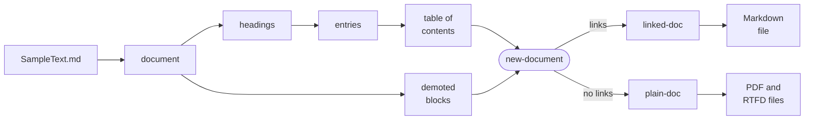
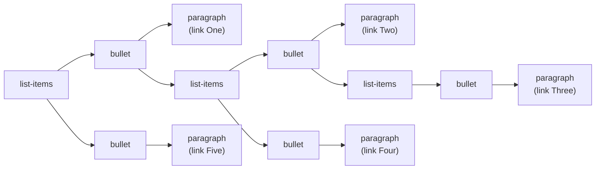

# Markdown TOC

Documents are data, and a table of contents is a good first program to show what that means. This example reads a Markdown document, a long sample text that comes with LispKit, and inserts a table of contents. The program neither searches for lines that start with `#` nor uses regular expressions. It parses the document into a tree of Scheme values, the _syntax tree_, and processes the tree with pattern matching: it extracts the headings, builds a nested list of links from them, and demotes the headings of the document by one level. The result is a new document with a new title, a table of contents, and the original document as its main part. The program writes the new document back as Markdown source and saves it as PDF and RTFD documents, in which the diagram and the formulas of the sample text are images.

<div class="gallery"><figure><figcaption><p>The beginning of the PDF document</p></figcaption></figure> <figure><figcaption><p>A page with a diagram and formulas</p></figcaption></figure></div>

:::info

**Program:** [`MarkdownTOC.scm`](https://github.com/objecthub/swift-lispkit/blob/master/Sources/LispKit/Resources/Examples/MarkdownTOC.scm), in the `Examples` folder of LispKit\
**Libraries:** `(lispkit base)`, `(lispkit datatype)`, `(scheme list)`, and `(lispkit markdown)`\
**Techniques:** syntax trees as algebraic datatypes, pattern matching with `match`, tree transformation, nested lists built from flat data, GitHub-style anchors, writing Markdown source, saving PDF and RTFD documents\
**Requires:** LispKit 2.6.3 or later

:::

## What the program does

The sample text, `SampleText.md`, is one of the assets of LispKit. It is a document of about 200 lines with a title, six sections, and three subsections, and it uses most of what the Markdown dialect of the program knows: emphasis, links, lists, task lists, tables, code blocks with syntax highlighting, a Mermaid diagram, and mathematical formulas. The program reads it and prints this:

```
Generated /Users/me/Documents/SampleTextWithToc.md (reads back as equal document: #t)

# Sample Document

## Table of Contents
- [Critical Document Title](#critical-document-title)
  - [Summary](#summary)
  - [Considering More Options](#considering-more-options)
  - [Left To Do](#left-to-do)
  - [Final Remarks](#final-remarks)
  - [Last But Not Least](#last-but-not-least)
  - [Advanced Features](#advanced-features)
    - [Tables](#tables)
    - [Mermaid Diagrams](#mermaid-diagrams)
    - [Mathematical Formulas](#mathematical-formulas)

Generated /Users/me/Documents/SampleTextWithToc.rtfd
Generated /Users/me/Documents/SampleTextWithToc.pdf
```

The first line says that the program wrote a Markdown file, and that parsing the file again yields a document that is equal to the one the program wrote. The rest is the beginning of that file: the new title, the heading of the table of contents, and a nested list with one link for each heading. The last two lines name the PDF and the RTFD document. The program opens the PDF document when it is done.

The Markdown file contains the sample text after the table of contents. The new title is the only heading of level 1, so every heading of the sample text is one level lower than it was:

```
## Critical Document Title

### Summary

Lorem ipsum dolor sit amet, **consectetur adipiscing** elit.
Aliquam non risus in massa ornare lacinia. Etiam at ullamcorper
ligula. Mauris et orci ut lectus convallis euismod. *Mauris*
vitae purus congue, finibus tellus nec, lacinia felis.

Etiam eget lectus quis leo tincidunt venenatis. Duis iaculis
tristique tempor. *Maecenas vestibulum* vehicula dui:
[objecthub.com](https://objecthub.com).

### Considering More Options

Nullam gravida `suscipit placerat`. Vivamus gravida fermentum
magna vitae condimentum. Interdum et **malesuada fames** ac ante
ipsum primis in faucibus.
```

The table of contents in the PDF document has no links, since links to a place in the same document cannot be followed in PDF and RTFD documents. The Markdown file does have them. The links of the Markdown file work in every viewer that gives the headings the same anchors as GitHub does.

## Running the program

Build LispKit from a clone of the [GitHub repository](https://github.com/objecthub/swift-lispkit) and run the program with the LispKit REPL:

```
swift build -c release -Xswiftc "-D" -Xswiftc "SPM"
.build/release/LispKitRepl -r Sources/LispKit/Resources -d LispKit \
    Sources/LispKit/Resources/Examples/MarkdownTOC.scm
```

The program reads the sample text from the assets of LispKit, which `-r` makes available. It writes `SampleTextWithToc.md`, `SampleTextWithToc.rtfd`, and `SampleTextWithToc.pdf` into your `Documents` folder, and it takes a few seconds. To store the files somewhere else, change the definition of `output-directory`. The RTFD document is a folder that TextEdit opens like a file. `LispKitRepl` ends when the program is done. To try the snippets in the section about variations, start it with the option `-p`, which makes the definitions of the program available at the prompt:

```
.build/release/LispKitRepl -r Sources/LispKit/Resources -d LispKit \
    -p Sources/LispKit/Resources/Examples/MarkdownTOC.scm
```

## How it works in a nutshell

The program is a pipeline of small procedures, each of which turns one kind of data into another. The table of contents and the demoted headings are created independently from the same document. A flag decides whether the table of contents has links, and so two documents are made: one for the Markdown file and one for the PDF and RTFD documents.



| Step | Procedure | Result |
| --- | --- | --- |
| parse | `markdown` | a `document` |
| extract headings | `extract-headings` | a list of pairs `(level . title)` |
| create entries | `make-entries` | a list of entries `(level title anchor)` |
| build the table of contents | `table-of-contents`, `toc-items`, and `toc-item` | a heading and a nested list |
| demote the headings | `demote-headings` | a list of blocks |
| assemble | `new-document` | a `document` |
| write | `markdown->source-string` and `save-markdown` | a Markdown, an RTFD, and a PDF file |

## Libraries

| Library | What the program uses it for |
| --- | --- |
| [`(lispkit base)`](../../libraries/lispkit/lispkit-base.md) | the language, hashtables (`make-equal-hashtable`, `hashtable-ref`, and `hashtable-set!`), and files and directories (`system-directory`, `asset-file-path`, `path`, `read-file`, `write-file`, and `open-file`) |
| [`(lispkit datatype)`](../../libraries/lispkit/lispkit-datatype.md) | `match`, which takes apart the variants of an algebraic datatype |
| [`(scheme list)`](../../libraries/srfi.md) | the list procedures of SRFI 1: `filter-map`, `take`, `take-while`, and `drop-while` |
| [`(lispkit markdown)`](../../libraries/lispkit/lispkit-markdown.md) | Markdown documents: `markdown`, the datatypes `block`, `list-item`, and `inline` with their constructors and patterns, `text->string`, `markdown->source-string`, `markdown=?`, and `save-markdown` |

## Design

### Documents are data

Library `(lispkit markdown)` represents a parsed document by three algebraic datatypes: `block`, `list-item`, and `inline`. A document is a `document` block, which contains a list of blocks. The program uses these variants:

| Datatype | Variant | Meaning |
| --- | --- | --- |
| `block` | `(document blocks)` | a document |
| `block` | `(heading level text)` | a heading of level 1 to 6 |
| `block` | `(paragraph text)` | a paragraph |
| `block` | `(blockquote blocks)` | a block quote, which contains blocks |
| `block` | `(list-items start tight items)` | a list of list items; _start_ is the number of the first item of a numbered list, and _tight_ means that there are no blank lines between the items |
| `list-item` | `(bullet ch tight? blocks)` | an item of a bullet list, written with the bullet character _ch_ |
| `list-item` | `(ordered num ch tight? blocks)` | an item of a numbered list |
| `list-item` | `(task checked? item)` | the item of a task list that wraps an item of one of the other kinds |
| `inline` | `(text string)` | a piece of text |
| `inline` | `(link text uri title)` | a link; _text_ is a list of `inline` objects, and _title_ is a string or `#f` |

Each variant is a constructor and a pattern at the same time. The expression `(heading 2 (list (text "Contents")))` creates a heading, and the pattern `(heading level text)` in a `match` form takes a heading apart. This is the idea behind the program: the same vocabulary reads and writes documents. The text of a heading is a list of `inline` objects, not a string. Emphasis, code, and links inside a heading are objects of their own:

```scheme
(define small-md (markdown "# A *b* `c`\n\ntext"))
(markdown->debug-string small-md)
  ; ⇒ "document(heading(1, text(\"A \"), emph(text(\"b\")), text(\" \"), code(\"c\")), paragraph(text(\"text\")))"
```

A table of contents has plain text, though. `text->string` turns a list of `inline` objects into the text they show, without any markup:

```scheme
(match (car (document-blocks small-md))
  ((heading level text) (text->string text)))
  ; ⇒ "A b c"
```

### Extracting the headings

`extract-headings` goes through the top-level blocks of the document and keeps the headings, as pairs of a level and a title. It does not look inside block quotes and lists: a heading in a quotation does not belong in the table of contents. For the sample text, the result is:

```scheme
(length (document-blocks doc))
  ; ⇒ 46
(extract-headings (document-blocks doc))
  ; ⇒ ((1 . "Critical Document Title") (2 . "Summary") (2 . "Considering More Options")
  ;     (2 . "Left To Do") (2 . "Final Remarks") (2 . "Last But Not Least")
  ;     (2 . "Advanced Features") (3 . "Tables") (3 . "Mermaid Diagrams")
  ;     (3 . "Mathematical Formulas"))
```

### Anchors

A link of the table of contents needs a target. Markdown viewers, such as GitHub, give every heading an _anchor_, a name that is derived from the title of the heading, and a link `#name` leads to the heading. `anchor` follows the rules of GitHub: the title is converted into lowercase, letters, digits, and underscores are kept, spaces and hyphens become hyphens, and every other character is dropped.

```scheme
(map anchor '("Left To Do" "What's new?" "A - B" "Über uns" "1. Intro" "C++ & Scheme" "Snake_case ok"))
  ; ⇒ ("left-to-do" "whats-new" "a---b" "über-uns" "1-intro" "c--scheme" "snake_case-ok")
```

Two headings may have the same title, and an anchor has to lead to exactly one heading. As GitHub does it, `make-entries` keeps the first anchor as it is and numbers the later ones with a suffix:

```scheme
(define dups (markdown "# Summary\n\n## Summary\n\n### Summary" dialect))
(map caddr (make-entries (extract-headings (document-blocks dups))))
  ; ⇒ ("summary" "summary-1" "summary-2")
```

Anchors only work if the viewer creates them. The HTML that `markdown->html` writes has no anchors, so a link to `#two` does not lead anywhere there:

```scheme
(markdown->html (document (list (heading 2 (list (text "Two"))))))
  ; ⇒ "<h2>Two</h2>\n"
```

### Nesting the entries

The headings arrive as a flat list, and the table of contents is a tree. The levels of the headings tell what the tree looks like. Here is a small document and the entries that the program creates for it:

```scheme
(define small (markdown "# One\n\n## Two\n\n### Three\n\n## Four\n\n# Five" dialect))
(define small-entries (make-entries (extract-headings (document-blocks small))))
small-entries
  ; ⇒ ((1 "One" "one") (2 "Two" "two") (3 "Three" "three") (2 "Four" "four") (1 "Five" "five"))
```

`toc-items` takes the level of the first entry as the level of the list. An entry is followed by all the entries with a greater level, and these are its children: `take-while` collects them, and `drop-while` skips them. The remaining entries are the next items of the same list. The two procedures `toc-items` and `toc-item` call each other, one for each level of the tree. This is the tree of `list-items`, `bullet` items, and `paragraph` blocks that the program builds for the entries above:



Written as Markdown source, the tree looks like this, with links and without:

```scheme
(markdown->source-string (document (table-of-contents small-entries #t)) dialect)
  ; ⇒ "## Table of Contents\n- [One](#one)\n  - [Two](#two)\n    - [Three](#three)\n  - [Four](#four)\n- [Five](#five)\n"
(markdown->source-string (document (table-of-contents small-entries #f)) dialect)
  ; ⇒ "## Table of Contents\n- One\n  - Two\n    - Three\n  - Four\n- Five\n"
```

The program does not require well-formed documents. A heading that skips a level, such as a level 3 heading after a level 1 heading, still becomes a child:

```scheme
(define skip (markdown "# One\n\n### Three\n\n## Two" dialect))
(markdown->source-string (document (table-of-contents (make-entries (extract-headings (document-blocks skip))) #f)) dialect)
  ; ⇒ "## Table of Contents\n- One\n  - Three\n  - Two\n"
```

### Demoting the headings

The new document has a title of its own, a level 1 heading. The headings of the original document move down by one level, so that the title of the original, a level 1 heading, becomes a level 2 heading, like the heading of the table of contents. `demote-headings` rebuilds the list of blocks: a heading gets the next level, though never more than 6, and a block quote and a list get a demoted copy of their content. The original document is not changed. Headings in block quotes and lists are demoted, too, since the document does not become consistent otherwise:

```scheme
(markdown->source-string
  (document (demote-headings (document-blocks (markdown "# H\n\n> ## Q\n\n- ### L\n\n1. # O" dialect))))
  dialect)
  ; ⇒ "## H\n\n> ### Q\n\n- #### L\n\n1. ## O\n"
```

### Two documents

Links to a place in the same document cannot be followed in PDF and RTFD documents, so a table of contents with links would look as if it works but do nothing. The program therefore creates the table of contents twice: with links for the Markdown file, where a viewer follows them, and without links for the PDF and RTFD documents. `new-document` has a parameter `links?` for this, and `linked-doc` and `plain-doc` are the two results.

### Writing the documents

`markdown->source-string` writes a document as Markdown source. Reading the source with `markdown` and the same dialect gives back a document that is equal to the original according to `markdown=?`. This does not mean that the source looks like the source of the sample text. Tables, for instance, are written in a normalized form, and a formula between `\[` and `\]` becomes a formula between `$$`. The program checks the equality and prints the result. `markdown=?` compares documents after merging adjacent `text` fragments, since the parser splits text into fragments in a way that depends on how the text is written. `markdown-equals?` compares the documents as they are.

`save-markdown` renders the document and saves it in a file. The format is `pdf`, `rtfd`, or `rtf`; RTF files cannot contain images, so the diagram and the formulas of the sample text would be shown as code and as written. The next argument is an association list with options. The other arguments are the page size and the margins, which only matter for PDF files, and the title and author of the document.

### The main ideas

**Documents are trees of values.** The parsed document is not a string with markup. It is a value that the program takes apart with patterns and builds with constructors, and a heading is as easy to create as it is to find.

**One vocabulary for reading and writing.** The variants of the datatypes are patterns in `match` and constructors in expressions. The code that looks for headings and the code that creates them use the same words.

**Small procedures that transform data.** `extract-headings`, `make-entries`, `toc-items`, `demote-headings`, and `new-document` each do one step and return new data, and none of them changes its argument. All of them are easy to try at the REPL.

**Recursion follows the shape of the data.** The table of contents is a tree, so `toc-items` and `toc-item` are mutually recursive, and `demote-headings` and `demote-item` call themselves and each other for nested blocks and list items.

**One flag instead of two programs.** The same procedures make the table of contents with and without links.

**Compute first, write last.** The procedures only compute values. The program writes files and opens the PDF document after the new documents are complete.

## Walkthrough

The following sections go through the program from top to bottom. Together, the code blocks make up the complete source of `MarkdownTOC.scm`.

### Header and imports

<details>

<summary>Description, credits, and license</summary>

```scheme
;;; Insert a table of contents into a Markdown document
;;;
;;; This program parses a Markdown document and processes its abstract syntax
;;; tree with pattern matching: it extracts the headings of the document, builds
;;; a nested list with links to the headings from them, and demotes the headings
;;; of the document by one level. The result is a new document with a new title,
;;; a table of contents, and the original document as its main part. The new
;;; document is written back as Markdown source, saved as PDF and RTFD document,
;;; and the PDF document is opened afterwards by the default application of the
;;; operating system.
;;;
;;; The links of the table of contents refer to the headings by their anchors,
;;; which are derived from the titles of the headings as GitHub does it. Thus,
;;; they work if the Markdown source is shown by a viewer that supports such
;;; anchors. Links to a place in the same document cannot be followed in PDF
;;; and RTFD documents, so the table of contents of these documents does not
;;; contain any links.
;;;
;;; Author: Matthias Zenger
;;; Copyright © 2026 Matthias Zenger. All rights reserved.
;;;
;;; Licensed under the Apache License, Version 2.0 (the "License");
;;; you may not use this file except in compliance with the License.
;;; You may obtain a copy of the License at
;;;
;;;   http://www.apache.org/licenses/LICENSE-2.0
;;;
;;; Unless required by applicable law or agreed to in writing,
;;; software distributed under the License is distributed on an
;;; "AS IS" BASIS, WITHOUT WARRANTIES OR CONDITIONS OF ANY KIND,
;;; either express or implied. See the License for the specific
;;; language governing permissions and limitations under the
;;; License.
```

</details>

The program imports `(lispkit base)` for the language and for files, `(lispkit datatype)` for `match`, `(scheme list)` for the list procedures of SRFI 1, and `(lispkit markdown)` for Markdown documents:

```scheme
(import (lispkit base)
        (lispkit datatype)
        (scheme list)
        (lispkit markdown))
```

### Settings

The first definitions are settings. `system-directory` returns the list of directories of the given kind, and `car` takes the first one, the `Documents` directory of the user. `path` appends file names to it. The title of the new document, the heading of its table of contents, and the Markdown dialect are settings, too. The dialect `latex` knows tables and definition lists, underlined and struck-through text, task lists, and formulas between dollar signs and in LaTeX notation, which the sample text uses.

```scheme
;; Where the generated files are stored
(define output-directory (car (system-directory 'documents)))
(define markdown-file-path (path output-directory "SampleTextWithToc.md"))
(define rtfd-file-path (path output-directory "SampleTextWithToc.rtfd"))
(define pdf-file-path (path output-directory "SampleTextWithToc.pdf"))

;; The title of the new document, and the heading of its table of contents
(define document-title "Sample Document")
(define toc-title "Table of Contents")

;; The Markdown dialect used for reading and writing documents. Dialect `latex`
;; supports tables and definition lists, underlined text, strikethrough text,
;; task lists, and LaTeX formulas.
(define dialect 'latex)
```

### Reading the document

`asset-file-path` searches the asset directories for the file `SampleText.md` in the folder `Documents`, `read-file` returns its content as a string, and `markdown` parses it. The result `doc` is a document.

```scheme
;; Read the Markdown file and parse it
(define doc
  (markdown (read-file (asset-file-path "SampleText" "md" "Documents")) dialect))
```

### Extracting the headings

A document consists of blocks. `document-blocks` matches the document against the pattern `(document blocks)` and returns the blocks. `match` takes a value and a list of cases, and the first case whose pattern matches the value is the one that is executed.

```scheme
;; Extracting headings

;; Returns the blocks of a Markdown document
(define (document-blocks md)
  (match md
    ((document blocks) blocks)))
```

`extract-headings` matches every block. The case `(heading level text)` binds the variables `level` and `text` to the parts of the heading and returns a pair of the level and the title as plain text. All other blocks fall into the `else` case and return `#f`. `filter-map` applies the procedure to each block and collects the results that are not `#f`.

```scheme
;; Returns a list of headings `(level . title)` for the headings in `blocks`, in the
;; order in which they occur. Only the headings on the top-level of a document are
;; considered; headings within block quotes and lists do not belong into a table of
;; contents. `text->string` turns the text of a heading into plain text.
(define (extract-headings blocks)
  (filter-map
    (lambda (block)
      (match block
        ((heading level text) (cons level (text->string text)))
        (else #f)))
    blocks))
```

### Creating anchors

`anchor` turns a title into an anchor. It processes the characters of the lowercase title with `filter-map`: a character becomes itself, a hyphen, or `#f`, and `filter-map` drops the `#f`. `list->string` joins the remaining characters.

```scheme
;; Creating anchors

;; Returns the anchor for the title of a heading as it is created by GitHub: the
;; title in lowercase, with spaces and hyphens replaced by hyphens, and without any
;; other characters than letters, digits, and underscores.
(define (anchor title)
  (list->string
    (filter-map
      (lambda (ch)
        (cond ((or (char-alphabetic? ch) (char-numeric? ch) (char=? ch #\_)) ch)
              ((or (char-whitespace? ch) (char=? ch #\-)) #\-)
              (else #f)))
      (string->list (string-downcase title)))))
```

`make-entries` combines the headings with their anchors. The hashtable `used` counts how often each anchor has been used so far. The first heading with an anchor gets it as it is, and the following ones get a suffix: the number of the earlier uses. Each entry is a list of the level, the title, and the anchor.

```scheme
;; Turns the headings `(level . title)` into entries `(level title anchor)`. If
;; there are several headings with the same anchor, the anchors of all but the
;; first one get a number as suffix (`summary`, `summary-1`, `summary-2`, ...).
(define (make-entries headings)
  (let ((used (make-equal-hashtable)))
    (map (lambda (heading)
           (let* ((base (anchor (cdr heading)))
                  (count (hashtable-ref used base 0)))
             (hashtable-set! used base (+ count 1))
             (list (car heading)
                   (cdr heading)
                   (if (= count 0)
                       base
                       (string-append base "-" (number->string count))))))
         headings)))
```

### Creating the table of contents

`toc-item` creates a list item for an entry and its children. The item is a `bullet` with the bullet character `-`, the flag `#t` for a tight item, and a list of blocks. The first block is a paragraph, which contains a link or, without links, the plain title. A `link` has a list of `inline` objects as its text, the target `#anchor`, and no title. If the entry has children, the second block is a nested list, which `toc-items` creates for them.

```scheme
;; Creating the table of contents

;; Returns a bullet list item for `entry`, which has the nested list of items for the
;; entries `children` as sub-list. If `links?` is true, the title of the entry is a
;; link to the anchor of its heading.
(define (toc-item entry children links?)
  (let ((title (cadr entry))
        (anchor (caddr entry)))
    (bullet #\- #t
      (cons (paragraph
              (list (if links?
                        (link (list (text title)) (string-append "#" anchor) #f)
                        (text title))))
            (if (null? children)
                '()
                (list (list-items #f #t (toc-items children links?))))))))
```

`toc-items` creates the items of one list. It takes the first entry, collects the entries that come after it and have a greater level as its children, and continues with the others.

```scheme
;; Returns the list items for the entries in `entries`. An entry is followed by the
;; entries that have a greater level, which become its children. All other entries
;; are on the same level as the first entry.
(define (toc-items entries links?)
  (if (null? entries)
      '()
      (let* ((level (car (car entries)))
             (deeper? (lambda (entry) (> (car entry) level)))
             (children (take-while deeper? (cdr entries)))
             (rest (drop-while deeper? (cdr entries))))
        (cons (toc-item (car entries) children links?)
              (toc-items rest links?)))))
```

`table-of-contents` returns two blocks: the heading of the table of contents, with level 2, and the nested list.

```scheme
;; Returns the table of contents for `entries` as a list of blocks: a heading of
;; level 2 followed by a nested list with an item for each entry
(define (table-of-contents entries links?)
  (list (heading 2 (list (text toc-title)))
        (list-items #f #t (toc-items entries links?))))
```

### Demoting the headings

`demote-headings` maps over a list of blocks. A heading is replaced by a heading with the next level, but not by one with a level above 6. A block quote and a list are rebuilt with demoted content, and all other blocks stay as they are.

```scheme
;; Demoting headings

;; Returns `blocks` with all headings demoted by one level; the level of a heading
;; never gets larger than 6. Headings are also demoted if they are within block
;; quotes and lists.
(define (demote-headings blocks)
  (map (lambda (block)
         (match block
           ((heading level text) (heading (min 6 (+ level 1)) text))
           ((blockquote subblocks) (blockquote (demote-headings subblocks)))
           ((list-items start tight items) (list-items start tight (map demote-item items)))
           (else block)))
       blocks))
```

The items of a list are demoted by `demote-item`. A `bullet` or an `ordered` item has blocks, which are demoted. A `task` item wraps another item, which is demoted.

```scheme
;; Returns the list item `item` with all headings within it demoted by one level
(define (demote-item item)
  (match item
    ((bullet ch tight? blocks) (bullet ch tight? (demote-headings blocks)))
    ((ordered num ch tight? blocks) (ordered num ch tight? (demote-headings blocks)))
    ((task checked? subitem) (task checked? (demote-item subitem)))))
```

### Putting the new document together

`new-document` returns a document that consists of the title, the table of contents, and the demoted blocks of the original document. The procedure `append` puts the three parts together.

```scheme
;; Putting the new document together

;; Returns a new document with a title, the table of contents, and the demoted blocks
;; of the original document
(define (new-document md links?)
  (let* ((blocks (document-blocks md))
         (entries (make-entries (extract-headings blocks))))
    (document
      (append (list (heading 1 (list (text document-title))))
              (table-of-contents entries links?)
              (demote-headings blocks)))))
```

The program creates two documents, one with and one without links:

```scheme
;; The document for Markdown files, whose table of contents links to the headings
(define linked-doc (new-document doc #t))

;; The document for PDF and RTFD documents, whose table of contents has no links
(define plain-doc (new-document doc #f))
```

### Writing the Markdown file

`markdown->source-string` writes the document with links as Markdown source, and `write-file` saves it.

```scheme
;; Write the document with the links back as Markdown source. `markdown->source-string`
;; writes a document that is parsed into an equal document again. Documents are
;; compared with `markdown=?`, which does not care how the parser splits text into
;; fragments (`markdown-equals?` compares the structure of documents).
(define source (markdown->source-string linked-doc dialect))
(write-file markdown-file-path source)
```

The program reports the file and whether the source reads back as an equal document: `markdown` parses the source again with the same dialect, and `markdown=?` compares the result with the document that was written.

```scheme
(display "Generated ")
(display markdown-file-path)
(display " (reads back as equal document: ")
(display (markdown=? linked-doc (markdown source dialect)))
(display ")")
(newline)
(newline)
```

The program shows the first three blocks of the document: the title, the heading of the table of contents, and the list. `take` returns the first three elements of the list of blocks, and `document` wraps them into a document, which is written as source again.

```scheme
;; Show the beginning of the new document: its title, and the table of contents
(display (markdown->source-string (document (take (document-blocks linked-doc) 3)) dialect))
(newline)
```

### Saving PDF and RTFD documents

The document without links is saved twice. For the RTFD document, the options set the theme and the width of Mermaid diagrams and keep `save-markdown` from loading images from the web. The page size and the margins are not used for RTFD, so the program passes `#f`. The last two arguments are the title and the author of the document; the program passes `document-title` for the title, so the title property of the saved document and its first heading agree.

```scheme
;; Save the document without links as RTFD and PDF documents. Both formats keep
;; the diagram and the formulas of the document as images. The PDF document has
;; A4 pages with margins of 20 mm.
(save-markdown rtfd-file-path plain-doc 'rtfd
               '((mermaid . ((theme . neutral) (width . 400)))
                 (remote-images . none))
               #f #f document-title "LispKit")
```

The PDF document has pages of size `a4` and margins of 20 millimeters. The options select the font and the sizes of text, code, and headings, the spacing of lines, and the width of Mermaid diagrams.

```scheme
(save-markdown pdf-file-path plain-doc 'pdf
               '((font-family . "Times")
                 (font-size . 15)
                 (line-spacing . 1.32)
                 (code-font-family . "Menlo, Consolas, monospace")
                 (code-font-size . 12)
                 (code-block-font-size . 8.9)
                 (code-block-line-spacing . 1.2)
                 (h1-font-size . 24)
                 (h2-font-size . 20)
                 (h3-font-size . 17)
                 (mermaid . ((theme . neutral) (width . 300)))
                 (remote-images . none))
               'a4 "20mm" document-title "LispKit")
```

The program reports what it did and opens the PDF document with the application that the system uses for PDF files:

```scheme
(display "Generated ")
(display rtfd-file-path)
(newline)
(display "Generated ")
(display pdf-file-path)
(newline)
```

```scheme
;; Open the PDF document in a system-specific fashion
(open-file pdf-file-path)
```

## Variations

The definitions of the program are available at the prompt of the REPL, which was started with the option `-p`. The program ran once when it was loaded, so it has written its files and opened the PDF document. This does no harm: running it again replaces the files.

**A shorter table of contents.** Often only the top levels of a document belong into a table of contents. Entries are lists with the level in front, so a procedure that removes the deeper ones is a single call of `filter`:

```scheme
(define entries (make-entries (extract-headings (document-blocks doc))))
(define (limit-levels entries max-level)
  (filter (lambda (entry) (<= (car entry) max-level)) entries))
(map cadr (limit-levels entries 2))
  ; ⇒ ("Critical Document Title" "Summary" "Considering More Options" "Left To Do"
  ;     "Final Remarks" "Last But Not Least" "Advanced Features")
```

To use it, pass `(limit-levels entries 2)` to `table-of-contents` in the definition of `new-document`.

**Your own document.** The program works for any Markdown document. To use one of your own, replace the argument of `read-file` in the definition of `doc` with the path of your file. Here is a small document with a title and two sections. `new-document` adds the new title and the table of contents:

```scheme
(define notes (markdown "# Notes\n\n## Monday\n\nText\n\n## Tuesday\n\nText" dialect))
(markdown->source-string (new-document notes #t) dialect)
  ; ⇒ "# Sample Document\n\n## Table of Contents\n- [Notes](#notes)\n  - [Monday](#monday)\n  - [Tuesday](#tuesday)\n\n## Notes\n\n### Monday\n\nText\n\n### Tuesday\n\nText\n"
```

**Unique anchors.** The numbers that `make-entries` appends to anchors can collide with the anchor of a heading that has such a number in its title. Here, the heading `Summary 1` gets the anchor `summary-1`, which already belongs to the second heading, the first repeated `Summary`. The links to the two headings lead to the same place:

```scheme
(define tricky
  (markdown "# Summary\n\n## Summary\n\n## Summary\n\n### Summary 1\n\n## Summary 1" dialect))
(map caddr (make-entries (extract-headings (document-blocks tricky))))
  ; ⇒ ("summary" "summary-1" "summary-2" "summary-1" "summary-1-1")
```

The fix is to continue counting until the anchor is new. This version of `make-entries` records every anchor it hands out, and it replaces the version of the program:

```scheme
(define (make-entries headings)
  (let ((used (make-equal-hashtable)))
    (map (lambda (heading)
           (let* ((base (anchor (cdr heading)))
                  (unique (let loop ((candidate base))
                            (if (hashtable-contains? used candidate)
                                (let ((count (+ (hashtable-ref used base 0) 1)))
                                  (hashtable-set! used base count)
                                  (loop (string-append base "-" (number->string count))))
                                candidate))))
             (hashtable-set! used unique 0)
             (list (car heading) (cdr heading) unique)))
         headings)))

(map caddr (make-entries (extract-headings (document-blocks tricky))))
  ; ⇒ ("summary" "summary-1" "summary-2" "summary-1-1" "summary-1-2")
```

**More ideas.** The table of contents could be numbered, which needs `ordered` items with a counter instead of `bullet` items. A second program could check a document instead of changing it: it could look for headings that skip a level, or for headings with the same title. And since a syntax tree is a value, one table of contents could cover several documents.

## Further reading

* [`(lispkit markdown)`](../../libraries/lispkit/lispkit-markdown.md): the datatypes of Markdown documents, parsing, and conversions
* [`(lispkit datatype)`](../../libraries/lispkit/lispkit-datatype.md): algebraic datatypes and pattern matching
* [`(scheme list)`](../../libraries/srfi.md): SRFI 1, the list library
* [CommonMark](https://commonmark.org): the specification of the Markdown syntax that the parser follows
* [GitHub Flavored Markdown](https://github.github.com/gfm/): the specification of tables, task lists, and strikethrough text
