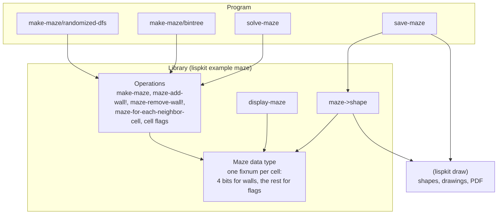
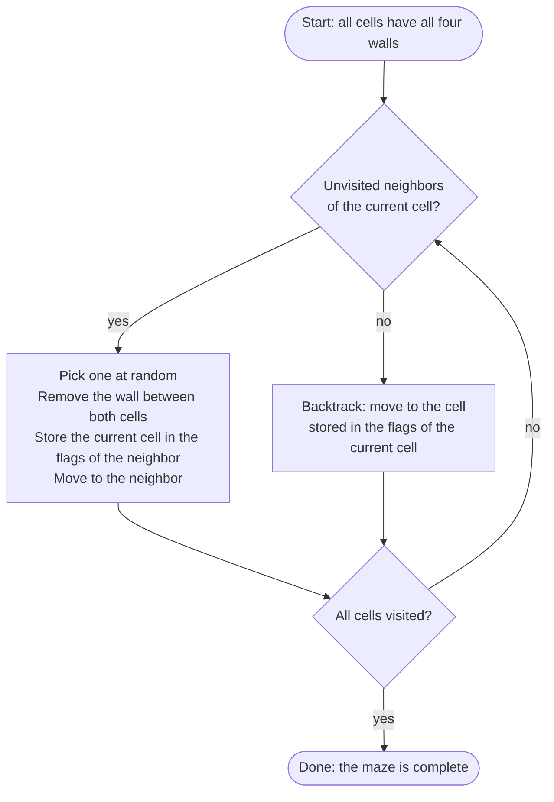

# Maze

This example is a small framework for creating mazes. A maze is a board of cells, and each cell has up to four walls. The program consists of two parts: a library that defines an abstract data type for mazes, together with procedures for printing a maze on the terminal and for turning it into a drawing, and a program that uses this library to generate random mazes with two different algorithms and to find the path through a maze. Mazes can be shown as text on the terminal or saved as vector graphics in a PDF file, optionally with the solution highlighted.

:::info

**Program:** [`Maze.scm`](https://github.com/objecthub/swift-lispkit/blob/master/Sources/LispKit/Resources/Examples/Maze.scm), in the `Examples` folder of LispKit\
**Libraries:** `(lispkit base)`, `(lispkit draw)`, and `(lispkit example maze)`, which the program defines itself\
**Techniques:** local libraries, an abstract data type, bit fields, randomized algorithms, backtracking, path finding

:::

## What the program draws

<div class="gallery"><figure><figcaption><p>Randomized depth-first search</p></figcaption></figure> <figure><figcaption><p>Binary tree</p></figcaption></figure></div>

Both mazes have 30 × 30 cells. They are _perfect mazes_: every cell can be reached from every other cell, and there is exactly one path between any two cells. In graph terms, the passages of such a maze form a spanning tree of the grid, so a maze of _n_ cells has _n_ − 1 passages. This was checked for 130 random mazes of each algorithm.

The algorithms still create mazes with a very different character. The numbers below were measured for 100 random mazes of 30 × 30 cells with a verification script that is not part of the example:

| | Randomized depth-first search | Binary tree |
| --- | --- | --- |
| Dead ends (cells with three walls) | about 10% | about 25% |
| Path from the upper left to the lower right cell | about 300 steps on average | always 58 steps |
| Character | A few long, winding corridors | Many short branches; open corridors along the top and the left side |

The paths are found by procedure `solve-maze` of the program, which is described below.

## Running the program

Build LispKit from a clone of the [GitHub repository](https://github.com/objecthub/swift-lispkit) and load the program into the LispKit REPL:

```
swift build -c release -Xswiftc "-D" -Xswiftc "SPM"
.build/release/LispKitRepl -r Sources/LispKit/Resources -d LispKit \
    -p Sources/LispKit/Resources/Examples/Maze.scm
```

The option `-p` runs the program as the _prelude_ of the REPL. The REPL stays open afterwards, and the definitions of the program are available at the prompt. Without `-p`, `LispKitRepl` runs the program and ends. Leave the REPL with `(exit)`.

Loading the program defines the library and the procedures for creating and drawing mazes. Nothing is drawn yet. To print a random maze with 15 × 15 cells on the terminal, enter:

```scheme
(display-maze (make-maze/randomized-dfs 15 15))
```

```
+---+---+---+---+---+---+---+---+---+---+---+---+---+---+---+
|   |               |                       |               |
+   +   +---+   +   +---+   +---+---+---+   +   +---+---+   +
|   |       |   |           |       |       |   |       |   |
+   +---+   +   +---+---+   +   +   +---+   +   +   +   +   +
|   |       |   |       |   |   |       |   |       |   |   |
+   +---+   +   +   +   +---+   +---+   +   +---+---+   +   +
|       |   |       |           |       |           |   |   |
+---+   +   +---+---+---+---+---+   +---+---+---+   +---+   +
|       |       |   |           |   |               |       |
+   +---+---+   +   +   +---+   +   +   +---+---+---+   +   +
|   |       |   |   |   |   |       |           |       |   |
+   +---+   +   +   +   +   +---+---+---+---+   +---+   +   +
|       |           |   |   |               |           |   |
+---+   +   +---+---+   +   +   +---+   +---+---+---+---+   +
|   |   |       |       |       |       |           |       |
+   +   +---+---+   +---+---+---+   +   +   +   +---+   +---+
|       |           |               |   |   |           |   |
+   +---+   +---+---+   +   +---+---+---+   +---+---+---+   +
|   |       |   |       |       |           |               |
+   +   +---+   +   +---+---+   +   +---+---+---+---+   +   +
|   |   |       |   |       |       |                   |   |
+   +   +   +   +   +---+   +---+---+   +---+   +---+---+   +
|       |   |   |       |   |               |   |       |   |
+---+---+---+   +---+   +   +   +---+---+---+   +   +   +   +
|           |       |   |       |       |       |   |   |   |
+   +---+   +   +   +   +   +---+   +   +   +---+   +---+   +
|       |       |   |   |   |       |   |   |   |       |   |
+   +   +---+---+---+   +---+   +---+   +   +   +   +   +   +
|   |                           |           |       |       |
+---+---+---+---+---+---+---+---+---+---+---+---+---+---+---+
```

The next lines create three PDF files: a maze with 40 × 40 cells of 10 × 10 points, a binary tree maze with 50 × 50 cells of 8 × 8 points, and a maze with 40 × 40 cells in which the path from the upper left to the lower right cell is highlighted.

```scheme
(save-maze "Maze-DFS.pdf" (make-maze/randomized-dfs 40 40) 10 10)
(save-maze "Maze-BinTree.pdf" (make-maze/bintree 50 50) 8 8)
(let ((maze (make-maze/randomized-dfs 40 40)))
  (save-maze "Maze-Solved.pdf" maze 10 10
             (solve-maze maze (cell 0 0) (cell 39 39))))
```

A relative file name refers to the directory the REPL was started in. Each maze is random, so your mazes will look different.

## Mazes in a nutshell

A maze is a rectangular grid of _cells_. A cell has coordinates `(x . y)`, with `(0 . 0)` in the upper left corner, and up to four walls: towards the west, east, north, and south. A wall between two cells belongs to both of them. The library stores the walls of a cell in four bits of a fixnum, and uses the remaining bits for _flags_, which algorithms can use for bookkeeping:

| Bit | 0 | 1 | 2 | 3 | 4 and higher |
| --- | --- | --- | --- | --- | --- |
| Meaning | West wall | East wall | North wall | South wall | Flags |
| Value | 1 | 2 | 4 | 8 | multiples of 16 |

The following lines create a maze with 3 × 2 cells, add the walls around it and one more wall between the cells `(1 . 0)` and `(1 . 1)`, and print the maze:

```scheme
(define m (make-maze 3 2 0))           ; 3 x 2 cells without any walls
(maze-add-border-walls! m)             ; walls around the maze
(maze-add-wall! m (cell 1 0) south)    ; a wall between the cells (1 . 0) and (1 . 1)
(display-maze m)
```

```
+---+---+---+
|           |
+   +---+   +
|           |
+---+---+---+
```

The walls of both cells next to the new wall have changed. Cell `(1 . 0)` has the walls north (4) and south (8), cell `(1 . 1)` the walls south (8) and north (4), so both have the value 12. The flags of a cell are independent of its walls, and removing the wall removes it from both sides:

```scheme
(maze-cell-walls m (cell 1 0))                ; ⇒ 12
(maze-cell-walls m (cell 1 1))                ; ⇒ 12
(set-maze-cell-flags! m (cell 1 1) 42)
(maze-cell-flags m (cell 1 1))                ; ⇒ 42
(maze-cell-walls m (cell 1 1))                ; ⇒ 12
(maze-remove-wall! m (cell 1 0) south)
(maze-cell-walls m (cell 1 0))                ; ⇒ 4
(maze-cell-walls m (cell 1 1))                ; ⇒ 8
```

## Libraries

| Library | Used for |
| --- | --- |
| [`(lispkit base)`](../../libraries/lispkit/lispkit-base.md) | The language itself, in particular the fixnum operations (`fx+`, `fx*`, `fxand`, `fxior`, `fxxor`, `fxlshift`, `fxrshift`, `fxrandom`, ...), vectors, `do`, `let-optionals`, `let-values`, `define-values`, and `string-append!`. It also re-exports [`(lispkit type)`](../../libraries/lispkit/lispkit-type.md), which provides `make-type`. |
| [`(lispkit draw)`](../../libraries/lispkit/lispkit-draw.md) | Shapes and drawings: `shape`, `move-to`, `line-to`, `relative-line-to`, `point`, `transform-shape`, `translate`, `drawing`, `draw`, `color`, `set-color`, `size`, and `save-drawing`, which writes a drawing into a PDF file. |
| `(lispkit example maze)` | The maze library. It is defined by the program itself. |

LispKit allows programs to define libraries directly with `define-library`. R7RS only knows libraries in separate files. A local library like this one lets a program hide internal details and document its interface in one place, without any file organization. The program part imports the library as if it were installed globally, together with `(lispkit base)` and `(lispkit draw)`.

## Design

### Three tiers

The library defines the maze data type, the operations on it, and two views of a maze: text and a shape for drawing. The program uses the operations to create mazes and the drawing library to save them:



The library exports these procedures:

| Group | Exports |
| --- | --- |
| Directions | `west`, `east`, `north`, `south`, `all-directions`, `direction-west?`, `direction-east?`, `direction-north?`, `direction-south?`, `invert-direction`, `mirror-direction` |
| Cells | `cell`, `cell-x`, `cell-y` |
| Mazes | `make-maze`, `maze?`, `maze-type-tag`, `maze-width`, `maze-height`, `maze-bounds`, `maze-cell-in-bounds?`, `maze-cell-id`, `maze-cell-id->cell` |
| Walls | `maze-cell-walls`, `maze-has-wall?`, `maze-has-no-wall?`, `set-maze-cell-walls!`, `maze-add-wall!`, `maze-remove-wall!`, `maze-add-border-walls!` |
| Flags | `maze-cell-flags`, `set-maze-cell-flags!`, `maze-cell-unvisited?` |
| Neighbors | `maze-for-each-neighbor-cell` |
| Output | `display-maze`, `maze->shape` |

### The main ideas

**An abstract data type.** `make-type` creates a new type `maze` whose values are distinct from any other value, even though a maze is represented by a pair holding the dimensions and a vector. The library does not export the procedure that exposes this representation. Programs can only use the maze operations, so the representation can change without breaking them.

**One fixnum per cell.** A maze with _w_ × _h_ cells is a vector with _w_ · _h_ fixnums. The cell `(x . y)` is stored at index _w_ · _y_ + _x_. The four lowest bits of the fixnum are the walls, the other bits are the flags. Directions use the same bit values as the walls. A _set of directions_ is simply the sum of the values, e.g. `all-directions` is 15.

**Walls are stored on both sides.** `maze-add-wall!` and `maze-remove-wall!` update the cell and its neighbor in the given direction. Procedures that read walls can look at one cell only. Procedures that draw a maze can draw every wall once.

**The algorithms use the interface only.** Neither the two generation algorithms nor the solver know how a maze is represented. They use `make-maze`, `maze-add-wall!`, `maze-remove-wall!`, `maze-has-no-wall?`, `maze-for-each-neighbor-cell`, and the flags.

**The state lives in the maze.** The depth-first search needs to remember how it reached a cell, in order to backtrack. It stores this information in the flags of the cells instead of maintaining a separate stack.

## Walkthrough

The following sections go through the program from top to bottom. Together, the code blocks make up the complete source of `Maze.scm`.

### Header

<details>

<summary>Description, credits, and license</summary>

```scheme
;;; Maze generation
;;;
;;; This is a slightly bigger example which implements a maze generation
;;; framework and two sample algorithms which generate random mazes.
;;;
;;; The code is organized in two parts: the framework for representing and
;;; generating mazes is implemented in terms of a library
;;; `(lispkit example maze)`. It defines a new datatype `maze` which
;;; implements a maze of given dimensions as a vector of fixnum values.
;;; Conceptually, a maze is a board of cells. Each cell has up to four
;;; walls in the directions towards `north`, `south`, `east`, and `west`.
;;; In addition, each cell provides a 60-bit fixnum value for representing
;;; custom flags.
;;;
;;; The second part of the code imports the library and implements two
;;; algorithms for generating random mazes: one is based on a randomized
;;; backtracking approach doing a depth first search, the second one
;;; implements a very simple approach by generating a random binary tree.
;;;
;;; Mazes can be either printed onto a terminal via function `display-maze`
;;; or there is a simple function `save-maze` which draws a maze into a
;;; LispKit drawing which is then saved into a PDF file.
;;;
;;; Both algorithms generate perfect mazes: there is exactly one path between
;;; any two cells. Function `solve-maze` finds this path. It can be passed to
;;; `save-maze` as an optional argument to highlight it in the PDF file.
;;;
;;; Example usage:
;;;   (display-maze (make-maze/randomized-dfs 15 15))
;;;   (save-maze "Maze-DFS.pdf" (make-maze/randomized-dfs 40 40) 10 10)
;;;   (save-maze "Maze-BinTree.pdf" (make-maze/bintree 50 50) 8 8)
;;;   (let ((maze (make-maze/randomized-dfs 40 40)))
;;;     (save-maze "Maze-Solved.pdf" maze 10 10
;;;                (solve-maze maze (cell 0 0) (cell 39 39))))
;;;
;;; Author: Matthias Zenger
;;; Copyright © 2019-2026 Matthias Zenger. All rights reserved.
;;;
;;; Licensed under the Apache License, Version 2.0 (the "License"); you may
;;; not use this file except in compliance with the License. You may obtain
;;; a copy of the License at
;;;
;;;   http://www.apache.org/licenses/LICENSE-2.0
;;;
;;; Unless required by applicable law or agreed to in writing, software
;;; distributed under the License is distributed on an "AS IS" BASIS,
;;; WITHOUT WARRANTIES OR CONDITIONS OF ANY KIND, either express or implied.
;;; See the License for the specific language governing permissions and
;;; limitations under the License.
```

</details>

### The library

```scheme
;; Library providing functionality for creating, representing and manipulating data structures
;; for mazes, maze cells, and directions.

(define-library (lispkit example maze)

  (export west
          east
          north
          south
          all-directions
          direction-west?
          direction-east?
          direction-north?
          direction-south?
          invert-direction
          mirror-direction)

  (export cell
          cell-x
          cell-y)

  (export maze?
          maze-type-tag
          make-maze
          maze-width
          maze-height
          maze-bounds
          maze-cell-in-bounds?
          maze-cell-id
          maze-cell-id->cell
          maze-cell-walls
          maze-has-wall?
          maze-has-no-wall?
          set-maze-cell-walls!
          maze-add-wall!
          maze-remove-wall!
          maze-add-border-walls!
          maze-cell-flags
          set-maze-cell-flags!
          maze-cell-unvisited?
          maze-for-each-neighbor-cell
          display-maze
          maze->shape)

  (import (lispkit base)
          (lispkit draw))
```

`define-library` defines a library with the name `(lispkit example maze)`. The library exports the directions, cells, and maze operations in three `export` declarations, and it imports `(lispkit base)` and `(lispkit draw)`. The body consists of three `begin` blocks: directions, cells, and mazes.

#### Directions

```scheme
  (begin
    (define west 1)
    (define east 2)
    (define north 4)
    (define south 8)
    (define all-directions 15)

    (define (direction-west? dir)
      (not (fxzero? (fxand dir west))))

    (define (direction-east? dir)
      (not (fxzero? (fxand dir east))))

    (define (direction-north? dir)
      (not (fxzero? (fxand dir north))))

    (define (direction-south? dir)
      (not (fxzero? (fxand dir south))))

    (define (invert-direction dir)
      (fxxor dir all-directions))

    (define (mirror-direction dir)
      (fxior
        (fxior (if (direction-west? dir) east 0)
               (if (direction-east? dir) west 0))
        (fxior (if (direction-north? dir) south 0)
               (if (direction-south? dir) north 0))))
  )
```

A direction is a bit: `west` is 1, `east` 2, `north` 4, and `south` 8. Sets of directions are sums of these values. `all-directions` is the set of all four. The predicates test whether a direction is contained in a set with `fxand`. `invert-direction` flips all four bits and yields the directions that are not in the set. `mirror-direction` maps every direction in the set to its opposite: `west` to `east`, `north` to `south`, and vice versa. The two algorithms do not need these two procedures.

#### Cells

```scheme
  (begin
    (define cell cons)
    (define cell-x car)
    (define cell-y cdr)
  )
```

A cell is a pair of a column and a row. The row numbers increase from top to bottom, so `north` leads to a smaller y coordinate.

#### The maze type

```scheme
  (begin
    (define-values (maze-type-tag new-maze maze? maze-ref make-maze-subtype) (make-type 'maze))

    (define (make-maze width height . args)
      (let-optionals args ((walls 0))
        (new-maze (cons (cons width height) (make-vector (fx* width height) walls)))))

    (define (maze-width maze)
      (caar (maze-ref maze)))

    (define (maze-height maze)
      (cdar (maze-ref maze)))

    (define (maze-bounds maze)
      (let ((m (maze-ref maze)))
        (values (caar m) (cdar m))))
```

`make-type` returns five values. The type tag, a constructor, a predicate, and an accessor are of interest here: the constructor `new-maze` wraps a representation into a maze object, and `maze-ref` returns the representation. `maze?` is exported, `maze-ref` is not.

The representation is a pair: the dimensions as a pair of width and height, and a vector with one element for each cell. `make-maze` creates a maze in which every cell has the same walls. By default there are no walls, i.e. all four bits are 0. The optional argument is a set of directions. `maze-bounds` returns width and height as two values.

#### Cell indices

```scheme
    (define (maze-cell-in-bounds? maze cll)
      (let ((m (maze-ref maze)))
        (and (fx>= (cell-x cll) 0)
             (fx>= (cell-y cll) 0)
             (fx< (cell-x cll) (caar m))
             (fx< (cell-y cll) (cdar m)))))

    (define (maze-cell-id maze cll)
      (let ((m (maze-ref maze)))
        (fx+ (fx* (caar m) (cell-y cll)) (cell-x cll))))

    (define (maze-cell-id->cell maze id)
      (let ((m (maze-ref maze)))
        (cell (fxremainder id (caar m)) (fx/ id (caar m)))))
```

`maze-cell-id` is the index of a cell in the vector. Cells are stored row by row. `maze-cell-id->cell` computes the cell from an index. `maze-cell-in-bounds?` checks whether a cell lies inside the maze.

#### Walls

```scheme
    (define (maze-cell-walls maze cll)
      (let ((m (maze-ref maze)))
        (fxand (vector-ref (cdr m) (fx+ (fx* (caar m) (cell-y cll)) (cell-x cll))) 15)))

    (define (maze-has-wall? maze cll dir)
      (not (fxzero? (fxand (maze-cell-walls maze cll) dir))))

    (define (maze-has-no-wall? maze cll dir)
      (fxzero? (fxand (maze-cell-walls maze cll) dir)))

    (define (set-maze-cell-walls! maze cll walls)
      (let* ((m (maze-ref maze))
             (i (fx+ (fx* (caar m) (cell-y cll)) (cell-x cll)))
             (v (vector-ref (cdr m) i)))
        (vector-set! (cdr m) i (fxior (fxand v -16) walls))))
```

`maze-cell-walls` masks out the lowest four bits of a cell. `set-maze-cell-walls!` replaces exactly these bits: `-16` has all bits set except for the four lowest ones, so `(fxand v -16)` clears the walls and keeps the flags.

```scheme
    (define (maze-add-wall! maze cll dir)
      (set-maze-cell-walls! maze cll (fxior (maze-cell-walls maze cll) dir))
      (maze-for-each-neighbor-cell maze cll dir
        (lambda (ncll ndir rdir)
          (set-maze-cell-walls! maze ncll (fxior (maze-cell-walls maze ncll) rdir)))))

    (define (maze-remove-wall! maze cll dir)
      (let ((walls (maze-cell-walls maze cll)))
        (set-maze-cell-walls! maze cll (fxxor walls (fxand walls dir))))
      (maze-for-each-neighbor-cell maze cll dir
        (lambda (ncll ndir rdir)
          (let ((nwalls (maze-cell-walls maze ncll)))
            (set-maze-cell-walls! maze ncll (fxxor nwalls (fxand nwalls rdir)))))))

    (define (maze-add-border-walls! maze)
      (let-values (((width height) (maze-bounds maze)))
        (do ((x 0 (fx+ x 1)))
            ((fx>= x width))
          (maze-add-wall! maze (cell x 0) north)
          (maze-add-wall! maze (cell x (fx1- height)) south))
        (do ((y 0 (fx+ y 1)))
            ((fx>= y height))
          (maze-add-wall! maze (cell 0 y) west)
          (maze-add-wall! maze (cell (fx1- width) y) east))))
```

`maze-add-wall!` sets the bits for the given directions in the cell, and then sets the opposite bits in the neighbors in these directions, so that both sides of a wall agree. `maze-remove-wall!` clears the bits in the same way: `(fxxor walls (fxand walls dir))` removes the directions of `dir` from `walls`, even if some of them are not set. `maze-add-border-walls!` puts the outer walls around the maze: the north wall for every cell in the first row, the south wall for the last row, and the west and east walls for the first and last columns. A cell outside of the maze does not exist, so the border walls are stored on one side only.

#### Flags

```scheme
    (define (maze-cell-flags maze cll)
      (let ((m (maze-ref maze)))
        (fxrshift (vector-ref (cdr m) (fx+ (fx* (caar m) (cell-y cll)) (cell-x cll))) 4)))

    (define (set-maze-cell-flags! maze cll flags)
      (let* ((m (maze-ref maze))
             (i (fx+ (fx* (caar m) (cell-y cll)) (cell-x cll)))
             (v (vector-ref (cdr m) i)))
        (vector-set! (cdr m) i (fxior (fxlshift flags 4) (fxand v 15)))))

    (define (maze-cell-unvisited? maze cll)
      (fx= (maze-cell-walls maze cll) all-directions))
```

The flags are stored in the bits above the walls. Reading them shifts the cell value to the right by four bits, writing them shifts the new flags to the left and keeps the walls. A cell is _unvisited_ if it has all four walls. A generation algorithm that starts with a maze whose cells have all walls can use this to tell which cells it has not yet carved into.

#### Neighbors

```scheme
    (define (maze-for-each-neighbor-cell maze cll dir f)
      (let-values (((width height) (maze-bounds maze)))
        (if (and (direction-west? dir) (fx> (cell-x cll) 0))
            (f (cell (fx1- (cell-x cll)) (cell-y cll)) west east))
        (if (and (direction-east? dir) (fx< (cell-x cll) (fx1- width)))
            (f (cell (fx1+ (cell-x cll)) (cell-y cll)) east west))
        (if (and (direction-north? dir) (fx> (cell-y cll) 0))
            (f (cell (cell-x cll) (fx1- (cell-y cll))) north south))
        (if (and (direction-south? dir) (fx< (cell-y cll) (fx1- height)))
            (f (cell (cell-x cll) (fx1+ (cell-y cll))) south north))))
```

`maze-for-each-neighbor-cell` calls `f` for each direction in the set `dir`. The neighbor in that direction must lie in the maze. `f` receives the neighbor cell, the direction towards it, and the reverse direction. Procedures such as `maze-add-wall!` and the depth-first search are built on top of this.

#### Printing a maze

```scheme
    (define (display-maze maze . args)
      (let-optionals args ((port (current-output-port)))
        (let-values (((width height) (maze-bounds maze)))
          (display
            (do ((line (string #\+))
                 (x 0 (fx+ x 1)))
                ((fx>= x width) line)
              (string-append! line (if (maze-has-wall? maze (cell x 0) north) "---+" "   +")))
            port)
          (newline port)
          (do ((y 0 (fx+ y 1)))
              ((fx>= y height))
            (display
              (do ((line (string (if (maze-has-wall? maze (cell 0 y) west) #\| #\space)))
                   (x 0 (fx+ x 1)))
                  ((fx>= x width) line)
                (string-append! line (if (maze-has-wall? maze (cell x y) east) "   |" "    ")))
              port)
            (newline port)
            (display
              (do ((line (string #\+))
                   (x 0 (fx+ x 1)))
                  ((fx>= x width) line)
                (string-append! line (if (maze-has-wall? maze (cell x y) south) "---+" "   +")))
              port)
            (newline port)))))
```

`display-maze` prints a maze with characters. It builds each line as a string with `string-append!`, which appends to a string in place. The first line shows the north walls of the first row. For each row, there is one line with the cells and their west and east walls, and one line with the south walls. Each cell is three characters wide. An optional argument specifies the output port; by default, the current output port is used.

#### Turning a maze into a shape

```scheme
    (define (maze->shape maze dx dy)
      (let-values (((width height) (maze-bounds maze)))
        (shape
          (do ((y 0 (fx1+ y)))
              ((fx>= y height))
            (do ((x 0 (fx1+ x))
                 (cll (cell 0 y) (cell (fx1+ x) y)))
                ((fx>= x width))
              (if (maze-has-wall? maze cll north)
                  (begin
                    (move-to (point (* x dx) (* y dy)))
                    (relative-line-to (point dx 0))))
              (if (maze-has-wall? maze cll west)
                  (begin
                    (move-to (point (* x dx) (* y dy)))
                    (relative-line-to (point 0 dy))))))
          (do ((x 0 (fx1+ x))
               (y (fx1- height)))
              ((fx>= x width))
            (if (maze-has-wall? maze (cell x y) south)
                (begin
                  (move-to (point (* x dx) (* height dy)))
                  (relative-line-to (point dx 0)))))
          (do ((x (fx1- width))
               (y 0 (fx1+ y)))
              ((fx>= y height))
            (if (maze-has-wall? maze (cell x y) east)
                (begin
                  (move-to (point (* width dx) (* y dy)))
                  (relative-line-to (point 0 dy))))))))
  )
)
```

`maze->shape` turns a maze into a _shape_: a path made of line segments in drawing coordinates, with `dx` × `dy` units for each cell. A wall between two cells belongs to both, so the procedure only creates the north and west walls of each cell and then adds the south walls of the last row and the east walls of the last column. This way, every wall is part of the shape once. `move-to` starts a new segment at the given point, and `relative-line-to` adds a line from there to a point at the given offset. The last two parentheses close the `begin` block and the library.

### The program

```scheme
(import (lispkit base)
        (lispkit draw)
        (lispkit example maze))
```

This imports `(lispkit base)`, `(lispkit draw)`, and the library defined above into the program.

#### Randomized depth-first search

```scheme
;; Returns a random maze generated by a randomized depth first search algorithm. Backtracking
;; is implemented by memorizing the previous cell using cell flags, as provided by library
;; `(lispkit example maze)`. `height` and `width` define the dimensions of the maze in terms
;; of number of vertical and horizontal cells.
(define (make-maze/randomized-dfs width height . args)
  (let-optionals args ((startx 0)
                       (starty 0))
    (do ((maze      (make-maze width height all-directions))
         (current   (cell startx starty))
         (unvisited (fx1- (fx* width height))
                    (if (fxzero? count) unvisited (fx1- unvisited)))
         (next      (make-vector 4))
         (count     0 0))
        ((fxzero? unvisited) maze)
      (maze-for-each-neighbor-cell maze current all-directions
        (lambda (ncll ndir rdir)
          (if (maze-cell-unvisited? maze ncll)
              (begin (vector-set! next count (cons ncll ndir))
                     (set! count (fx1+ count))))))
      (if (fxzero? count)
          (set! current (maze-cell-id->cell maze (maze-cell-flags maze current)))
          (let ((target (vector-ref next (fxrandom count))))
            (maze-remove-wall! maze current (cdr target))
            (set-maze-cell-flags! maze (car target) (maze-cell-id maze current))
            (set! current (car target)))))))
```

The procedure starts with a maze in which every cell has all four walls. It carves passages by walking through the maze: at every step it moves to a random neighbor that has not been visited, and it removes the wall between both cells. If there is no such neighbor, it goes back to the cell it came from and tries again. The `do` loop has these variables:

* `maze`: the maze, initially with all walls in every cell
* `current`: the cell the algorithm is at, initially the start cell (by default the upper left one)
* `unvisited`: the number of cells that have not been visited yet, initially all but the start cell
* `next`: a vector with room for the four neighbors of the current cell
* `count`: the number of candidates that were put into `next` in this step, reset to 0 for every step

In every step, `maze-for-each-neighbor-cell` collects the neighbors that are still unvisited, together with their directions, in `next`. If `count` is 0, there is no way forward and the algorithm backtracks. Otherwise, it picks one candidate with `(fxrandom count)`, removes the wall towards it, and stores the id of the current cell in the flags of the new cell, which is the link needed for backtracking. Then it moves on. `unvisited` is decremented in the steps in which the algorithm moved to a new cell. When it reaches 0, all cells have been visited and the maze is returned.



Backtracking through the flags makes a separate stack unnecessary. The walk goes deep into the maze before it turns back, which is where the long, winding corridors come from.

#### Binary tree

```scheme
;; Returns a random maze generated by a randomized binary tree algorithm. `height` and
;; `width` define the dimensions of the maze in terms of number of vertical and horizontal
;; cells.
(define (make-maze/bintree width height . args)
  (let ((maze (make-maze width height 0))
        (max-x (fx1- width)))
    (maze-add-border-walls! maze)
    (do ((x 1 (if (fx>= x max-x) 1 (fx1+ x)))
         (y 1 (if (fx>= x max-x) (fx1+ y) y)))
        ((fx>= y height) maze)
      (maze-add-wall! maze (cell x y) (if (fxzero? (fxrandom 2)) north west)))))
```

This algorithm starts with a maze without any walls, adds the border walls, and then visits every cell except for those in the first row and the first column. For each of them, it adds a wall either to the north or to the west, decided by a coin toss with `(fxrandom 2)`. The other direction stays open. Hence, every cell is connected with exactly one of its neighbors above or to the left. Following these connections always leads to the upper left cell, which makes the passages a binary tree with the upper left cell as its root.

The first row and the first column have no extra walls, so they become two long corridors. The path from any cell to the upper left corner never leads away from it. For the path from the lower right corner, this means that it is always the shortest possible one: 29 + 29 = 58 steps in a maze with 30 × 30 cells. The algorithm is simple and fast, but the mazes have an obvious bias.

#### Solving a maze

```scheme
;; Returns the list of cells on the path from cell `from` to cell `to`, or `#f` if there is no
;; such path. The path is found by a depth first search which never goes back to the previous
;; cell. This is sufficient for mazes without cycles, such as the ones generated by the
;; procedures above: there is exactly one path between any two cells.
(define (solve-maze maze from to)
  (let search ((cll from) (previous #f))
    (if (equal? cll to)
        (list cll)
        (let ((route #f))
          (maze-for-each-neighbor-cell maze cll all-directions
            (lambda (next dir back)
              (if (and (not route)
                       (maze-has-no-wall? maze cll dir)
                       (not (equal? next previous)))
                  (let ((rest (search next cll)))
                    (if rest (set! route (cons cll rest)))))))
          route))))
```

`solve-maze` returns the list of cells on the path from `from` to `to`. In a perfect maze there is exactly one such path, so a simple search is enough. The loop `search` starts at `from` and looks at every neighbor that is not separated from the current cell by a wall. It never goes back to the cell it came from, which is `previous`, so it does not walk in circles. When it reaches `to`, it returns a list with this one cell, and every cell on the way back adds itself to the front of the list with `cons`. As soon as one neighbor has found the goal, `route` is set and the remaining neighbors are skipped. If no neighbor leads to the goal, `route` stays `#f`, and so does the result of `solve-maze`: there is no path. The number of steps is the length of the path minus one.

A maze with cycles can have several paths between two cells. This search is not guaranteed to stop there, because it might walk around a cycle forever. The mazes created by the program have no cycles.

#### Saving a maze as PDF

```scheme
;; Returns a shape for a line through the centers of the cells in list `route`. `dx` and `dy`
;; refer to the dimensions of a single cell.
(define (route->shape route dx dy)
  (let ((center (lambda (cll)
                  (point (* dx (+ (cell-x cll) 0.5)) (* dy (+ (cell-y cll) 0.5))))))
    (shape (move-to (center (car route)))
           (for-each (lambda (cll) (line-to (center cll))) (cdr route)))))
```

`route->shape` turns a route into a shape: a line that starts in the center of the first cell and leads through the centers of all the other cells. `center` computes the center of a cell in drawing coordinates, hence the 0.5. `move-to` starts the line, and `line-to` adds a segment for each of the other cells.

```scheme
;; Saves a maze into a PDF file at `path`. `dx` and `dy` refer to the dimensions of a single
;; cell in the drawing that is used for generating the PDF file. The size of the PDF canvas
;; gets automatically computed from the dimensions of the `maze` as well as `dx` and `dy`.
;; If a `route`, i.e. a list of cells as returned by `solve-maze`, is provided, it is drawn
;; as a red line on top of the maze.
(define (save-maze path maze dx dy . args)
  (let-optionals args ((route #f))
    (let* ((walls    (maze->shape maze dx dy))
           (mdrawing (drawing
                       (draw (transform-shape walls (translate 20 20)))
                       (if route
                           (begin
                             (set-color (color 0.8 0.0 0.0))
                             (draw (transform-shape (route->shape route dx dy) (translate 20 20))
                                   2.0)))))
           (dsize    (size (fx+ (fx* (maze-width maze) dx) 40)
                           (fx+ (fx* (maze-height maze) dy) 40))))
      (save-drawing path mdrawing dsize))))
```

`save-maze` creates the shape of the walls and moves it by 20 points to the right and to the bottom, which leaves a margin. `drawing` creates a new drawing and executes its body with this drawing as the current one, so `draw` strokes the shapes into it. The size of the page is computed from the number of cells and their size, plus the margins on both sides. `save-drawing` writes the drawing into a one-page PDF file.

The procedure has an optional argument: `let-optionals` binds `route` to the argument after `dy` or, if there is none, to `#f`. If a route is provided, the procedure sets the stroke color to red and draws the shape of the route on top of the walls, with a line width of 2.0. The route runs through the middle of the cells, so it never covers a wall.

Here are the paths from the upper left to the lower right corner for the two mazes shown above, drawn by `save-maze` with the result of `solve-maze` as its last argument. The path through the first maze needs 274 steps and winds through the whole maze. The path through the second maze takes 58 steps, as expected, and leads in a monotone staircase from one corner to the other:

<div class="gallery"><figure><figcaption><p>Depth-first search: 274 steps</p></figcaption></figure> <figure><figcaption><p>Binary tree: 58 steps</p></figcaption></figure></div>

## Variations

**Other starting points.** `make-maze/randomized-dfs` accepts the start cell as two optional arguments. `(make-maze/randomized-dfs 40 40 20 20)` starts in the middle of the maze. The result is still a perfect maze.

**More ideas.** Implement another algorithm using the library, e.g. a randomized version of Kruskal's or Prim's algorithm; the flags of the cells are available for bookkeeping. Mark the dead ends of a maze or draw the cells with a color that depends on their distance from the start. Display the cells of the solution in the terminal output of `display-maze`. Find the two cells of a maze with the longest path between them.

## Further reading

* [`(lispkit draw)`](../../libraries/lispkit/lispkit-draw.md): shapes, drawings, and PDF output
* [`(lispkit type)`](../../libraries/lispkit/lispkit-type.md): defining new types with `make-type`
* [Maze generation algorithm](https://en.wikipedia.org/wiki/Maze_generation_algorithm): an overview of the algorithms for creating mazes
