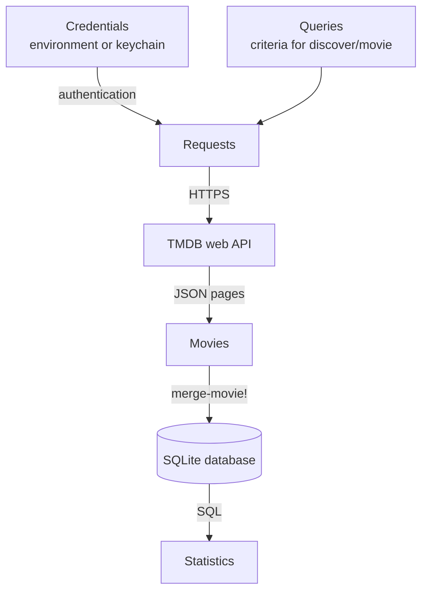
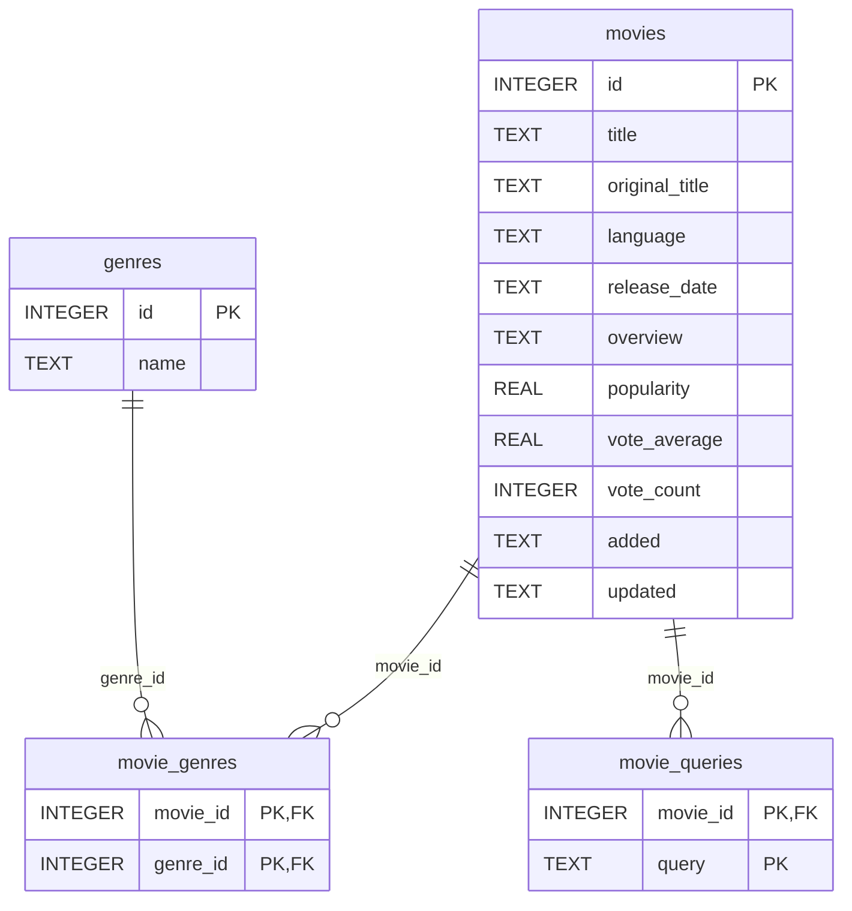
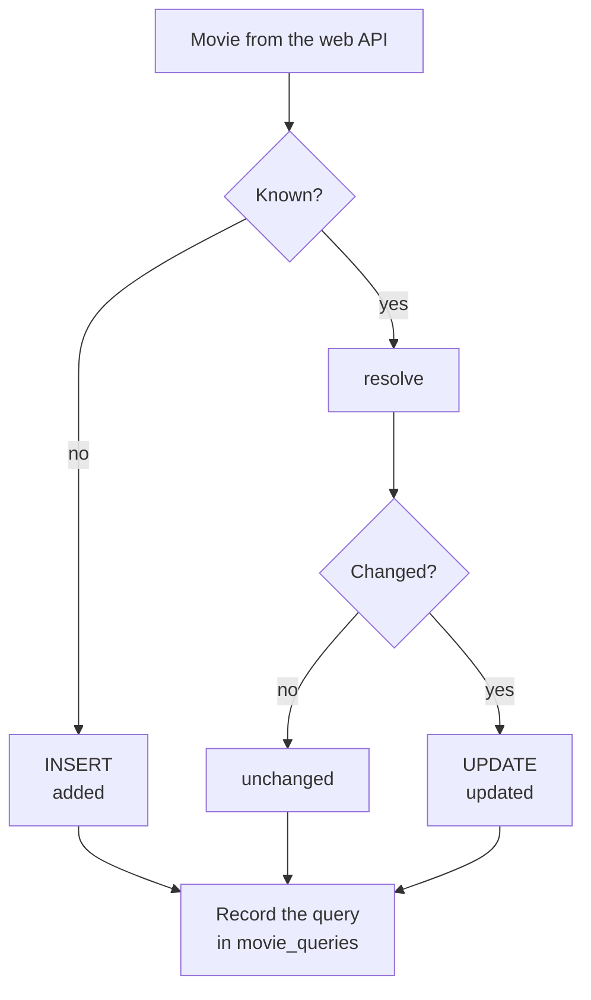
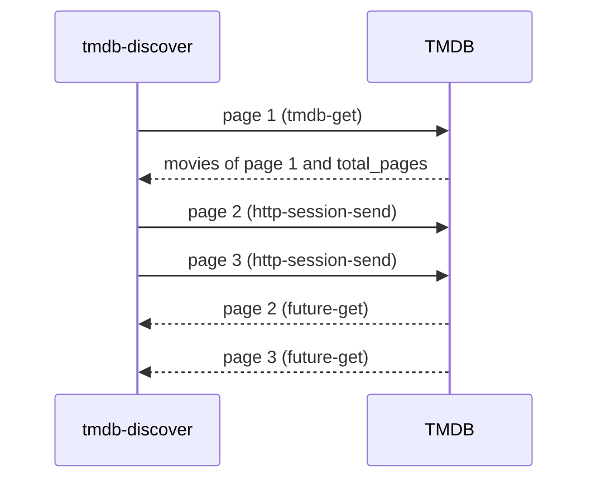

# Movies

A web API answers a question for the moment, and a database remembers the answers. This example connects the two. The program asks the web API of The Movie Database (TMDB) for movies, for instance for all English-language thrillers released in 2025, and keeps them in a local SQLite database. Several queries with different criteria overlap, and the program can run again and again, so the same movie arrives many times, sometimes in a slightly different version. The program merges every version into the database: each movie is stored once, new movies are added, and movies whose data changed are updated. In the end, SQL queries compute statistics about the collection. The credentials for the web API are not part of the program; they come from environment variables or from the system keychain.

:::info

**Program:** [`Movies.scm`](https://github.com/objecthub/swift-lispkit/blob/master/Sources/LispKit/Resources/Examples/Movies.scm), in the `Examples` folder of LispKit\
**Libraries:** `(lispkit base)`, `(lispkit http)`, `(lispkit url)`, `(lispkit json)`, `(lispkit sqlite)`, `(lispkit system keychain)`, `(lispkit text-table)`, `(lispkit thread)`, and `(lispkit thread future)`\
**Techniques:** authenticated web API requests, concurrent requests with futures, JSON, SQLite, transactions and upserts, merging data from several sources, SQL aggregation, credentials in the system keychain\
**Requires:** an Internet connection and a free TMDB account for an API read access token or an API key\
**Notice:** This product uses the TMDB API but is not endorsed or certified by TMDB.

:::

## What the program does

The program runs four queries against the `discover/movie` endpoint of the web API, each of them for the first three result pages, which are 60 movies:

| Query | Criteria |
| --- | --- |
| `english-thrillers` | English-language thrillers released in 2025, most popular first |
| `english-horror` | English-language horror movies released in 2025, most popular first |
| `mystery-or-thriller` | movies in any language released in 2025 that are mysteries or thrillers, most popular first |
| `thriller-classics` | thrillers of all times with at least 5000 votes, best rated first |

The first three queries overlap on purpose: a movie that is a horror thriller is found by two of them. The program merges the movies of each query into the database and tells how many were added, updated, or unchanged. Then it queries the database for statistics. This is the beginning of the output of a first run with an empty database:

```
Database ~/Documents/Movies.sqlite with 0 movies
Running query english-thrillers: English-language thrillers released in 2025
Running query english-horror: English-language horror movies released in 2025
Running query mystery-or-thriller: Mystery or thriller movies in any language released in 2025
Running query thriller-classics: Thrillers of all times with many votes, best rated first

Merged queries
┌─────────────────────┬──────────┬───────┬─────────┬───────────┐
│        Query        │ Returned │ Added │ Updated │ Unchanged │
┝━━━━━━━━━━━━━━━━━━━━━┿━━━━━━━━━━┿━━━━━━━┿━━━━━━━━━┿━━━━━━━━━━━┥
│ english-thrillers   │       60 │    60 │       0 │         0 │
│ english-horror      │       60 │    44 │       0 │        16 │
│ mystery-or-thriller │       60 │    13 │       4 │        43 │
│ thriller-classics   │       60 │    60 │       0 │         0 │
└─────────────────────┴──────────┴───────┴─────────┴───────────┘
```

The first query adds all 60 movies. Of the 60 movies of the second query, 16 are in the database already, because they are horror thrillers. The 4 updates of the third query are movies that were stored before, with a slightly different number of votes: _Weapons_ was stored with 4183 votes, for example, and arrived with 4186. The section about merging explains where such differences come from. The program can run again at any time. A second run has nothing to add, because the database knows everything already:

```
Database ~/Documents/Movies.sqlite with 177 movies
Running query english-thrillers: English-language thrillers released in 2025
Running query english-horror: English-language horror movies released in 2025
Running query mystery-or-thriller: Mystery or thriller movies in any language released in 2025
Running query thriller-classics: Thrillers of all times with many votes, best rated first

Merged queries
┌─────────────────────┬──────────┬───────┬─────────┬───────────┐
│        Query        │ Returned │ Added │ Updated │ Unchanged │
┝━━━━━━━━━━━━━━━━━━━━━┿━━━━━━━━━━┿━━━━━━━┿━━━━━━━━━┿━━━━━━━━━━━┥
│ english-thrillers   │       60 │     0 │       0 │        60 │
│ english-horror      │       60 │     0 │       0 │        60 │
│ mystery-or-thriller │       60 │     0 │       0 │        60 │
│ thriller-classics   │       60 │     0 │       0 │        60 │
└─────────────────────┴──────────┴───────┴─────────┴───────────┘
```

The movies of TMDB change from day to day, and so will the numbers on this page. Further below, the walkthrough shows every table of statistics.

## Running the program

Build LispKit from a clone of the [GitHub repository](https://github.com/objecthub/swift-lispkit) and run the program with the LispKit REPL. The program needs credentials for the web API of TMDB. Create a free account at [themoviedb.org](https://www.themoviedb.org/) and request access to the API in the settings of your account (the page is [themoviedb.org/settings/api](https://www.themoviedb.org/settings/api)). TMDB shows two credentials, which both work: an _API read access token_, a long string that the program sends in an HTTP header, and an _API key_, a short string that the program sends as a parameter of the request. Pass one or both to the program via environment variables:

```
swift build -c release -Xswiftc "-D" -Xswiftc "SPM"
export TMDB_ACCESS_TOKEN="<your API read access token>"
.build/release/LispKitRepl -r Sources/LispKit/Resources -d LispKit \
    Sources/LispKit/Resources/Examples/Movies.scm
```

The program creates the database `~/Documents/Movies.sqlite`. To use another database, pass its path as an argument. The tables of the database are created if they do not exist, and the movies are merged into the existing data:

```
.build/release/LispKitRepl -r Sources/LispKit/Resources -d LispKit \
    Sources/LispKit/Resources/Examples/Movies.scm ~/Desktop/Thrillers.sqlite
```

You can open the database with any SQLite client, for instance with `sqlite3 ~/Documents/Movies.sqlite` in a terminal.

**Credentials in the keychain.** Environment variables are inconvenient, and they are visible to other programs. The program can keep the credentials in the system keychain instead. Run it once with the argument `store-credentials` while the environment variables are set:

```
.build/release/LispKitRepl -r Sources/LispKit/Resources -d LispKit \
    Sources/LispKit/Resources/Examples/Movies.scm store-credentials
```

```
stored TMDB API read access token in the keychain
stored TMDB API key in the keychain
```

After that, the environment variables are no longer needed. If both are set, the environment variables take precedence over the keychain. The argument `forget-credentials` removes the credentials from the keychain again:

```
removed TMDB API read access token from the keychain
removed TMDB API key from the keychain
```

**Credentials in a REPL.** The program can also be loaded into a REPL with the option `-p`, which keeps the REPL open afterwards. If the program complains about missing credentials, pass them as strings to `store-credentials!`, and then call `main` to run the program again:

```
.build/release/LispKitRepl -r Sources/LispKit/Resources -d LispKit \
    -p Sources/LispKit/Resources/Examples/Movies.scm
```

```scheme
(store-credentials! "<your API read access token>" "<your API key>")
(main)
```

The arguments of `store-credentials!` are the access token and the API key, in this order. An argument that is `#f` or missing leaves out that credential, so `(store-credentials! #f "<your API key>")` stores just the API key. Without any string argument, `store-credentials!` copies the environment variables, like the command line argument `store-credentials`. `main` takes the arguments of the command line as an optional list; without it, the program uses the default database, and `(main '("Thrillers.sqlite"))` uses another one.

Without credentials, the program explains what to do and ends:

```
No TMDB credentials found. Set the environment variables TMDB_ACCESS_TOKEN
and/or TMDB_API_KEY. Run this program with the argument store-credentials
to keep them in the keychain.
```

If TMDB rejects the credentials, the program ends with an error. A wrong API key, for example, results in:

```
[error] TMDB request failed with status 401 ("unauthorized")
```

## How it works in a nutshell

The program is a pipeline. The queries are data: each one is a list of parameters for the web API. For every query, the program sends requests, converts the answers into movies, and merges them into the database. The merge is the heart of the program. Statistics are plain SQL queries over the merged data.



## Libraries

| Library | What the program uses it for |
| --- | --- |
| [`(lispkit base)`](../../libraries/lispkit/lispkit-base.md) | the language: `guard`, `parameterize`, `append-map`, `iota`, `sort`, `display*`, `thunk`, `get-environment-variable`, and `command-line` |
| [`(lispkit thread)`](../../libraries/lispkit/lispkit-thread.md) | `thread-sleep!`, which waits before a failed request is repeated |
| [`(lispkit thread future)`](../../libraries/lispkit/lispkit-thread-future.md) | `future-get`, which returns the response of a request |
| [`(lispkit http)`](../../libraries/lispkit/lispkit-http.md) | requests and responses: `make-http-request`, `http-session-send`, `http-response-status-code`, `http-response-content`, and `http-status-code->string` |
| [`(lispkit url)`](../../libraries/lispkit/lispkit-url.md) | `url`, which builds a URL from its parts and encodes the query parameters |
| [`(lispkit json)`](../../libraries/lispkit/lispkit-json.md) | the responses of the web API as JSON values: `bytevector->json`, `json-ref`, `json-children`, `json->value`, and `json-null?` |
| [`(lispkit sqlite)`](../../libraries/lispkit/lispkit-sqlite.md) | the database: `open-database`, `close-database`, `prepare-statement`, `bind-parameters`, `process-statement`, and `row-values` |
| [`(lispkit text-table)`](../../libraries/lispkit/lispkit-text-table.md) | the tables of the statistics: `make-text-table`, `add-text-table-row!`, and `text-table->string` |
| [`(lispkit system keychain)`](../../libraries/lispkit/lispkit-system-keychain.md) | the credentials: `make-keychain`, `keychain-ref-string`, `keychain-set-string!`, `keychain-exists?`, and `keychain-remove!` |

## Design

### The web API

The web API of TMDB (version 3) is a REST API. The program uses two of its endpoints. Both answer with JSON.

| Endpoint | Answer |
| --- | --- |
| `genre/movie/list` | `{"genres": [{"id": 28, "name": "Action"}, ...]}`: the identifiers and names of all genres |
| `discover/movie` | `{"page": 1, "results": [...], "total_pages": 14, "total_results": 278}`: one page of 20 movies that match the criteria that are passed as parameters |

The criteria of the `discover/movie` endpoint are query parameters of the request. The program uses these:

| Parameter | Meaning |
| --- | --- |
| `with_genres` | genre identifiers; `,` means _and_ and `\|` means _or_ (the program sends 53 for thrillers, 27 for horror, and 9648 for mysteries) |
| `with_original_language` | the language in which the movie was made, e.g. `en` |
| `primary_release_year` | the year of the first release |
| `vote_count.gte` | the minimum number of votes |
| `sort_by` | the order of the results, e.g. `popularity.desc` or `vote_average.desc` |
| `include_adult`, `language`, `page` | no adult content, the language of titles and descriptions, and the number of the page; the program sets them for every request |

A movie in a result page is a JSON object. This is what the first movie of the query `thriller-classics` looks like. The program only uses the members `id`, `title`, `original_title`, `original_language`, `release_date`, `overview`, `popularity`, `vote_average`, `vote_count`, and `genre_ids`; the description is shortened here:

```
{"id": 155, "title": "The Dark Knight", "original_title": "The Dark Knight",
 "original_language": "en", "release_date": "2008-07-16", "overview": "...",
 "genre_ids": [28, 53, 80], "popularity": 66.6897, "vote_average": 8.5,
 "vote_count": 37079, "adult": false, "video": false,
 "backdrop_path": "/9FE5eD92WfVCiivM9Pq9GVSrlWk.jpg",
 "poster_path": "/qJ2tW6WMUDux911r6m7haRef0WH.jpg", ...}
```

Requests have to be authenticated. An API read access token goes into an HTTP header, `Authorization: Bearer <token>`, and an API key goes into the URL as the parameter `api_key`. TMDB answers an invalid credential with the status 401, and it limits the rate of requests (status 429). Responses are served from a cache, which the header `cache-control` of the responses announces: `public, max-age=22458` is a validity of more than six hours.

That cache has a consequence for the program. The movies of different queries are different snapshots. If the same movie is returned by two queries, its number of votes can differ by one, because the cache entries were filled at different times. The merge has to cope with such differences.

### The database

The database has four tables. A movie is identified by its TMDB identifier, which is the primary key of the table `movies`. A movie has several genres, and a genre belongs to several movies, which is why the table `movie_genres` connects the two. The table `movie_queries` records which query found which movie.



A few decisions are worth noting:

* The identifier of TMDB is the key. The program does not generate keys. The same movie is the same row, no matter which query found it or how often.
* Missing values are `NULL`. LispKit represents `NULL` as the empty list `()`, and the program represents a JSON `null` or a missing member the same way, so values flow between the API and the database unchanged.
* `added` and `updated` are timestamps that SQLite sets (`CURRENT_TIMESTAMP`, in UTC). `added` is set when a movie enters the database and never changes. `updated` records the last change.
* The program enables foreign keys (`PRAGMA foreign_keys = ON`), because SQLite does not enforce them by default. A movie with a genre that is not in `genres` would therefore not be inserted, and when a movie is deleted, its genres and queries are deleted with it (`ON DELETE CASCADE`).
* Dates are stored as text in the format `2025-03-17`. Such strings sort correctly, and SQLite's date functions understand them.

### Merging

The same movie arrives more than once, within a run and across runs. The program therefore does not just insert movies. For every movie it decides what to do, and the result is one of three words. A movie that is not in the database is _added_. A movie that is known is merged with the stored version. If the merge changes something, the movie is _updated_, and otherwise it is _unchanged_. In either case, the program records that the query found the movie.



The merge of a known movie follows a policy for each kind of data:

| Data | Policy | Reason |
| --- | --- | --- |
| title, original title, language, release date, overview | the new value, unless it is missing or empty | a gap in the answer of the web API must not erase what is known |
| popularity, rating, number of votes | the version with more votes, the new one if the numbers are equal | votes only accumulate, so the version with more votes is the more recent one |
| genres | replaced by the new set, unless the new set is empty | the genres of a movie describe the movie as a whole |
| queries that found the movie | added to the set | the set only grows |
| `added` | never changed | it tells when the movie entered the collection |

Why not use `INSERT OR REPLACE`? It would delete the stored row and write the new one. Missing members in a new version would erase data, a stale version from the cache would replace a newer one, `added` would be reset, and the program could not tell whether a movie changed. The policy above avoids all of this.

Every query is merged in a single transaction. If anything fails while a query is merged, the transaction is rolled back and the database keeps the state it had before the query. The requests for a query are finished before the transaction begins, so the database is not locked while the program waits for the network.

The policy makes the program _idempotent_: running it again and again with the same answers from the web API changes nothing. This is what the second run above shows.

### Requests

The pages of one query could be requested one after another, but the program does not need to wait. A result page tells how many pages there are, so the program requests the first page and waits for it. Then it sends the requests for the remaining pages at the same time. `http-session-send` returns a _future_ immediately, and `future-get` waits for the response.



A request that fails because of the rate limit (429) or a problem of the server (5xx) is repeated up to twice, after waiting one and two seconds. Any other status ends the program with an error that names the status.

### Credentials

Where do the credentials come from? The program looks at two places, in this order:

| Order | Source | Use |
| --- | --- | --- |
| 1 | environment variables `TMDB_ACCESS_TOKEN` and `TMDB_API_KEY` | quick tests, scripts, and for storing the credentials in the keychain |
| 2 | system keychain, service `TMDB`, keys `access-token` and `api-key` | everyday use; the credentials are encrypted and not visible in the environment |

If an access token is available, the program sends it as a bearer token. Otherwise, it uses the API key. Source code never contains a credential, and neither does the database.

### The main ideas

**Identity decides.** The key of TMDB turns an uncontrolled stream of answers into a collection without duplicates. Everything else follows from asking _is this movie known?_

**Merge by policy, not by overwriting.** For each kind of data, there is a rule that says which version wins. The rules are in one place, the table `column-kinds` and the procedure `resolve`, and they are easy to change.

**Fetch first, write second.** All requests of a query finish before the transaction begins, and the transaction either writes everything or nothing.

**Data instead of code.** Queries are lists of parameters. SQL statements are strings, with values passed as parameters instead of being pasted into the text. Rows are lists. A new query is a new list.

**Let SQL do the statistics.** Counting, grouping, joining, and averaging are what a database is good at. The program asks the questions and formats the answers.

**Secrets stay out of the code.** The keychain keeps the credentials outside of the source and outside of the database.

## Walkthrough

The following sections go through the program from top to bottom. Together, the code blocks make up the complete source of `Movies.scm`.

### Header and imports

<details>

<summary>Description, credits, and license</summary>

```scheme
;;; Collect movies from a web API in a local SQLite database
;;;
;;; This program retrieves movies from the web API of The Movie Database
;;; (TMDB) and merges them into a local SQLite database. It runs several
;;; queries with different criteria, e.g. all English-language thrillers
;;; released in 2025. The queries overlap, so the same movie is returned
;;; more than once. The merge identifies movies by their TMDB identifier,
;;; adds movies that are new, updates movies whose data changed, and leaves
;;; everything else untouched. Thus, the program can be run repeatedly: each
;;; run merges the current TMDB data into the same database. Finally, the
;;; program queries the database for statistics, such as the number of
;;; movies, the distribution of genres, and the best rated movies.
;;;
;;; Merging: The same movie can be returned by several queries and by several
;;; runs of the program, and its versions can differ. A movie is identified by
;;; its TMDB identifier, so it is stored only once. Descriptive data of a new
;;; version replaces the existing data unless it is missing. For the statistics
;;; of a movie (popularity, rating, and number of votes), the version with more
;;; votes is kept, since votes only accumulate. The genres of a movie are replaced
;;; by the genres of the new version, and a table records which queries found
;;; which movies. The movies of a query are merged in a single transaction, so
;;; an error does not leave the database in an inconsistent state.
;;;
;;; The program combines the following libraries:
;;;   - `(lispkit http)` sends requests to the web API. Requests are sent
;;;     asynchronously, so the pages of a query are fetched concurrently.
;;;   - `(lispkit json)` represents and inspects the responses of the API.
;;;   - `(lispkit sqlite)` creates the database, merges the movies in
;;;     transactions, and answers the queries for the statistics.
;;;   - `(lispkit system keychain)` keeps the credentials for the web API in
;;;     the system keychain, so they do not need to be part of the code.
;;;   - `(lispkit text-table)` formats the statistics as text tables.
;;;
;;; Credentials: TMDB requires an _API read access token_ or an _API key_,
;;; which are available for free in the account settings at themoviedb.org.
;;; The program reads them from the environment variables `TMDB_ACCESS_TOKEN`
;;; and `TMDB_API_KEY`, or else from the keychain. To store the credentials
;;; of the environment variables in the keychain, run the program once with
;;; the argument `store-credentials`. The variables are not needed after that.
;;; With the argument `forget-credentials`, the credentials are removed from
;;; the keychain again. In a REPL that loaded the program, the call
;;; `(store-credentials! <access token> <API key>)` stores the credentials that are
;;; given as strings, and `(main)` runs the program again.
;;;
;;; Usage: Movies.scm [<database> | store-credentials | forget-credentials]
;;; The default database is `~/Documents/Movies.sqlite`.
;;;
;;; This product uses the TMDB API but is not endorsed or certified by TMDB.
;;;
;;; Author: Matthias Zenger
;;; Copyright © 2026 Matthias Zenger. All rights reserved.
;;;
;;; Licensed under the Apache License, Version 2.0 (the "License"); you may
;;; not use this file except in compliance with the License. You may obtain
;;; a copy of the License at
;;;
;;;   http://www.apache.org/licenses/LICENSE-2.0
;;;
;;; Unless required by applicable law or agreed to in writing, software
;;; distributed under the License is distributed on an "AS IS" BASIS,
;;; WITHOUT WARRANTIES OR CONDITIONS OF ANY KIND, either express or implied.
;;; See the License for the specific language governing permissions and
;;; limitations under the License.
```

</details>

The program imports the libraries that were listed above. `(lispkit thread)` and `(lispkit thread future)` provide `thread-sleep!` and `future-get`.

```scheme
(import (lispkit base)
        (lispkit thread)
        (lispkit thread future)
        (lispkit http)
        (lispkit url)
        (lispkit json)
        (lispkit sqlite)
        (lispkit text-table)
        (lispkit system keychain))
```

### Settings

The database is located in the documents folder of the user, `~` stands for the home directory. A query is limited to three pages of 20 movies. Raising `max-pages` collects more movies per query, at the price of more requests.

```scheme
;;; Settings

;; The default location of the database
(define default-database "~/Documents/Movies.sqlite")

;; The maximum number of result pages (20 movies each) fetched for a query
(define max-pages 3)
```

The queries are a list. Each entry has a name, a description, and the list of parameters for the `discover/movie` endpoint, which is an association list from names to values. The name is stored in the database, the description is printed while the program runs. `9648|53` selects movies that are in the genre _Mystery_ or in the genre _Thriller_, whereas a comma would require both. The first three queries overlap on purpose, and the fourth one reaches back to all times.

```scheme
;; The queries. Each query has a name, a description, and the parameters of a
;; request for TMDB's `discover/movie` endpoint. The parameters select genres
;; (53 = Thriller, 27 = Horror, 9648 = Mystery; `|` means "or"), the original
;; language, the release year, the minimum number of votes, and the sort order.
;; The first three queries overlap on purpose.
(define queries
  '(("english-thrillers"
     "English-language thrillers released in 2025"
     (("with_genres" . "53") ("with_original_language" . "en")
      ("primary_release_year" . "2025") ("sort_by" . "popularity.desc")))
    ("english-horror"
     "English-language horror movies released in 2025"
     (("with_genres" . "27") ("with_original_language" . "en")
      ("primary_release_year" . "2025") ("sort_by" . "popularity.desc")))
    ("mystery-or-thriller"
     "Mystery or thriller movies in any language released in 2025"
     (("with_genres" . "9648|53") ("primary_release_year" . "2025")
      ("sort_by" . "popularity.desc")))
    ("thriller-classics"
     "Thrillers of all times with many votes, best rated first"
     (("with_genres" . "53") ("vote_count.gte" . "5000")
      ("sort_by" . "vote_average.desc")))))
```

### Credentials

The keychain client is created for the service name `TMDB`; all items of the program live under this name. `credentials` lists, for each credential, its key in the keychain, the environment variable, and a label for messages.

```scheme
;;; Credentials

;; The keychain service under which the credentials are stored, and for each
;; credential its key, the environment variable, and a label.
(define keychain (make-keychain "TMDB"))

(define credentials
  '(("access-token" "TMDB_ACCESS_TOKEN" "TMDB API read access token")
    ("api-key" "TMDB_API_KEY" "TMDB API key")))
```

`credential` returns the value of a credential. `(or a b)` makes the order explicit: an environment variable wins, and the keychain is only asked if the variable is not set. `keychain-ref-string` returns `#f` for an item that does not exist.

```scheme
;; Returns the value of a credential: an environment variable overrides the
;; keychain. The result is `#f` if the credential is unknown.
(define (credential key)
  (let ((entry (assoc key credentials)))
    (or (get-environment-variable (cadr entry))
        (keychain-ref-string keychain key))))
```

`store-credentials!` stores credentials in the keychain. Its optional arguments are the access token and the API key, in the order of `credentials`. `let-optionals` binds them to `token` and `key`, which are `#f` if they are missing. If at least one of them is a string, the program stores exactly the credentials that were given as strings. Otherwise, it stores the values of the environment variables, which is what the command line argument `store-credentials` does. `for-each` goes through `credentials` and the list of arguments in parallel. The program counts the stored credentials, so that it can tell the user when there was nothing to store. `keychain-set-string!` creates the item or overwrites it. The last argument is a label that the keychain shows in its user interface.

```scheme
;; Stores credentials in the keychain. The optional arguments are the access token
;; and the API key, in the order of `credentials`. If at least one of them is a
;; string, the credentials given as strings are stored. Otherwise, the values of the
;; environment variables are stored.
(define (store-credentials! . args)
  (let-optionals args ((token #f) (key #f))
    (let ((given? (or (string? token) (string? key)))
          (count 0))
      (for-each (lambda (entry arg)
                  (let ((value (if given?
                                   (and (string? arg) arg)
                                   (get-environment-variable (cadr entry)))))
                    (when value
                      (keychain-set-string! keychain (car entry) value (caddr entry))
                      (set! count (+ count 1))
                      (display* "stored " (caddr entry) " in the keychain\n"))))
                credentials
                (list token key))
      (when (= count 0)
        (display* "nothing to store; set TMDB_ACCESS_TOKEN or TMDB_API_KEY\n")))))
```

`forget-credentials!` removes the items, each only if it exists.

```scheme
;; Removes the credentials from the keychain
(define (forget-credentials!)
  (for-each (lambda (entry)
              (when (keychain-exists? keychain (car entry))
                (keychain-remove! keychain (car entry))
                (display* "removed " (caddr entry) " from the keychain\n")))
            credentials))
```

`authentication` decides which credential is used for the requests, and what the result looks like: a pair of the symbol `token` or `key` and the credential, or `#f` if there is nothing. An access token is preferred.

```scheme
;; Returns the credential for authenticating requests as a pair of either `token`
;; or `key` and the credential, or `#f` if there is none. The access token is
;; preferred.
(define (authentication)
  (let ((token (credential "access-token")))
    (if token
        (cons 'token token)
        (let ((key (credential "api-key")))
          (and key (cons 'key key))))))
```

### Accessing the web API

`tmdb-auth` is a parameter object that holds the result of `authentication`. `main` binds it with `parameterize` while the program runs, so the procedures that send requests do not need an additional argument.

```scheme
;;; Accessing the web API

;; The credential used for authenticating requests, as returned by `authentication`.
;; It is bound by `main` while the program runs.
(define tmdb-auth (make-parameter #f))
```

`tmdb-request` builds a request for a path of the API and a list of parameters. The `url` procedure assembles the URL from its scheme, host, path, and query parameters, and it encodes the parameters. The `|` of `9648|53`, for instance, becomes `%7C`. An access token is sent in the header `Authorization`, and an API key is added as one more parameter.

```scheme
;; Returns a request for the given path of the web API with the given query
;; parameters. An access token is sent as a bearer token in the HTTP header
;; and an API key as a query parameter.
(define (tmdb-request path params)
  (let ((auth (tmdb-auth))
        (headers '(("Accept" . "application/json"))))
    (if (eq? (car auth) 'token)
        (make-http-request
          (url "https" "api.themoviedb.org" (string-append "/3/" path) params)
          "GET"
          (cons (cons "Authorization" (string-append "Bearer " (cdr auth))) headers))
        (make-http-request
          (url "https" "api.themoviedb.org" (string-append "/3/" path)
               (cons (cons "api_key" (cdr auth)) params))
          "GET"
          headers))))
```

```scheme
(url "https" "api.themoviedb.org" "/3/discover/movie" '(("with_genres" . "9648|53") ("page" . "1")))
  ; ⇒ "https://api.themoviedb.org/3/discover/movie?with_genres=9648%7C53&page=1"
```

`tmdb-await` takes a request and the future that was returned when it was sent. `future-get` waits for the response. If the status is 200, the body, a bytevector with JSON text, is parsed into a JSON value. A response with the status 429 or 5xx is tried again up to twice: the named `let` called `retry` sleeps for a growing number of seconds, sends the request again, and waits for the new response. Every other response ends the program with an error. The `$0` and `$1` in the message are replaced by the irritants `status` and the name of the status.

```scheme
;; Waits for the response to `request` that is delivered by `future` and returns
;; its body as a JSON value. Requests that were rejected because of the rate limit
;; or because of a problem with the server are repeated twice.
(define (tmdb-await request future)
  (let retry ((response (future-get future)) (attempt 1))
    (let ((status (http-response-status-code response)))
      (cond ((= status 200)
             (bytevector->json (http-response-content response)))
            ((and (< attempt 3) (or (= status 429) (>= status 500)))
             (thread-sleep! attempt)
             (retry (future-get (http-session-send request)) (+ attempt 1)))
            (else
             (error "TMDB request failed with status $0 ($1)"
                    status
                    (http-status-code->string status)))))))
```

`tmdb-get` is the simple case for a single request: send it and wait for the answer.

```scheme
;; Sends a request and waits for the response
(define (tmdb-get path params)
  (let ((request (tmdb-request path params)))
    (tmdb-await request (http-session-send request))))
```

`tmdb-genres` requests the list of genres and returns it as an association list from identifiers to names, such as `((28 . "Action") (12 . "Adventure") ...)`.

```scheme
;; Returns the genres of movies as an association list from identifiers to names
(define (tmdb-genres)
  (map (lambda (genre) (cons (json-ref/value genre 'id) (json-ref/value genre 'name)))
       (json-children (json-ref (tmdb-get "genre/movie/list" '(("language" . "en"))) 'genres))))
```

`tmdb-discover` runs a query and returns its movies as a list of JSON objects. The inner procedure `page-params` appends the fixed parameters and the number of the page to the parameters of the query. The first page is requested and awaited, because it knows the number of pages: `total_pages`. The program fetches `max-pages` of them or fewer. The requests for the remaining pages are created, sent all at once with `(map http-session-send requests)`, and then awaited. `iota` counts the page numbers, starting with 2, and `(max 0 ...)` protects against queries that have only one page. `append-map` joins the movies of the pages.

```scheme
;; Runs a query and returns the movies of its first `max-pages` result pages as
;; a list of JSON objects. The first page tells how many pages there are. The
;; other pages are requested all at once and arrive concurrently.
(define (tmdb-discover params)
  (define (page-params n)
    (append params `(("include_adult" . "false") ("language" . "en-US")
                     ("page" . ,(number->string n)))))
  (let* ((page1 (tmdb-get "discover/movie" (page-params 1)))
         (last-page (min max-pages (json-ref/value page1 'total_pages)))
         (requests (map (lambda (n) (tmdb-request "discover/movie" (page-params n)))
                        (iota (max 0 (- last-page 1)) 2)))
         (futures (map http-session-send requests))
         (pages (cons page1 (map tmdb-await requests futures))))
    (append-map (lambda (page) (json-children (json-ref page 'results))) pages)))
```

`json-ref/value` returns a member of a JSON object as a Scheme value. A member that is missing or `null` becomes `()`, the value that SQLite uses for `NULL`, and all other values are converted by `json->value`:

```scheme
;; Returns the Scheme value of member `key` of JSON object `obj`; JSON `null`
;; and missing members are represented by `()`, which is also SQL's NULL.
(define (json-ref/value obj key)
  (let ((value (json-ref obj key)))
    (if (or (not value) (json-null? value)) '() (json->value value))))
```

```scheme
(define sample (string->json "{\"a\": null, \"b\": 7}"))

(json-ref/value sample 'a)   ; ⇒ ()
(json-ref/value sample 'b)   ; ⇒ 7
(json-ref/value sample 'c)   ; ⇒ ()
```

### Managing the database

Strings in LispKit cannot span several lines, so a long SQL statement is written as a sequence of strings, one for each line. `sql` joins them with spaces. The statements of the program all use this notation.

```scheme
;;; Managing the database

;; Combines the lines of an SQL statement. Since string literals cannot span
;; several lines, statements are written as a sequence of strings.
(define (sql . lines)
  (apply string-append (map (lambda (line) (string-append line " ")) lines)))
```

```scheme
(sql "SELECT * FROM movies" "WHERE id = ?")
  ; ⇒ "SELECT * FROM movies WHERE id = ? "
```

The schema consists of four statements. `CREATE TABLE IF NOT EXISTS` makes it safe to run them every time the program starts. Genres and movies are in a many-to-many relation, and `movie_queries` records which query found which movie. The foreign keys connect the tables, and `ON DELETE CASCADE` removes the dependent rows of a deleted movie.

```scheme
;; The tables of the database. Genres and movies are in a many-to-many relation.
;; The table `movie_queries` records which queries found which movies.
(define schema
  (list
    (sql "CREATE TABLE IF NOT EXISTS genres ("
         "  id INTEGER PRIMARY KEY,"
         "  name TEXT NOT NULL)")
    (sql "CREATE TABLE IF NOT EXISTS movies ("
         "  id INTEGER PRIMARY KEY,"
         "  title TEXT NOT NULL,"
         "  original_title TEXT,"
         "  language TEXT,"
         "  release_date TEXT,"
         "  overview TEXT,"
         "  popularity REAL,"
         "  vote_average REAL,"
         "  vote_count INTEGER,"
         "  added TEXT NOT NULL,"
         "  updated TEXT NOT NULL)")
    (sql "CREATE TABLE IF NOT EXISTS movie_genres ("
         "  movie_id INTEGER NOT NULL REFERENCES movies(id) ON DELETE CASCADE,"
         "  genre_id INTEGER NOT NULL REFERENCES genres(id),"
         "  PRIMARY KEY (movie_id, genre_id))")
    (sql "CREATE TABLE IF NOT EXISTS movie_queries ("
         "  movie_id INTEGER NOT NULL REFERENCES movies(id) ON DELETE CASCADE,"
         "  query TEXT NOT NULL,"
         "  PRIMARY KEY (movie_id, query))")))
```

The next procedures are the interface to the database. `execute!` compiles a statement with `prepare-statement`, fills its `?` placeholders with the values of the list `args` via `bind-parameters`, runs it with `process-statement`, and ignores the results. Values are never pasted into the text of a statement, which keeps the program safe from SQL injection and takes care of quotes in titles like _Ocean's Eleven_. For a query, `process-statement` returns `#f` as long as there is a row that can be read, and `#t` when all rows have been processed.

```scheme
;; Executes an SQL statement with the given parameters, ignoring its results
(define (execute! db sql . args)
  (let ((stmt (prepare-statement db sql)))
    (bind-parameters stmt args)
    (process-statement stmt)
    (void)))
```

`query` collects all rows of a query into a list. Every row is a list of column values, obtained by `row-values`. `query-row` returns the first row or `#f`, and `query-value` the first value of the first row, which suits queries like `SELECT COUNT(*)`.

```scheme
;; Executes an SQL query with the given parameters and returns its results as a
;; list of rows, each of which is a list of column values
(define (query db sql . args)
  (let ((stmt (prepare-statement db sql)))
    (bind-parameters stmt args)
    (let loop ((rows '()))
      (if (process-statement stmt)
          (reverse rows)
          (loop (cons (row-values stmt) rows))))))
```

```scheme
;; Returns the first row of the results of an SQL query, or `#f` if there is none
(define (query-row db sql . args)
  (let ((rows (apply query db sql args)))
    (and (pair? rows) (car rows))))
```

```scheme
;; Returns the first column of the first row of the results of an SQL query
(define (query-value db sql . args)
  (car (apply query-row db sql args)))
```

```scheme
(define demo (open-movie-database ":memory:"))

(query demo "SELECT 6 * 7")                  ; ⇒ ((42))
(query-row demo "SELECT 1 WHERE 0")          ; ⇒ #f
(query-value demo "SELECT COUNT(*) FROM movies")  ; ⇒ 0
```

`call-with-transaction` executes the procedure `proc` between `BEGIN` and `COMMIT`. If `proc` raises an error, the `guard` rolls the transaction back and raises the error again, so that the caller still sees it. `(guard (condition (#t ...)) ...)` catches everything, which is fine here, since the error is not handled but passed on.

```scheme
;; Runs `proc` in a transaction. Either all changes of `proc` are written to the
;; database, or none of them if `proc` raises an error.
(define (call-with-transaction db proc)
  (execute! db "BEGIN")
  (guard (condition (#t (execute! db "ROLLBACK") (raise condition)))
    (let ((result (proc)))
      (execute! db "COMMIT")
      result)))
```

A failed transaction leaves no traces. In the following test, a genre is inserted, and then an error occurs. The `guard` of the test catches the error, and the genre is not in the table:

```scheme
(guard (condition (#t 'failed))
  (call-with-transaction demo
    (thunk (execute! demo "INSERT INTO genres (id, name) VALUES (1, 'Drama')")
           (error "something went wrong"))))
  ; ⇒ failed
(query-value demo "SELECT COUNT(*) FROM genres")
  ; ⇒ 0
```

`open-movie-database` opens the file, which creates it if it does not exist, switches on the foreign keys, and creates the tables.

```scheme
;; Opens the database at `path`, creating it with all tables if necessary
(define (open-movie-database path)
  (let ((db (open-database path)))
    (execute! db "PRAGMA foreign_keys = ON")
    (for-each (lambda (sql) (execute! db sql)) schema)
    db))
```

### Merging data into the database

Genres are merged first, because the movies refer to them. This is a plain _upsert_: `ON CONFLICT(id) DO UPDATE` inserts a genre, or updates the name of the genre that has this identifier already.

```scheme
;;; Merging data into the database

;; Merges genres, given as an association list from identifiers to names. This is
;; a plain "upsert": a genre is inserted, or the name of an existing genre is updated.
(define (merge-genres! db genres)
  (call-with-transaction db
    (thunk
      (for-each (lambda (genre)
                  (execute! db
                    (sql "INSERT INTO genres (id, name) VALUES (?, ?)"
                         "ON CONFLICT(id) DO UPDATE SET name = excluded.name")
                    (car genre) (cdr genre)))
                genres))))
```

`movie-values` extracts the values of a movie from the JSON object in the order of the columns of the table. Numbers of the columns `popularity` and `vote_average` are converted into floating-point numbers. This is important: the web API sends a rating of 8 as `8`, but SQLite returns a column of type `REAL` as `8.0`. Without the conversion, `equal?` would see the two values as different, and the program would update the movie every time it comes up.

```scheme
;; Returns the values of a movie for the columns `title`, `original_title`,
;; `language`, `release_date`, `overview`, `popularity`, `vote_average`, and
;; `vote_count`. Real numbers are always inexact.
(define (movie-values movie)
  (define (real key)
    (let ((x (json-ref/value movie key))) (if (number? x) (inexact x) x)))
  (list (json-ref/value movie 'title)
        (json-ref/value movie 'original_title)
        (json-ref/value movie 'original_language)
        (json-ref/value movie 'release_date)
        (json-ref/value movie 'overview)
        (real 'popularity)
        (real 'vote_average)
        (json-ref/value movie 'vote_count)))
```

Now the conflict policy. `column-kinds` assigns to each of the eight columns the kind of data: descriptive or statistical. The long comment describes the rules from above.

```scheme
;; Conflict resolution. If a movie is already in the database, its data is merged
;; with the data that was just retrieved. Descriptive columns (title, language,
;; release date, ...) take the new value, unless it is missing: a gap in the data
;; returned by the web API must not erase what is known already. The statistics
;; (popularity, rating, and number of votes) of two versions of a movie can differ,
;; because TMDB serves each query from a cache that was filled at a different time.
;; Votes only accumulate, so the version with more votes is the more recent one.
(define column-kinds '(text text text text text statistics statistics statistics))
```

`resolve` takes the new values and the stored values and returns the merged values. Which version is more recent is decided by the number of votes, the eighth value, which is at index 7. If the new version has no number of votes, the stored statistics stay; if the stored version has none, the new statistics win. Otherwise, the new version wins unless it has fewer votes. `map` goes over the three lists in parallel: descriptive values are taken from the new version unless they are `()` or the empty string, and statistics are taken from the version that is more recent.

```scheme
;; Returns the merged values of a movie, given the new values and the values that
;; are in the database. Both are lists as returned by `movie-values`.
(define (resolve new old)
  (let* ((new-votes (list-ref new 7))
         (old-votes (list-ref old 7))
         (newer? (cond ((null? new-votes) #f)
                       ((null? old-votes) #t)
                       (else (>= new-votes old-votes)))))
    (map (lambda (kind n o)
           (if (eq? kind 'text)
               (if (or (null? n) (equal? n "")) o n)
               (if newer? n o)))
         column-kinds new old)))
```

```scheme
(define heat '("Heat" "Heat" "en" "1995-12-15" "A crew of thieves" 70.0 7.9 1000))

(resolve '("Heat (1995)" () "en" "1995-12-15" "" 75.0 7.8 900) heat)
  ; ⇒ ("Heat (1995)" "Heat" "en" "1995-12-15" "A crew of thieves" 70.0 7.9 1000)
(resolve '("Heat" "Heat" "en" "1995-12-15" "" 75.0 7.95 1200) heat)
  ; ⇒ ("Heat" "Heat" "en" "1995-12-15" "A crew of thieves" 75.0 7.95 1200)
```

In the first merge, the new version has a new title, but no original title and no description, so those stay as they are. The new version has fewer votes, 900 against 1000, and so the stored statistics are kept. The second version has more votes, 1200, and brings new statistics, while the empty description does not erase the stored one.

`set-genres!` replaces the genres of a movie by deleting the old rows and inserting the new ones.

```scheme
;; Replaces the genres of a movie
(define (set-genres! db id genres)
  (execute! db "DELETE FROM movie_genres WHERE movie_id = ?" id)
  (for-each (lambda (genre)
              (execute! db "INSERT INTO movie_genres (movie_id, genre_id) VALUES (?, ?)" id genre))
            genres))
```

`merge-movie!` is the center of the program. It extracts the identifier, the values, and the sorted genres from the JSON object, and then looks up the stored version. If there is none, the movie is inserted with its genres, and the result is `added`. Otherwise, it computes the merged version, and it compares it with the stored one: the merged values must be the same, and the genres must be the same, unless the new version has none. If so, the result is `unchanged`. If not, the movie is updated, the genres are replaced if the new version has some, and the result is `updated`. At the end, the movie is connected to the query. `INSERT OR IGNORE` does nothing if the pair of movie and query is recorded already, which is what keeps the table free of duplicates.

```scheme
;; Merges a movie, given as a JSON object, into the database and records that
;; query `name` found it. The movie is identified by its TMDB identifier. The
;; result is `added` if the movie was not in the database, `updated` if the
;; database changed, and `unchanged` if the database already knew everything.
(define (merge-movie! db name movie)
  (let* ((id (json-ref/value movie 'id))
         (new (movie-values movie))
         (genres (sort < (vector->list (json-ref/value movie 'genre_ids))))
         (old (query-row db
                (sql "SELECT title, original_title, language, release_date, overview,"
                     "       popularity, vote_average, vote_count"
                     "FROM movies WHERE id = ?")
                id))
         (result
           (cond ((not old)
                  (apply execute! db
                    (sql "INSERT INTO movies (title, original_title, language, release_date,"
                         "                    overview, popularity, vote_average, vote_count,"
                         "                    id, added, updated)"
                         "VALUES (?, ?, ?, ?, ?, ?, ?, ?, ?, CURRENT_TIMESTAMP, CURRENT_TIMESTAMP)")
                    (append new (list id)))
                  (set-genres! db id genres)
                  'added)
                 (else
                  (let ((merged (resolve new old))
                        (known (map car (query db
                                          (sql "SELECT genre_id FROM movie_genres"
                                               "WHERE movie_id = ? ORDER BY genre_id")
                                          id))))
                    (cond ((and (equal? merged old)
                                (or (null? genres) (equal? genres known)))
                           'unchanged)
                          (else
                           (apply execute! db
                             (sql "UPDATE movies SET title = ?, original_title = ?, language = ?,"
                                  "                  release_date = ?, overview = ?, popularity = ?,"
                                  "                  vote_average = ?, vote_count = ?,"
                                  "                  updated = CURRENT_TIMESTAMP"
                                  "WHERE id = ?")
                             (append merged (list id)))
                           (unless (null? genres)
                             (set-genres! db id genres))
                           'updated)))))))
    (execute! db "INSERT OR IGNORE INTO movie_queries (movie_id, query) VALUES (?, ?)" id name)
    result))
```

Here is the procedure at work, with the movie _Heat_ as it arrives from a query. The first version is added. The same version again is unchanged. A version with more votes updates the movie, and a stale version with fewer votes and an empty title changes nothing:

```scheme
(define (heat-version title votes)
  (json `((id . 949) (title . ,title) (original_title . "Heat")
          (original_language . "en") (release_date . "1995-12-15")
          (overview . "A crew of thieves") (popularity . 70)
          (vote_average . 7.9) (vote_count . ,votes) (genre_ids . #(53)))))

(merge-genres! demo '((53 . "Thriller")))
(merge-movie! demo "demo" (heat-version "Heat" 1000))         ; ⇒ added
(merge-movie! demo "demo" (heat-version "Heat" 1000))         ; ⇒ unchanged
(merge-movie! demo "demo" (heat-version "Heat (1995)" 1200))  ; ⇒ updated
(merge-movie! demo "demo" (heat-version "" 900))              ; ⇒ unchanged
(query demo "SELECT title, vote_count FROM movies")           ; ⇒ (("Heat (1995)" 1200))
```

`run-query!` fetches the movies of a query and then merges them in one transaction. `tally` counts how many times each result occurred. The result is a row for the summary table: name, number of movies returned, and the numbers of added, updated, and unchanged movies. The movies are fetched before the transaction begins, so the database is only locked while it is written.

```scheme
;; Runs a query against the web API and merges all movies it returns into the
;; database within one transaction. Returns a row for the summary table with the
;; name of the query, the number of movies returned, and how many of them were
;; added, updated, and unchanged.
(define (run-query! db spec)
  (let* ((name (car spec))
         (movies (tmdb-discover (caddr spec)))
         (results (call-with-transaction db
                    (thunk (map (lambda (movie) (merge-movie! db name movie)) movies)))))
    (define (tally kind) (length (filter (lambda (r) (eq? r kind)) results)))
    (list name (length movies) (tally 'added) (tally 'updated) (tally 'unchanged))))
```

### Statistics

`text` turns the values of a table into text, and it writes `()`, which is a `NULL` of the database, as a dash. `with-bars` adds a column with a bar of the character `█` to each row. The bar is up to 30 characters long, proportional to the number in the second column.

```scheme
;;; Statistics

;; Returns the text for a table cell
(define (text x)
  (cond ((string? x) x)
        ((null? x) "-")
        (else (number->string x))))
```

```scheme
;; Appends to each row a bar whose length is proportional to the number in the
;; second column of the row
(define (with-bars rows)
  (let ((peak (apply max 1 (map cadr rows))))
    (map (lambda (row)
           (append row (list (make-string (exact (round (/ (* (cadr row) 30) peak))) #\█))))
         rows)))
```

`print-table` prints a table with a title. The headers are centered, and a column is aligned to the right if the values in the first row are numbers. The tables use `make-text-table`, which takes a list of column specifications, and `add-text-table-row!`.

```scheme
;; Prints a table with a title. `headers` are the names of the columns and `rows`
;; are lists of values. Columns with numbers are aligned to the right.
(define (print-table title headers rows)
  (let ((table (make-text-table
                 (map (lambda (header i)
                        (list header 'center
                              (if (and (pair? rows) (number? (list-ref (car rows) i))) 'right 'left)))
                      headers
                      (iota (length headers))))))
    (for-each (lambda (row) (add-text-table-row! table (map text row))) rows)
    (display* "\n" title "\n" (text-table->string table) "\n")))
```

`print-statistics` asks the database seven questions. The first table collects eight numbers, each from a small query: `COUNT(DISTINCT ...)` counts the genres in use and the languages, `MIN` and `MAX` find the first and the last release date, and the average rating leaves out movies with fewer than 50 votes, since their ratings are unreliable. The number of thrillers counts the rows of `movie_genres` that belong to the genre _Thriller_. The last row counts the movies that are connected to more than one query, with a subquery that groups `movie_queries` by movie.

```scheme
;; Prints statistics about the movies in the database
(define (print-statistics db)
  (print-table "Overview"
    '("Statistic" "Value")
    (list (list "Movies"
                (query-value db "SELECT COUNT(*) FROM movies"))
          (list "Genres in use"
                (query-value db "SELECT COUNT(DISTINCT genre_id) FROM movie_genres"))
          (list "Languages"
                (query-value db "SELECT COUNT(DISTINCT language) FROM movies"))
          (list "Earliest release"
                (query-value db "SELECT MIN(release_date) FROM movies"))
          (list "Latest release"
                (query-value db "SELECT MAX(release_date) FROM movies"))
          (list "Average rating (50+ votes)"
                (query-value db (sql "SELECT ROUND(AVG(vote_average), 2) FROM movies"
                                     "WHERE vote_count >= 50")))
          (list "Thrillers"
                (query-value db (sql "SELECT COUNT(*) FROM movie_genres mg"
                                     "JOIN genres g ON g.id = mg.genre_id"
                                     "WHERE g.name = 'Thriller'")))
          (list "Found by more than one query"
                (query-value db (sql "SELECT COUNT(*) FROM"
                                     "  (SELECT movie_id FROM movie_queries"
                                     "   GROUP BY movie_id HAVING COUNT(*) > 1)")))))
```

```
Overview
┌──────────────────────────────┬────────────┐
│          Statistic           │   Value    │
┝━━━━━━━━━━━━━━━━━━━━━━━━━━━━━━┿━━━━━━━━━━━━┥
│ Movies                       │        177 │
│ Genres in use                │         17 │
│ Languages                    │          8 │
│ Earliest release             │ 1954-08-01 │
│ Latest release               │ 2026-05-13 │
│ Average rating (50+ votes)   │       7.01 │
│ Thrillers                    │        139 │
│ Found by more than one query │         51 │
└──────────────────────────────┴────────────┘
```

The second table counts the movies per query, and how many of them only this query found. The correlated subquery counts for each row of `movie_queries` how many queries found its movie. If there is just one, the row counts for the sum.

```scheme
  (print-table "Movies per query"
    '("Query" "Movies" "Found only by this query")
    (query db (sql "SELECT query, COUNT(*),"
                   "       SUM((SELECT COUNT(*) FROM movie_queries other"
                   "            WHERE other.movie_id = this.movie_id) = 1)"
                   "FROM movie_queries this"
                   "GROUP BY query ORDER BY COUNT(*) DESC, query")))
```

```
Movies per query
┌─────────────────────┬────────┬──────────────────────────┐
│        Query        │ Movies │ Found only by this query │
┝━━━━━━━━━━━━━━━━━━━━━┿━━━━━━━━┿━━━━━━━━━━━━━━━━━━━━━━━━━━┥
│ english-horror      │     60 │                       41 │
│ english-thrillers   │     60 │                       12 │
│ mystery-or-thriller │     60 │                       13 │
│ thriller-classics   │     60 │                       60 │
└─────────────────────┴────────┴──────────────────────────┘
```

The third table is the distribution of the genres. A movie has several genres, so the numbers add up to more than the number of movies. The share is relative to all movies, and the average rating of a genre counts only movies with 50 votes or more: the `CASE` expression yields `NULL` for other movies, and `AVG` skips `NULL`.

```scheme
  (print-table "Movies per genre (a movie can have several genres)"
    '("Genre" "Movies" "Share %" "Avg. rating" "")
    (with-bars
      (query db (sql "SELECT g.name, COUNT(*),"
                     "       ROUND(100.0 * COUNT(*) / (SELECT COUNT(*) FROM movies), 1),"
                     "       ROUND(AVG(CASE WHEN m.vote_count >= 50 THEN m.vote_average END), 2)"
                     "FROM movie_genres mg"
                     "JOIN genres g ON g.id = mg.genre_id"
                     "JOIN movies m ON m.id = mg.movie_id"
                     "GROUP BY g.id ORDER BY COUNT(*) DESC, g.name"))))
```

```
Movies per genre (a movie can have several genres)
┌─────────────────┬────────┬─────────┬─────────────┬────────────────────────────────┐
│      Genre      │ Movies │ Share % │ Avg. rating │                                │
┝━━━━━━━━━━━━━━━━━┿━━━━━━━━┿━━━━━━━━━┿━━━━━━━━━━━━━┿━━━━━━━━━━━━━━━━━━━━━━━━━━━━━━━━┥
│ Thriller        │    139 │    78.5 │        7.18 │ ██████████████████████████████ │
│ Horror          │     74 │    41.8 │        6.41 │ ████████████████               │
│ Drama           │     47 │    26.6 │         7.5 │ ██████████                     │
│ Mystery         │     47 │    26.6 │        7.02 │ ██████████                     │
│ Action          │     43 │    24.3 │        7.18 │ █████████                      │
│ Crime           │     39 │    22.0 │        7.46 │ ████████                       │
│ Science Fiction │     27 │    15.3 │        6.98 │ ██████                         │
│ Comedy          │     25 │    14.1 │         6.7 │ █████                          │
│ Adventure       │     11 │     6.2 │         7.2 │ ██                             │
│ Fantasy         │      7 │     4.0 │        6.44 │ ██                             │
│ History         │      4 │     2.3 │         7.3 │ █                              │
│ Romance         │      4 │     2.3 │        7.24 │ █                              │
│ Animation       │      3 │     1.7 │        7.41 │ █                              │
│ War             │      3 │     1.7 │        7.57 │ █                              │
│ Family          │      2 │     1.1 │        7.23 │                                │
│ Music           │      1 │     0.6 │        8.38 │                                │
│ Western         │      1 │     0.6 │        7.95 │                                │
└─────────────────┴────────┴─────────┴─────────────┴────────────────────────────────┘
```

Combinations of genres use a self-join: two rows of `movie_genres` with the same movie and `x.genre_id < y.genre_id` are a pair of genres, with each pair counted once.

```scheme
  (print-table "Most frequent combinations of genres"
    '("Genres" "Movies" "")
    (with-bars
      (query db (sql "SELECT a.name || ' + ' || b.name, COUNT(*)"
                     "FROM movie_genres x"
                     "JOIN movie_genres y ON x.movie_id = y.movie_id AND x.genre_id < y.genre_id"
                     "JOIN genres a ON a.id = x.genre_id"
                     "JOIN genres b ON b.id = y.genre_id"
                     "GROUP BY x.genre_id, y.genre_id ORDER BY COUNT(*) DESC, 1 LIMIT 5"))))
```

```
Most frequent combinations of genres
┌────────────────────┬────────┬────────────────────────────────┐
│       Genres       │ Movies │                                │
┝━━━━━━━━━━━━━━━━━━━━┿━━━━━━━━┿━━━━━━━━━━━━━━━━━━━━━━━━━━━━━━━━┥
│ Drama + Thriller   │     45 │ ██████████████████████████████ │
│ Action + Thriller  │     39 │ ██████████████████████████     │
│ Horror + Thriller  │     38 │ █████████████████████████      │
│ Thriller + Crime   │     38 │ █████████████████████████      │
│ Thriller + Mystery │     34 │ ███████████████████████        │
└────────────────────┴────────┴────────────────────────────────┘
```

The languages and the decades are simple aggregations. A decade is made from the first three digits of the release date followed by `0s`.

```scheme
  (print-table "Movies per language (top 5)"
    '("Language" "Movies" "")
    (with-bars
      (query db (sql "SELECT language, COUNT(*) FROM movies"
                     "GROUP BY language ORDER BY COUNT(*) DESC, language LIMIT 5"))))
```

```
Movies per language (top 5)
┌──────────┬────────┬────────────────────────────────┐
│ Language │ Movies │                                │
┝━━━━━━━━━━┿━━━━━━━━┿━━━━━━━━━━━━━━━━━━━━━━━━━━━━━━━━┥
│ en       │    162 │ ██████████████████████████████ │
│ ko       │      5 │ █                              │
│ es       │      3 │ █                              │
│ ja       │      3 │ █                              │
│ fr       │      1 │                                │
└──────────┴────────┴────────────────────────────────┘
```

```scheme
  (print-table "Movies per decade of the release"
    '("Decade" "Movies" "")
    (with-bars
      (query db (sql "SELECT substr(release_date, 1, 3) || '0s', COUNT(*) FROM movies"
                     "WHERE release_date IS NOT NULL GROUP BY 1 ORDER BY 1"))))
```

```
Movies per decade of the release
┌────────┬────────┬────────────────────────────────┐
│ Decade │ Movies │                                │
┝━━━━━━━━┿━━━━━━━━┿━━━━━━━━━━━━━━━━━━━━━━━━━━━━━━━━┥
│ 1950s  │      2 │                                │
│ 1960s  │      1 │                                │
│ 1970s  │      1 │                                │
│ 1980s  │      7 │ ██                             │
│ 1990s  │     13 │ ███                            │
│ 2000s  │     15 │ ████                           │
│ 2010s  │     15 │ ████                           │
│ 2020s  │    123 │ ██████████████████████████████ │
└────────┴────────┴────────────────────────────────┘
```

The last table lists the best rated movies that have at least 1000 votes.

```scheme
  (print-table "Best rated movies (at least 1000 votes)"
    '("Title" "Released" "Rating" "Votes")
    (query db (sql "SELECT title, release_date, ROUND(vote_average, 2), vote_count FROM movies"
                   "WHERE vote_count >= 1000 ORDER BY vote_average DESC, title LIMIT 5"))))
```

```
Best rated movies (at least 1000 votes)
┌─────────────────┬────────────┬────────┬───────┐
│      Title      │  Released  │ Rating │ Votes │
┝━━━━━━━━━━━━━━━━━┿━━━━━━━━━━━━┿━━━━━━━━┿━━━━━━━┥
│ The Dark Knight │ 2008-07-16 │    8.5 │ 37079 │
│ Parasite        │ 2019-05-30 │   8.49 │ 21568 │
│ Pulp Fiction    │ 1994-09-10 │   8.48 │ 31175 │
│ Fight Club      │ 1999-10-15 │   8.44 │ 33123 │
│ Psycho          │ 1960-06-22 │    8.4 │ 11381 │
└─────────────────┴────────────┴────────┴───────┘
```

### Main program

`collect-movies` opens the database and prints how many movies are in it. It merges the genres, runs the queries, and prints the summary table and the statistics. While the queries run, the program prints which query is running. The `map` collects the results of `run-query!`, and `print-table` prints them after all queries have finished. Finally, the database is closed.

```scheme
;;; Main program

;; Fetches movies for all queries, merges them into the database at `path`,
;; and prints statistics
(define (collect-movies path)
  (let ((db (open-movie-database path)))
    (display* "Database " path " with "
              (query-value db "SELECT COUNT(*) FROM movies") " movies\n")
    (merge-genres! db (tmdb-genres))
    (print-table "Merged queries"
      '("Query" "Returned" "Added" "Updated" "Unchanged")
      (map (lambda (spec)
             (display* "Running query " (car spec) ": " (cadr spec) "\n")
             (run-query! db spec))
           queries))
    (print-statistics db)
    (close-database db)))
```

`main` looks at the command line arguments, which are an optional list, empty by default. This way, `(main)` runs the program in a REPL. The arguments `store-credentials` and `forget-credentials` manage the keychain. In all other cases, the program needs a credential. If there is one, `parameterize` binds `tmdb-auth` while the movies are collected, and the first argument, if there is one, is the path of the database. Otherwise, the program prints a message.

```scheme
;; Handles the command line arguments, authenticates, and runs the program. The
;; optional argument is the list of command line arguments; it is empty by default.
(define (main . args)
  (let-optionals args ((arguments '()))
    (cond ((equal? arguments '("store-credentials"))
           (store-credentials!))
          ((equal? arguments '("forget-credentials"))
           (forget-credentials!))
          (else
           (let ((auth (authentication)))
             (if auth
                 (parameterize ((tmdb-auth auth))
                   (collect-movies (if (pair? arguments) (car arguments) default-database)))
                 (display* "No TMDB credentials found. Set the environment variables TMDB_ACCESS_TOKEN\n"
                           "and/or TMDB_API_KEY. Run this program with the argument store-credentials\n"
                           "to keep them in the keychain.\n")))))))
```

The last expression calls `main`. `(command-line)` returns the path of the program, followed by its arguments. The program drops the first element.

```scheme
(main (let ((arguments (command-line)))
        (if (pair? arguments) (cdr arguments) '())))
```

## Variations

The snippets below use definitions of the program. The program runs as soon as it is loaded, since its last expression calls `main`. To experiment with the definitions, copy `Movies.scm` to a file `MoviesLib.scm` and delete its last two lines. Start `LispKitRepl` with the copy as prelude, which makes its definitions available at the prompt:

```
.build/release/LispKitRepl -r Sources/LispKit/Resources -d LispKit -p MoviesLib.scm
```

The credentials have to be available, via environment variables or the keychain; `store-credentials!` puts them into the keychain.

**The genres of TMDB.** `tmdb-genres` needs the credentials, which `parameterize` provides:

```scheme
(define genres (parameterize ((tmdb-auth (authentication))) (tmdb-genres)))

(cdr (assv 53 genres))
  ; ⇒ "Thriller"
(map cdr (filter (lambda (genre) (memv (car genre) '(27 53 9648))) genres))
  ; ⇒ ("Horror" "Mystery" "Thriller")
```

**A new query.** Add a query for Korean thrillers of 2025 to the database. `run-query!` returns the row for the summary table:

```scheme
(define db (open-movie-database default-database))

(define korean-thrillers
  '("korean-thrillers"
    "Korean thrillers released in 2025"
    (("with_genres" . "53") ("with_original_language" . "ko")
     ("primary_release_year" . "2025") ("sort_by" . "popularity.desc"))))

(parameterize ((tmdb-auth (authentication)))
  (run-query! db korean-thrillers))
```

```
("korean-thrillers" 60 58 0 2)
```

Of the 60 movies, 58 were new and two were found by another query. To make it part of every run, add the entry to the list `queries`.

**Your own statistics.** The database is an ordinary SQLite database, so every SQL query works, and `print-table` formats the results. Which horror comedies did the queries find? Genre 27 is _Horror_ and genre 35 is _Comedy_:

```scheme
(print-table "Horror comedies"
  '("Title" "Released" "Rating")
  (query db (sql "SELECT m.title, m.release_date, ROUND(m.vote_average, 1)"
                 "FROM movies m"
                 "WHERE m.id IN (SELECT movie_id FROM movie_genres WHERE genre_id = 27)"
                 "  AND m.id IN (SELECT movie_id FROM movie_genres WHERE genre_id = 35)"
                 "ORDER BY m.vote_average DESC, m.title")))
```

```
Horror comedies
┌───────────────────────────┬────────────┬────────┐
│           Title           │  Released  │ Rating │
┝━━━━━━━━━━━━━━━━━━━━━━━━━━━┿━━━━━━━━━━━━┿━━━━━━━━┥
│ Night of the Zoopocalypse │ 2025-01-23 │    6.8 │
│ Death of a Unicorn        │ 2025-03-17 │    6.4 │
│ Heart Eyes                │ 2025-02-06 │    6.2 │
│ Hold the Fort             │ 2025-07-16 │    6.1 │
│ The Parenting             │ 2025-03-12 │    6.1 │
│ The Monkey                │ 2025-02-10 │    6.0 │
│ Portal to Hell            │ 2025-02-22 │    5.9 │
│ Anaconda                  │ 2025-12-24 │    5.8 │
│ Borderline                │ 2025-03-14 │    5.7 │
│ Hell of a Summer          │ 2025-04-03 │    5.6 │
└───────────────────────────┴────────────┴────────┘
```

**More ideas.** TMDB has more to offer than the `discover/movie` endpoint: the endpoint `movie/<id>` returns details such as the runtime and the budget, and `movie/<id>/credits` the cast. A table of directors or actors that is filled by further requests would make a good next step. The queries could use `release_date.gte` to ask only for movies since the last run. The program could write the results of a query to a JSON file with `(lispkit json)`, or it could compare two database files. If you run the program regularly, for example once a day, the columns `added` and `updated` tell you what changed.

## Further reading

* [`(lispkit http)`](../../libraries/lispkit/lispkit-http.md): requests, responses, and sessions
* [`(lispkit sqlite)`](../../libraries/lispkit/lispkit-sqlite.md): databases, statements, and transactions
* [`(lispkit system keychain)`](../../libraries/lispkit/lispkit-system-keychain.md): the system keychain
* [`(lispkit json)`](../../libraries/lispkit/lispkit-json.md) and [`(lispkit url)`](../../libraries/lispkit/lispkit-url.md): JSON values and URLs
* [The Movie Database API](https://developer.themoviedb.org/docs/getting-started): documentation of the web API, including the `discover/movie` endpoint
* [SQLite: UPSERT](https://www.sqlite.org/lang_upsert.html) and [foreign key support](https://www.sqlite.org/foreignkeys.html): the SQL features that the program relies on
