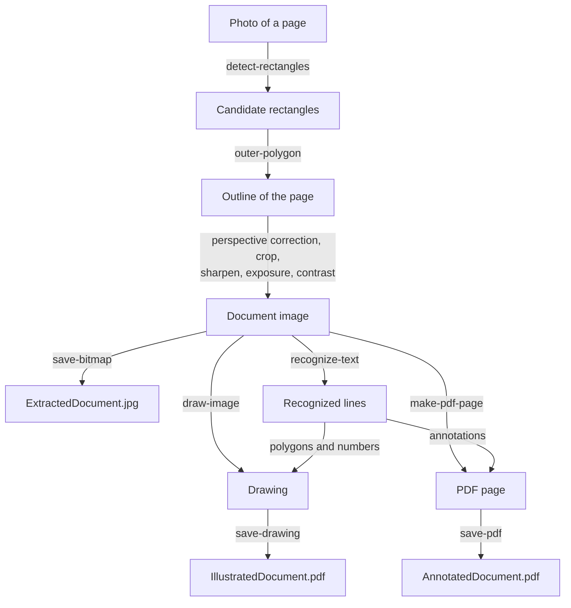

# OCR

A phone takes a photo of a printed page. The page lies on a table at an angle, the corners are distorted, and the lighting is uneven. This example turns the photo into a clean image of the page, reads the text with _optical character recognition_ (OCR), and saves the result in three files: the straightened page as a JPEG file, a PDF file in which a red box and a number mark every recognized line of text, and a second PDF file in which the lines are marked with regular PDF annotations that can be edited in a PDF viewer.

<div class="gallery"><figure><figcaption><p>The photo</p></figcaption></figure> <figure><figcaption><p>The extracted document</p></figcaption></figure></div>

<figure><figcaption><p>The upper part of the illustrated document. Every recognized line has a box and a number.</p></figcaption></figure>

:::info

**Program:** [`OCR.scm`](https://github.com/objecthub/swift-lispkit/blob/master/Sources/LispKit/Resources/Examples/OCR.scm), in the `Examples` folder of LispKit\
**Libraries:** `(lispkit base)`, `(lispkit iterate)`, `(lispkit draw)`, `(lispkit image)`, `(lispkit vision)`, `(lispkit pdf)`, and `(lispkit thread future)`\
**Techniques:** document detection, perspective correction, image filters, optical character recognition, drawings, PDF annotations\
**Platforms:** macOS and iOS, because the program relies on Apple's _Vision_, _Core Image_, and _PDFKit_ frameworks

:::

## What the program does

The program has no user interface. It runs through these steps:

1. It loads the photo `Page.jpg` and detects the rectangles in it. The detector finds one, the sheet of paper.
2. It straightens the page: the perspective of the photo is corrected for the corners of the rectangle, a margin of 5% is cut off at each border, and the image is sharpened and turned into a high-contrast gray scale image. The result is an image of 3422 × 5086 pixels, which the program saves in `ExtractedDocument.jpg`.
3. It recognizes the text in the straightened image. The text consists of 36 lines, which the program prints on the console.
4. It draws the page and, for every recognized line, a red polygon around the line and a number. The drawing is saved in `IllustratedDocument.pdf`.
5. It builds a second PDF file from the straightened image. For every line, it adds a red rectangle and a yellow note whose popup shows the recognized text. The file is saved as `AnnotatedDocument.pdf`.

All three files are written to the _Documents_ folder.

<figure><figcaption><p>The same part in the annotated document. The yellow notes are PDF annotations. Clicking a note shows the recognized text.</p></figcaption></figure>

## Running the program

Build LispKit from a clone of the [GitHub repository](https://github.com/objecthub/swift-lispkit) and load the program into the LispKit REPL:

```
swift build -c release -Xswiftc "-D" -Xswiftc "SPM"
.build/release/LispKitRepl -r Sources/LispKit/Resources -d LispKit \
    -p Sources/LispKit/Resources/Examples/OCR.scm
```

The option `-p` runs the program as the _prelude_ of the REPL. The REPL stays open afterwards, and the definitions of the program are available at the prompt. Without `-p`, `LispKitRepl` runs the program and ends. Leave the REPL with `(exit)`.

The photo is part of LispKit's assets, and the option `-r` makes LispKit find it. The program takes about two seconds. This is its output, with the lines of recognized text between the two dashed lines:

```
Saved extracted document image to /Users/me/Documents/ExtractedDocument.jpg
------------------------
1.4 EXTENSIBILITY REQUIREMENTS
Source
Compiler
Binary
Entry
point
Extension
Source
Compiler
Extension
Figure 1.3: Extensibility based on plug-ins.
frameworks in which the business model of the original development team re-
quires that the source code must not be published, but where external develop-
ers should still be given some degree of flexibility in customizing and extending
the functionality of the software. Black-box extensible frameworks are often also
called data-driven frameworks.
1.4 Extensibility Requirements
Software component technology emphasizes the construction of software from
off-the-shelf components that are provided by a global software component in-
dustry consisting of independent component developers [195]. To facilitate the
construction, deployment, and evolution of components in such a context, pro-
gramming techniques and programming platforms have to satisfy the following
requirements:
• Components are generic units of software that are implemented in a mod-
ular way with explicit context dependencies and with support for separate
compilation 11951.
• Facilities for composing independently developed components have to be
flexible but also safe and should not require access to implementation de-
tails (black-box component deployment).
• Component composition and component evolution mechanisms have to
scale well, since component-oriented programming is targeted towards pro-
gramming in the large [56].
• The reuse of components in different contexts should imply the least possi-
ble need for explicit adaptation code.
• In support for a smooth software evolution process, components have to be
extensible without the need to anticipate all possible future extensions.
------------------------
Saved illustrated document to /Users/me/Documents/IllustratedDocument.pdf
Saved annotated document to /Users/me/Documents/AnnotatedDocument.pdf
```

The recognizer works line by line and makes few mistakes. The two on this page are instructive. In the line numbered 25 in the figures, the reference `[195]` became `11951`, whereas the same reference in the line numbered 19 was recognized correctly. And the diagram is read as well: the lines 1 to 9 are the words in the figure, one fragment at a time.

## How it works in a nutshell

The program first creates a clean image of the page. Everything else, the console output and both PDF files, is derived from this image and from the recognized text:



## Libraries

| Library | What the program uses it for |
| --- | --- |
| [`(lispkit base)`](../../libraries/lispkit/lispkit-base.md) | the language, including `if-let*` of [`(lispkit control)`](../../libraries/lispkit/lispkit-control.md), and `asset-file-path`, `system-directory`, and `path` of [`(lispkit system)`](../../libraries/lispkit/lispkit-system.md) |
| [`(lispkit iterate)`](../../libraries/lispkit/lispkit-iterate.md) | the `for` loop, with and without a counter |
| [`(lispkit draw)`](../../libraries/lispkit/lispkit-draw.md) | images, drawings, shapes, rectangles, fonts, colors, `save-bitmap`, and `save-drawing` |
| [`(lispkit image)`](../../libraries/lispkit/lispkit-image.md) | image filters (`make-image-filter`, `image-filter-output`, `apply-image-filter`) and the conversion of coordinates (`map-image-point`, `map-image-rect`) |
| [`(lispkit vision)`](../../libraries/lispkit/lispkit-vision.md) | `detect-rectangles`, `recognize-text`, and the accessors of recognized text |
| [`(lispkit pdf)`](../../libraries/lispkit/lispkit-pdf.md) | PDF documents, pages, annotations, and `save-pdf` |
| [`(lispkit thread future)`](../../libraries/lispkit/lispkit-thread-future.md) | `future-get`, which returns the results of the Vision requests |

## Design

### Three coordinate systems

The program moves positions between three coordinate systems. Each library has its own, and mixing them up would put boxes into the wrong places.

| | Origin | Direction of the y-axis | Used by |
| --- | --- | --- | --- |
| Image coordinates | upper-left corner | down | the results of `detect-rectangles` and `recognize-text`, and drawings |
| Abstract image coordinates | lower-left corner | up | the filters of Core Image |
| PDF coordinates | lower-left corner | up | PDF pages and their annotations |

`map-image-point` and `map-image-rect` convert from image coordinates of a given image into the coordinates of the corresponding abstract image, which flips the y-axis. The program uses them in two places. The corners of the detected page are converted before they are given to the perspective correction. The boxes of the recognized lines are converted before they become PDF annotations, which works because the PDF page has the size of the image: its media box is 3422 × 5086 points, the size of the image. The first recognized line is a good example:

```scheme
(define first-line (cadr (car (future-get recognized-text))))
(recognized-text-string first-line)
  ; ⇒ "1.4 EXTENSIBILITY REQUIREMENTS"
(recognized-text-bounds first-line)
  ; ⇒ ((457.60856153569875 . 192.67695771191754) 1080.2850925611415 . 84.93070023021963)
(map-image-rect (recognized-text-bounds first-line) document)
  ; ⇒ ((457.60856153569875 . 4808.392342057863) 1080.2850925611415 . 84.93070023021937)
```

The line is 193 points below the upper edge of the image. In PDF coordinates, its lower edge is 4808 points above the lower edge of the page.

### Finding the page

`detect-rectangles` is called with default parameters, so it returns every rectangle it finds, not just one. For this photo, it is a single rectangle with full confidence. For other photos, the detector can return several rectangles, and some of them can be nested, such as the outline of an object together with a rectangle inside its frame. The program takes the outermost rectangle as the page and deals with this case in `outer-polygon`.

<figure><figcaption><p>Nested rectangles, found by the same detector in the billboard photo of the <a href="/examples/lispkit/imagecomposition">Image Composition</a> example. Here, <code>outer-polygon</code> selects the dashed outline.</p></figcaption></figure>

### Cleaning up the photo

The photo is cleaned up with a chain of Core Image filters, which the program creates with `make-image-filter`: each filter gets the output of the previous one as its input. The generic interface of `(lispkit image)` is used here, with the names and the arguments of the filters; the [Image Composition](imagecomposition.md) example uses the functional interface of `(lispkit image process)` for the same kind of work.

| Filter | Arguments | Effect |
| --- | --- | --- |
| `perspective-correction` | the four corners of the page | turns the quadrilateral page into a rectangle of 3802 × 5650 pixels |
| `crop` | the rectangle shrunk by 10% | cuts 5% off each border, leaving 3422 × 5086 pixels |
| `sharpen-luminance` | sharpness 1.0, radius 5.0 | makes the text crisper |
| `exposure-adjust` | +0.7 EV | brightens the paper |
| `color-controls` | saturation 0, brightness 0, contrast 2.5 | removes the colors and strengthens the contrast |

Finally, the image is rotated by 90° if it is wider than tall, so that the document is always in portrait format. A photo taken in landscape mode would need this. The photo of this example does not.

<div class="gallery"><figure><figcaption><p>The detected corners</p></figcaption></figure> <figure><figcaption><p>After perspective correction and cropping</p></figcaption></figure> <figure><figcaption><p>After sharpening, exposure, and contrast</p></figcaption></figure></div>

### Recognizing text

`recognize-text` returns a future for a list of _observations_, one per line of text. An observation is a list: its first element is the bounding box of the line, and the other elements are _recognized text_ objects, the candidates for the reading of the line, best candidate first. By default, there is one candidate per line, so `(cadr obs)` is the recognized text object of the line. Procedures `recognized-text-string`, `recognized-text-confidence`, `recognized-text-bounds`, and `recognized-text-corners` return its text, the confidence of the recognizer, the axis-aligned bounding box, and the corners of the quadrilateral around the text, which also follows text that is not horizontal. The program draws the corners and uses the bounding box to position the numbers.

### Two ways to mark up a page

The program saves the recognized lines in two kinds of PDF files:

* In `IllustratedDocument.pdf`, the marks are part of a **drawing**. The page is drawn as an image, and the polygons and numbers are drawn on top of it. The marks are fixed parts of the page. The drawing is saved with `save-drawing`.
* In `AnnotatedDocument.pdf`, the marks are **PDF annotations**. The PDF page is made from the image, and the annotations are objects on the page that a PDF viewer shows and lets users edit, move, or delete. Each annotation carries data, such as the recognized text in the note.

The annotated file has 108 annotations: a rectangle and a note for each of the 36 lines, and a popup for each note.

### The main ideas

**Compose the pipeline from independent steps.** Detecting the page, straightening it, recognizing the text, and writing the files are separate steps. The straightened image is the only thing that they share.

**Positions are only meaningful with a coordinate system.** The same line of text has a different position in the three coordinate systems, and the program converts it explicitly where it moves from one library to the next.

**Rely on the recognizer for the layout.** The recognizer returns lines with their positions. The program does not have to find lines, words, or columns itself.

## Walkthrough

The following sections go through the program from top to bottom. Together, the code blocks make up the complete source of `OCR.scm`.

### Header and imports

<details>

<summary>Description, credits, and license</summary>

```scheme
;;; OCR of document on photo
;;;
;;; This is a larger demo that combines the usage of the libraries (lispkit draw),
;;; (lispkit image), (lispkit vision), and (lispkit pdf). This program first
;;; loads the photo of a printed document, it then detects the document in that
;;; photo and applies a perspective correction to obtain a rectangular image
;;; representation of the document. This image is written to a file. Next,
;;; optical character recognition (OCR) is applied to the image and the recognized
;;; text printed into the console. An illustrated PDF file showing the document
;;; together with annotations referring to the recognized text gets then created
;;; and saved. Finally, a similar PDF file is created using library (lispkit pdf)
;;; but instead of drawing the annotations on top of the document image, the
;;; annotations are included as editable PDF annotations.
;;;
;;; Author: Matthias Zenger
;;; Copyright © 2025 Matthias Zenger. All rights reserved.
;;;
;;; Licensed under the Apache License, Version 2.0 (the "License"); you may
;;; not use this file except in compliance with the License. You may obtain
;;; a copy of the License at
;;;
;;;   http://www.apache.org/licenses/LICENSE-2.0
;;;
;;; Unless required by applicable law or agreed to in writing, software
;;; distributed under the License is distributed on an "AS IS" BASIS,
;;; WITHOUT WARRANTIES OR CONDITIONS OF ANY KIND, either express or implied.
;;; See the License for the specific language governing permissions and
;;; limitations under the License.
```

</details>

```scheme
(import (lispkit base)
        (lispkit iterate)
        (lispkit draw)
        (lispkit image)
        (lispkit vision)
        (lispkit pdf)
        (lispkit thread future))
```

### Finding the outermost polygon

```scheme
;; Returns the outermost polygon for a given list of polygons `points`. `current` is
;; the initial outermost polygon and must be set to `#f` for the initial call.
(define (outer-polygon current points)
  (if (pair? points)
      (if (not current)
          (outer-polygon (cons (closed-polygon (car points)) (car points)) (cdr points))
          (if (shape-contains? (car current) (car points))
              (outer-polygon current (cdr points))
              (let ((poly (closed-polygon (car points))))
                (if (shape-contains? poly (cdr current))
                    (outer-polygon (cons poly (car points)) (cdr points))
                    #f))))
      current))
```

`outer-polygon` goes through a list of polygons. A polygon is a list of points. The result is a pair of a shape and the list of points of the outermost polygon, or `#f`. `current` is the pair for the outermost polygon found so far, and `#f` at the start. The three cases for the next polygon `(car points)` are:

* If `current` is `#f`, the first polygon becomes the current one: `(closed-polygon (car points))` is a shape with the points of the polygon, and `shape-contains?` can ask it whether it contains points.
* If the shape of the current polygon contains all points of the next polygon, the next polygon is inside and the search continues with the current one.
* Otherwise, if the new polygon contains the current one, it becomes the current one. If neither polygon contains the other, there is no outermost polygon, and the result is `#f`.

```scheme
(define small '((100.0 . 100.0) (200.0 . 100.0) (200.0 . 200.0) (100.0 . 200.0)))
(define large '((50.0 . 50.0) (300.0 . 50.0) (300.0 . 300.0) (50.0 . 300.0)))
(define apart '((400.0 . 400.0) (500.0 . 400.0) (500.0 . 500.0) (400.0 . 500.0)))

(equal? (cdr (outer-polygon #f (list small large))) large)   ; ⇒ #t
(equal? (cdr (outer-polygon #f (list large small))) large)   ; ⇒ #t
(outer-polygon #f (list small apart))                        ; ⇒ #f
(outer-polygon #f '())                                       ; ⇒ #f
```

When the list is exhausted, the result is `current`, which is `#f` if there was no polygon at all.

```scheme
;; Shrinks the given rectangle `rct` by `pct` percent.
(define (shrink rct pct)
  (inset-rect rct (/ (* (rect-width rct) pct) 200.0) (/ (* (rect-height rct) pct) 200.0)))
```

`shrink` shrinks a rectangle by a percentage of its size. `(inset-rect rct dx dy)` takes `dx` off both the left and the right side and `dy` off the top and the bottom. Half of `pct` percent of the width and the height are removed from each side, so `(shrink rct 10)` cuts 5% off every border.

### Straightening the page

```scheme
;; Returns a perspective and color corrected image representing a
;; scanned piece of paper (or any rectangular object).
(define (perspective-color-corrected img candidates)
  (if-let*
    (((pair? candidates))
      ; Determine the outermost polygon and fail if that does not exist
      (poly (outer-polygon #f (map caddr candidates)))
      ; Correct the perspective of the photo based on `poly`
      (pers (make-image-filter 'perspective-correction img
              `((input-top-left . ,(map-image-point (list-ref (cdr poly) 0) img))
               (input-top-right . ,(map-image-point (list-ref (cdr poly) 1) img))
               (input-bottom-right . ,(map-image-point (list-ref (cdr poly) 2) img))
               (input-bottom-left . ,(map-image-point (list-ref (cdr poly) 3) img)))))
      ; Crop the photo 5% at each document border
      (crop (make-image-filter 'crop pers
              `((input-rectangle .
                 ,(shrink (abstract-image-bounds (image-filter-output pers)) 10)))))
      ; Sharpen the image
      (sharp (make-image-filter 'sharpen-luminance crop
              `((input-sharpness . 1.0)
                (input-radius . 5.0))))
      ; Dial up exposure a little
      (exp (make-image-filter 'exposure-adjust sharp
              `((input-e-v . 0.7))))
      ; Increase contrast
      (col (make-image-filter 'color-controls exp
              `((input-saturation . 0)
                (input-brightness . 0)
                (input-contrast . 2.5))))
      (out (image-filter-output col)))
    (abstract-image->image
      ; Perform 90 degree rotation, if needed, to make sure the image is in a
      ; portrait aspect ratio
      (if (> (rect-width (abstract-image-bounds out)) (rect-height (abstract-image-bounds out)))
          (apply-image-filter out `(affine-transform (input-transform . ,(rotate 1.5708))))
          out))
    #f))
```

`perspective-color-corrected` returns the image of the document, or `#f` if there is none. It is built with `if-let*`, which evaluates its clauses one after the other and stops with the alternative, here `#f`, as soon as a clause is `#f`. A clause in parentheses without a name is a plain test, and `(poly ...)` and the others bind names to the results of expressions. The clauses are:

1. `(pair? candidates)` tests that the detector found at least one rectangle.
2. `poly` is the outermost polygon, a pair of a shape and a list of four points. `(cdr poly)` is the list of points in the order top left, top right, bottom right, bottom left.
3. `pers` is the filter for the perspective correction. The corners are converted from image coordinates of `img` to abstract image coordinates with `map-image-point`. `make-image-filter` takes the name of the filter, its input image, and an association list with the arguments of the filter.
4. `crop` crops the output of `pers` to the rectangle that `shrink` computes from the bounds of the output.
5. `sharp`, `exp`, and `col` are the sharpening, the exposure, and the contrast filters of the table above. The last one sets the saturation to 0 to remove the colors.
6. `out` is the output of the last filter, an abstract image.

The final expression renders `out` into an image with `abstract-image->image`. If the width is greater than the height, `apply-image-filter` first rotates the image with an `affine-transform` filter by 1.5708 radians, which is about 90°.

### Drawing the numbers

```scheme
;; Load Helvetica font
(define helvetica (font "Helvetica" 34))
```

```scheme
;; Draw number `i` in a circle in `box` in "Helvetica" font size 34.
(define (draw-number i box)
  (let* ((mid (/ (rect-height box) 2))
         (bbox (rect (move-point (rect-point box) -70 (- mid 24)) (size 48 48)))
         (str (number->string i))
         (dim (text-size str helvetica)))
    (fill-ellipse bbox)
    (fill-rect (rect (rect-point box) (size 10 10)))
    (draw-text
      str
      (move-point (rect-point bbox) (/ (- 48 (size-width dim)) 2) 3)
      helvetica
      white)))
```

`draw-number` draws the mark for one line. `box` is the bounding box of the line in image coordinates. The circle with a diameter of 48 points is 70 points to the left of the box and centered vertically at the middle of the box. `(rect-point box)` is the upper-left corner of the box. The number is drawn in the middle of the circle: `text-size` measures the width of the text, and half of the remaining space is the offset on the left. The circle is filled with the current fill color, and the number is drawn in white. The small square of 10 × 10 points at the upper-left corner of the box is part of the mark as well. It is the small red dot that can be seen at the start of each box in the figures.

### Loading the photo and finding the page

```scheme
;; Path to the generated files
(define target-path (car (system-directory 'documents)))
```

`system-directory` returns a list of paths, and `car` takes the first one: the _Documents_ folder of the user.

```scheme
;; Load photo from asset library
(define photo (load-image (asset-file-path "Page" "jpg" "Images")))
```

`asset-file-path` searches the asset paths of LispKit for `Page.jpg` in the folder `Images`, and `load-image` loads it. The image is 4284 × 5712 points large.

```scheme
;; Detect rectangles in the photo (with default parameters).
;; The result of this operation is a future for detection results.
(define rectangles (detect-rectangles photo))
```

```scheme
;; Correct perspective, improve colors, and crop document
(define document (perspective-color-corrected photo (future-get rectangles)))
```

`detect-rectangles` returns a future, and `future-get` waits for the list of detected rectangles. Every detection has the form `(bounding-box confidence polygon)`, and `perspective-color-corrected` uses the third element, the polygon, of every detection. For this photo, the bounding box is `((288.4 . 607.2) 3637.3 . 4783.8)`, and the corners of the polygon are (1004.3, 607.2), (3925.7, 738.3), (3802.7, 5391.0), and (288.4, 4893.4), the page of the photo.

```scheme
;; Save the document in a JPG file
(save-bitmap (path target-path "ExtractedDocument.jpg") document 'jpg)
(display "Saved extracted document image to ")
(display (path target-path "ExtractedDocument.jpg"))
(newline)
```

`document` is a bitmap image of 3422 × 5086 pixels. `save-bitmap` writes it into a JPEG file in the _Documents_ folder.

### Recognizing the text

```scheme
;; Recognize text in the document image (using default parameters). This
;; returns a future eventually referring to the recognized text candidates.
(define recognized-text (recognize-text document))
```

The text is recognized in the straightened image, not in the original photo, so that the positions of the lines refer to the image from which the PDF files are made. As with the detection, the result is a future.

```scheme
;; Display the recognized text
(display "------------------------")
(newline)
(for obs in (future-get recognized-text)
  (display (recognized-text-string (cadr obs)))
  (newline))
(display "------------------------")
(newline)
```

Every observation is a list `(bounding-box candidate ...)`, so `(cadr obs)` is its best candidate. `for` goes through the list, and the program prints the text of each candidate.

### The illustrated document

```scheme
;; Create a drawing that illustrates the recognized text in the document
;; with rectangles showing where text was detected and a counter for each
;; detected line of text.
(define illustrated-document
  (drawing
    ; First draw the color and perspective corrected page
    (draw-image document (point 0 0))
    ; Switch to color red
    (set-color red)
    (set-fill-color red)
    ; For every detected line of text, draw a bounding box
    (for (i obs) in (future-get recognized-text)
      (draw (closed-polygon (recognized-text-corners (cadr obs))) 2)
      (draw-number i (recognized-text-bounds (cadr obs))))))
```

`drawing` creates a drawing and executes the statements in its body in the context of this drawing. The body draws the image of the document first, and then it switches the line and fill colors to red. `(for (i obs) in lst ...)` is a loop in which `i` is the index of the current element, starting with 0. This is the number in the circle. For each line, the program draws the polygon of its corners with a line width of 2 and then the number with `draw-number`.

```scheme
;; Save the illustrated document in a PDF file
(save-drawing (path target-path "IllustratedDocument.pdf")
              illustrated-document
              (image-size document)
              "Detected text")
(display "Saved illustrated document to ")
(display (path target-path "IllustratedDocument.pdf"))
(newline)
```

`save-drawing` renders the drawing into a PDF file. The size of the page is the size of the document image, and the title "Detected text" is stored in the PDF document.

### The annotated document

```scheme
;; The following code recreates the same PDF using the library (lispkit pdf)

;; Create a new empty PDF document and set a few document-level attributes
(define doc (make-pdf))
(pdf-attribute-set! doc 'Title "Annotated Document")
(pdf-attribute-set! doc 'Author "Matthias Zenger")
(pdf-attribute-set! doc 'Subject "Annotated PDF document created with (lispkit pdf)")
```

`make-pdf` creates an empty PDF document, and `pdf-attribute-set!` sets its title, author, and subject.

```scheme
;; Create a new PDF page on the basis of the extracted document image
;; and attach it to the empty PDF document
(define page (make-pdf-page document 0.0 #f #f #f))
(pdf-insert-page! doc 0 page)
```

`(make-pdf-page image compress rotate media upscale)` creates a PDF page from an image. The program passes `0.0` for the compression quality and `#f` for the rotation, the media box, and the upscaling. The page gets the size of the image, and `pdf-insert-page!` makes it the first page of the document. The loop below places annotations on `page`.

```scheme
;; Iterate through the recognized text and drop two types of annotations onto
;; the PDF page: 1) red rectangles indicate recognized text, 2) text popups
;; displaying the recognized text.
(for (i obs) in (future-get recognized-text)
  (let* ((box (recognized-text-bounds (cadr obs)))
         (mid (/ (rect-height box) 2))
         (tbox (rect (move-point (rect-point box) -60 (- mid 20)) (size 40 40)))
         (pbox (rect (move-point (rect-point box) 60 (- mid 60)) (size 200 130))))
    ; Place a red box annotation over the line
    (let ((annot (make-pdf-annotation (map-image-rect box document) 'square)))
      (pdf-annotation-border-set! annot '(solid 2.0))
      (pdf-annotation-color-set! annot red)
      (pdf-page-annotation-add! page annot))
    ; Make a text annotation which pops up when the yellow note icon gets clicked
    (let ((text (make-pdf-annotation (map-image-rect tbox document) 'text))
          (popup (make-pdf-annotation (map-image-rect pbox document) 'popup)))
      (pdf-annotation-contents-set! text (recognized-text-string (cadr obs)))
      (pdf-annotation-alignment-set! text 'left)
      (pdf-annotation-icon-set! text 'note)
      (pdf-annotation-color-set! text yellow)
      (pdf-annotation-popup-set! text popup)
      (pdf-page-annotation-add! page text))))
```

For every recognized line, the loop adds two annotations. `box` is the bounding box of the line in image coordinates. `tbox` is a square of 40 × 40 points, 60 points to the left of the line, for the note, and `pbox` is a rectangle of 200 × 130 points for the popup, which starts 60 points to the right of the left edge of the line. Like `box`, both are in image coordinates, so `map-image-rect` converts each of them into the coordinates of the PDF page before an annotation is created.

* The first annotation has the type `square`. It is a rectangle around the line, with a solid border of 2 points and the color red.
* The second annotation has the type `text`. It is a sticky note with the icon `note` and the color yellow, and its contents are the recognized text, left-aligned. A `popup` annotation, the window with the text, is associated with it by `pdf-annotation-popup-set!`.

Both annotations are added to the page with `pdf-page-annotation-add!`. The popups are not added explicitly, but they end up on the page as well, which is why the saved page has 108 annotations.

```scheme
;; Save the annotated document in a PDF file; annotations are regular
;; (editable) PDF annotations in this PDF file.
(save-pdf (path target-path "AnnotatedDocument.pdf")
          doc
          '((burn-in-annotations . #f)
            (save-text-from-ocr . #t)))
(display "Saved annotated document to ")
(display (path target-path "AnnotatedDocument.pdf"))
(newline)
```

`save-pdf` writes the document. With `burn-in-annotations` set to `#f`, the annotations are kept as annotations. If it was `#t`, they would become part of the page content and could no longer be edited. The option `save-text-from-ocr` asks PDFKit to apply its own OCR to the pages and to store the text as an invisible layer, so that the text of the page can be searched and selected. On the Mac used for this page, PDFKit did not create such a layer: `pdf->string` returns an empty string for the saved file. Writing the file directly with PDFKit and this option gave the same result.

## Variations

The definitions of the program are available at the prompt of the REPL, which was started with the option `-p`.

**Searching the page.** The recognized lines make it easy to look for words. This procedure returns the observations whose best candidate contains a word:

```scheme
(define (lines-with word)
  (filter (lambda (obs)
            (string-contains (string-downcase (recognized-text-string (cadr obs))) word))
          (future-get recognized-text)))

(map (lambda (obs) (recognized-text-string (cadr obs))) (lines-with "extensib"))
  ; ⇒ ("1.4 EXTENSIBILITY REQUIREMENTS"
  ;    "Figure 1.3: Extensibility based on plug-ins."
  ;    "the functionality of the software. Black-box extensible frameworks are often also"
  ;    "1.4 Extensibility Requirements"
  ;    "extensible without the need to anticipate all possible future extensions.")
```

The result of `lines-with` can be used instead of `(future-get recognized-text)` in the loops of the program, in order to mark only the lines with the word.

**Alternative readings.** The third argument of `recognize-text` is the number of candidates per line; the second argument restricts the search to a region, and `#f` stands for the whole image. With three candidates, the recognizer also returns the alternatives for the first line:

```scheme
(define candidates (cdr (car (future-get (recognize-text document #f 3)))))

(map recognized-text-string candidates)
  ; ⇒ ("1.4 EXTENSIBILITY REQUIREMENTS" "14 EXTENSIBILITY REQUIREMENTS" "1.4 EXTENSIBILITY REQUIREMENTS")
```

**Other photos.** To process a photo of your own, replace the file name in the call of `load-image`. The photo has to show the whole page, and the page has to be clearly visible against its surroundings. If the detector does not find a rectangle, `perspective-color-corrected` returns `#f`, and the following steps of the program fail, since it does not check for this case. The cat photo of the [Image Composition](imagecomposition.md) example is such a photo, while the billboard photo has two nested rectangles, and the result is an image of the outline of the whole sign:

```scheme
(define cat (load-image (asset-file-path "Inga" "jpg" "Images")))
(define billboard (load-image (asset-file-path "Billboard" "jpg" "Images")))

(perspective-color-corrected cat (future-get (detect-rectangles cat)))
  ; ⇒ #f
(image? (perspective-color-corrected billboard (future-get (detect-rectangles billboard))))
  ; ⇒ #t
```

It would be easy to check the result of `perspective-color-corrected` and to print a message instead.

**More ideas.** Recognize the text in a specific language by passing a list of language codes as the fourth argument of `recognize-text`. Take a photo of a page of a book, a slide, or a receipt, and compare the results. Write all recognized lines into a text file, or build a PDF with several pages from several photos.

## Further reading

* [`(lispkit vision)`](../../libraries/lispkit/lispkit-vision.md): rectangle detection and text recognition
* [`(lispkit image)`](../../libraries/lispkit/lispkit-image.md): image filters and abstract images
* [`(lispkit pdf)`](../../libraries/lispkit/lispkit-pdf.md): PDF documents, pages, and annotations
* [`(lispkit draw)`](../../libraries/lispkit/lispkit-draw.md): images, drawings, and shapes
* [`(lispkit iterate)`](../../libraries/lispkit/lispkit-iterate.md): the `for` loop
* [Image Composition](imagecomposition.md): another example with rectangle detection and perspective correction
