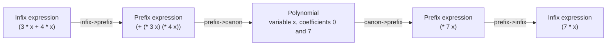

# Polynomials

What is `(x + 1) ^ 10 + (x - 1) ^ 10`? Expanded and simplified, it is `2x^10 + 90x^8 + 420x^6 + 420x^4 + 90x^2 + 2`: all odd powers cancel. This example is a small program that does such calculations symbolically. It reads an expression like the one above, multiplies out the products and powers, collects the terms, and prints the simplified result. For two expressions that are equal as polynomials, it always prints the same result: it computes a _canonical form_.

:::info

**Program:** [`Polynomials.scm`](https://github.com/objecthub/swift-lispkit/blob/master/Sources/LispKit/Resources/Examples/Polynomials.scm), in the `Examples` folder of LispKit\
**Libraries:** `(lispkit base)`\
**Techniques:** symbolic computation, canonical forms, nested data structures, operator-precedence parsing, `define-type`\
**Attribution:** The design of the data structures and algorithms is based on [chapter 15](https://github.com/norvig/paip-lisp/blob/master/docs/chapter15.md) of Peter Norvig's book _Paradigms of Artificial Intelligence Programming: Case Studies in Common Lisp_. The book is published under an MIT license at [github.com/norvig/paip-lisp](https://github.com/norvig/paip-lisp). The program is a LispKit-specific port of the code of the book; the implementations sometimes differ significantly.

:::

## What the program does

Procedure `canon` expects a polynomial in infix form, written as a Scheme list, and returns its canonical form, again in infix form. The operators are `+`, `-`, `*`, and `^`. The operands are numbers and variables, which are symbols. Parentheses are nested lists. These are the examples from the header of the program, with the results of a real run:

| Expression | Result |
| --- | --- |
| `(canon '(3 + x + 4 - x))` | `7` |
| `(canon '(x + y + y + x))` | `((2 * x) + (2 * y))` |
| `(canon '(3 * x + 4 * x))` | `(7 * x)` |
| `(canon '(3 * x + y + x + 4 * x))` | `((8 * x) + y)` |
| `(canon '(3 * x + y + z + x + 4 * x))` | `((8 * x) + y + z)` |
| `(canon '((x + 1) ^ 10 + (x - 1) ^ 10))` | `((2 * (x ^ 10)) + (90 * (x ^ 8)) + (420 * (x ^ 6)) + (420 * (x ^ 4)) + (90 * (x ^ 2)) + 2)` |
| `(canon '((x + 1) ^ 10 - (x - 1) ^ 10))` | `((20 * (x ^ 9)) + (240 * (x ^ 7)) + (504 * (x ^ 5)) + (240 * (x ^ 3)) + (20 * x))` |
| `(canon '(3 * x ^ 3 + 4 * x * y * (x - 1) + x ^ 2 * (x + y)))` | `((4 * (x ^ 3)) + (5 * y * (x ^ 2)) + (-4 * y * x))` |
| `(canon '(3 * x ^ 3 + 4 * x * w * (x - 1) + x ^ 2 * (x + w)))` | `((((5 * (x ^ 2)) + (-4 * x)) * w) + (4 * (x ^ 3)))` |

The binomial theorem confirms the two results for the tenth power. The coefficients in the sum are twice the binomial coefficients 1, 45, 210, 210, 45, and 1 of the even powers, and in the difference twice the coefficients 10, 120, 252, 120, and 10 of the odd powers.

The canonical form makes it easy to compare expressions. `(x + 1) * (x - 1)` and `x ^ 2 - 1` are different expressions for the same polynomial, and both end up in the same form:

```scheme
(canon '((x + 1) * (x - 1)))                      ; ⇒ ((x ^ 2) + -1)
(canon '(x ^ 2 - 1))                              ; ⇒ ((x ^ 2) + -1)
(equal? (canon '((x + 1) * (x - 1))) (canon '(x ^ 2 - 1)))  ; ⇒ #t
```

## Running the program

Build LispKit from a clone of the [GitHub repository](https://github.com/objecthub/swift-lispkit) and load the program into the LispKit REPL:

```
swift build -c release -Xswiftc "-D" -Xswiftc "SPM"
.build/release/LispKitRepl -r Sources/LispKit/Resources -d LispKit \
    -p Sources/LispKit/Resources/Examples/Polynomials.scm
```

The option `-p` runs the program as the _prelude_ of the REPL. The REPL stays open afterwards, and the definitions of the program are available at the prompt. Without `-p`, `LispKitRepl` runs the program and ends. Leave the REPL with `(exit)`.

The program only defines procedures, so nothing happens when it is loaded. Enter the expressions of the table above at the prompt to see the results. Because the program works with Scheme lists, expressions have to be quoted.

## How it works in a nutshell

The program converts an expression in several steps. Operators have different precedences, so the first step turns the infix expression into a prefix expression, in which every operator is the first element of a list and has its operands as the other elements. The prefix expression is then evaluated with polynomial arithmetic that produces a polynomial in canonical form. The remaining steps turn this polynomial back into a prefix and then into an infix expression. This is what `canon` does for `3 * x + 4 * x`:



The last two steps convert the result for printing. The middle step contains the actual algebra: the multiplication `3 * x` and `4 * x`, the addition of the products, and the simplification of the result happen in `prefix->canon`.

## Libraries

The program needs only [`(lispkit base)`](../../libraries/lispkit/lispkit-base.md). It uses `define-type`, which comes from [`(lispkit type)`](../../libraries/lispkit/lispkit-type.md) and is re-exported by `(lispkit base)`, `case-lambda`, `case`, vectors and the procedures `vector-copy`, `append-map`, `delq`, and `memq`, and numeric procedures such as `expt` and `zero?`.

## Design

### Polynomials as vectors

A polynomial in one variable is represented as a vector: the first element is the _main variable_, followed by the coefficients, starting with the one for the power 0. The polynomial `5*x^3 + 4*x + 1` has the main variable `x` and the coefficients 1, 4, 0, and 5:

```scheme
(prefix->canon '(+ (* 5 (^ x 3)) (+ (* 4 x) 1)))   ; ⇒ #<poly #(x 1 4 0 5)>
```

The vector is wrapped into a new type `poly`, so that polynomials can be told apart from other vectors. A coefficient can be a number or a polynomial in another variable. This is how polynomials with several variables are represented: `x*y + 1` is a polynomial in `x` with the coefficients 1 and `y`, and `y` is a polynomial itself:

| Polynomial | Representation |
| --- | --- |
| `5*x^3 + 4*x + 1` | `#<poly #(x 1 4 0 5)>` |
| `x*y + 1` | `#<poly #(x 1 #<poly #(y 0 1)>)>` |
| `x + y` | `#<poly #(x #<poly #(y 0 1)> 1)>` |
| `w + x` | `#<poly #(w #<poly #(x 0 1)> 1)>` |

The order of the variables is fixed: the variable whose name comes first in the alphabet is the main variable, the others are used in the coefficients. That is why the last example of the table is a polynomial in `w`, with coefficients that are polynomials in `x`, and why the last example of the first table has the shape `(... * w) + ...`. Any other order would also work, but without a fixed order, two equal polynomials could have different representations.

### Canonical form

A representation is _canonical_ if equal polynomials always have the same representation. Three rules guarantee this:

* The variables are always in the same order.
* The coefficients are stored for all powers from 0 to the degree, and the coefficient of the highest power is not 0. Trailing zeros are dropped.
* A polynomial of degree 0 is not a polynomial: it is replaced by its only coefficient. So a polynomial that is a constant is a number, and the sum `x - x` is the number `0`.

### Arithmetic

Adding and multiplying two polynomials depends on their main variables. For two polynomials `p` and `q`, `poly+poly` and `poly*poly` distinguish these cases:

| Case | What happens |
| --- | --- |
| `p` is a number | Add or multiply the number with `q`. |
| `q` is a number | The same with `p`. |
| `p` and `q` have the same main variable | Add the coefficients with the same power, or multiply every coefficient of `p` with every coefficient of `q`. |
| The main variable of `q` comes later in the alphabet | `q` is a constant for `p`: add or multiply it with the coefficients of `p`. |
| Otherwise | `p` is a constant for `q`. |

The operations on coefficients call `poly+poly` and `poly*poly` again, because coefficients can be polynomials. The result of each operation is normalized.

### The main ideas

**Two kinds of expressions.** Expressions are nested lists, either in infix form (`(3 * x + 4 * x)`) or in prefix form (`(+ (* 3 x) (* 4 x))`). Polynomials are objects of type `poly` or numbers. The program converts between the two kinds.

**Every operation returns a canonical result.** Each procedure ends by normalizing its result, so the arithmetic procedures can rely on canonical arguments.

**Recursion follows the data.** Expressions, polynomials with several variables, and the arithmetic on them are nested structures. The procedures for them are recursive procedures that mirror the nesting.

## Walkthrough

The following sections go through the program from top to bottom. Together, the code blocks make up the complete source of `Polynomials.scm`.

### Header and import

<details>

<summary>Description, credits, and license</summary>

```scheme
;;; Symbolic Mathematics with Polynomials
;;;
;;; The code below implements a symbolic canonicalizer for polynomials. A polynomial is
;;; a function of one or more variables that can be computed using only addition and
;;; multiplication. For instance, `4*x^3 + b*x^2 + 1` is a polynomial whose main variable
;;; is `x`, the degree, i.e. the highest power of x, is 3, and the coefficients are
;;; 4, b, 0, and 1.
;;;
;;; Here are a few sample interactions with the canonicalizer/simplifier of expressions
;;; involving polynomials. Procedure `canon` expects polynomials in infix form and returns
;;; their canonicalized form again in infix form:
;;;
;;;   > (canon '(3 + x + 4 - x))
;;;   7
;;;   > (canon '(x + y + y + x))
;;;   ((2 * x) + (2 * y))
;;;   > (canon '(3 * x + 4 * x))
;;;   (7 * x)
;;;   > (canon '(3 * x + y + x + 4 * x))
;;;   ((8 * x) + y)
;;;   > (canon '(3 * x + y + z + x + 4 * x))
;;;   ((8 * x) + y + z)
;;;   > (canon '((x + 1) ^ 10 + (x - 1) ^ 10))
;;;   ((2 * (x ^ 10)) + (90 * (x ^ 8)) + (420 * (x ^ 6)) + (420 * (x ^ 4)) + (90 * (x ^ 2)) + 2)
;;;   > (canon '((x + 1) ^ 10 - (x - 1) ^ 10))
;;;   ((20 * (x ^ 9)) + (240 * (x ^ 7)) + (504 * (x ^ 5)) + (240 * (x ^ 3)) + (20 * x))
;;;   > (canon '(3 * x ^ 3 + 4 * x * y * (x - 1) + x ^ 2 * (x + y)))
;;;   ((4 * (x ^ 3)) + (5 * y * (x ^ 2)) + (-4 * y * x))
;;;   > (canon '(3 * x ^ 3 + 4 * x * w * (x - 1) + x ^ 2 * (x + w)))
;;;   ((((5 * (x ^ 2)) + (-4 * x)) * w) + (4 * (x ^ 3)))
;;;
;;; The design of the data structures, functions and algorithms is based on chapter 15 of
;;; Peter Norvig's book on "Paradigms of Artificial Intelligence Programming: Case Studies
;;; in Common Lisp": https://github.com/norvig/paip-lisp/blob/master/docs/chapter15.md .
;;; The book has been published under an MIT license at https://github.com/norvig/paip-lisp .
;;;
;;; The code below is a LispKit-specific port of the code in Peter Norvig's book. The data
;;; structures and algorithms closely follow the presentation in the book, but the actual
;;; implementations sometimes differ significantly.
;;;
;;; Author: Matthias Zenger
;;; Copyright © 2020 Matthias Zenger. All rights reserved.
;;;
;;; Licensed under the Apache License, Version 2.0 (the "License"); you may not use this file
;;; except in compliance with the License. You may obtain a copy of the License at
;;;
;;;   http://www.apache.org/licenses/LICENSE-2.0
;;;
;;; Unless required by applicable law or agreed to in writing, software distributed under the
;;; License is distributed on an "AS IS" BASIS, WITHOUT WARRANTIES OR CONDITIONS OF ANY KIND,
;;; either express or implied. See the License for the specific language governing permissions
;;; and limitations under the License.
```

</details>

```scheme
(import (lispkit base))
```

### Expressions and operators

```scheme
;; Prefix expressions are represented as lists with at least two elements: the operator and
;; at least one argument.
(define (exp? x)
  (and (pair? x) (pair? (cdr x))))

;; Arguments of an expression
(define exp-args cdr)

;; The procedures implementing operators
(define (exp-op-proc x)
  (case (car x)
    ((+) poly+)
    ((-) poly-)
    ((*) poly*poly)
    ((^) poly^n)
    (else (error "not a valid operator" (car x)))))

;; The precedence of operators
(define (exp-op-precedence x)
  (case x
    ((+)  1)
    ((-)  1)
    ((*)  2)
    ((^)  3)
    (else #f)))
```

An expression is a list with at least two elements: the operator and one operand. `exp-op-proc` returns the procedure that implements an operator, and `exp-op-precedence` returns its precedence: `+` and `-` bind weakest, `*` is stronger, and `^` is the strongest. For a symbol that is not an operator, `exp-op-precedence` returns `#f`. This is how the parser tells operators from operands.

### From infix to prefix

```scheme
;; Converts an expression in infix form into prefix form.
(define (infix->prefix expr)
  (define (push-exp expr stack)
    (if (null? expr)
        (reduce-stack stack 0)
        (if (pair? (car expr))
            (push-exp (cdr expr) (cons (infix->prefix (car expr)) stack))
            (let ((prec (exp-op-precedence (car expr))))
              (if prec
                  (push-exp (cdr expr) (cons (car expr) (reduce-stack stack prec)))
                  (push-exp (cdr expr) (cons (car expr) stack)))))))
  (define (reduce-stack stack prec)
    (if (null? stack)
        (error "not a valid infix expression: $0" expr)
        (if (null? (cdr stack))
            stack
            (let ((next-prec (exp-op-precedence (cadr stack))))
              (if next-prec
                  (if (<= prec next-prec)
                      (reduce-stack (cons (list (cadr stack) (caddr stack) (car stack))
                                          (cdddr stack)) prec)
                      stack)
                  (error "not a valid infix expression: $0" expr))))))
  (car (push-exp expr '())))
```

`infix->prefix` is an operator-precedence parser that works with a stack. It walks through the list and pushes everything onto the stack. A nested list stands for a parenthesized expression and is converted recursively. An operator first reduces the stack: as long as the operator below the top of the stack has a precedence that is at least as high as the new operator, it and its two operands are combined into a prefix expression `(op left right)`. At the end, everything that is left is reduced.

The top of the stack is the first element of the list. Here is the stack while `(3 * x + 4 * x)` is processed:

| Stack | Rest of the input | What happens |
| --- | --- | --- |
| `()` | `3 * x + 4 * x` | `3` is an operand and is pushed. |
| `(3)` | `* x + 4 * x` | `*` is pushed. There is nothing to reduce. |
| `(* 3)` | `x + 4 * x` | `x` is pushed. |
| `(x * 3)` | `+ 4 * x` | `+` binds weaker than `*`, so `3 * x` is reduced first: `(* 3 x)`. Then `+` is pushed. |
| `(+ (* 3 x))` | `4 * x` | `4` is pushed. |
| `(4 + (* 3 x))` | `* x` | `*` binds stronger than `+`, so there is nothing to reduce. It is pushed. |
| `(* 4 + (* 3 x))` | `x` | `x` is pushed. |
| `(x * 4 + (* 3 x))` | | The end: `(* 4 x)` is reduced, and then the sum: `(+ (* 3 x) (* 4 x))`. |

All operators are left-associative, including `^`: `(2 ^ 3 ^ 2)` is parsed as `(2 ^ 3) ^ 2`, i.e. as `(^ (^ 2 3) 2)`. Mathematicians read it the other way round, so use parentheses for repeated powers. An expression that is not well-formed, such as `(x +)`, `(- x)`, or `(x / 2)`, ends with the error _not a valid infix expression_. There is no unary minus and no division; `(0 - x)` is the way to write `-x`.

### From prefix to infix

```scheme
;; Converts an expression in prefix form into infix form.
(define (prefix->infix expr)
  (if (pair? expr)
      (cons (prefix->infix (cadr expr))
            (append-map (lambda (x) (list (car expr) (prefix->infix x))) (cddr expr)))
      expr))
```

The conversion in the other direction puts the operator between the operands. Prefix expressions can have more than two operands: `(+ a b c)` becomes `(a + b + c)`. The results of `canon->prefix` use this, as in `(5 * y * (x ^ 2))`.

### The polynomial type

```scheme
;; Type `poly` defines a type for representing a polynomial dependent on a main variable.
;; Such polynomials are represented as a vector whose first element is the main variable,
;; and the second to _n_ elements are the coefficients of the polynomial.
;;
;; Example: Polynomial `5*x^3 + 4*x + 1` can be defined as follows:
;; `(prefix->canon '(+ (* 5 (^ x 3)) (+ (* 4 x) 1)))`. This expression returns
;; `#<poly #(x 1 4 0 5)>`.
(define-type poly
  poly?
  ((new-poly vec)
    vec)
  ((main-var (p))
    (vector-ref p 0))
  ((coef (p) i)
    (vector-ref p (+ i 1)))
  ((set-coef! (p) i c)
    (vector-set! p (+ i 1) c))
  ((degree (p))
    (- (vector-length p) 2))
  ((copy-poly (p))
    (new-poly (vector-copy p)))
  ((cut-poly (p) n)
    (new-poly (vector-copy p 0 (+ n 2)))))

;; Make the polynomial 0 + 0*x + 0*x^2 + ... 0*x^degree
(define (make-poly x degree)
  (let ((p (make-vector (+ degree 2) 0)))
    (vector-set! p 0 x)
    (new-poly p)))

;; Return a polynomial with main variable `var` and coefficients `c`, ...
(define (poly var c . cs)
  (let ((p (make-poly var (length cs))))
    (set-coef! p 0 c)
    (do ((i 1 (+ i 1))
         (coefs cs (cdr coefs)))
        ((null? coefs) p)
      (set-coef! p i (car coefs)))))
```

`define-type` defines a type `poly` with a predicate `poly?`. Its first clause defines the constructor `new-poly`, which wraps a vector. The other clauses define functions that work on the vector inside: `(main-var (p))` binds `p` to the vector of a polynomial, not to the polynomial. The polynomial `(new-poly (vector 'x 1 4 0 5))` is printed as `#<poly #(x 1 4 0 5)>`, and it is not a vector.

`coef` and `set-coef!` hide that the coefficient `i` is at position `i + 1` of the vector. `degree` is the length of the vector minus 2. `copy-poly` copies a polynomial, and `cut-poly` copies it with fewer coefficients. `make-poly` creates a polynomial with only zeros, and `poly` creates one from a variable and its coefficients: `(poly 'x 1 4 0 5)` is the polynomial `5*x^3 + 4*x + 1`.

### From prefix to polynomials

```scheme
;; Convert a prefix expression to canonical form.
(define (prefix->canon x)
  (cond ((number? x) x)
        ((symbol? x) (poly x 0 1))
        ((exp? x)    (apply (exp-op-proc x) (map prefix->canon (exp-args x))))
        (else        (error "not a polynomial: $0" x))))
```

`prefix->canon` is where the calculation happens. A number is already canonical. A symbol is a variable, which is the polynomial `0 + 1*x`. An expression is evaluated by applying the polynomial procedure of its operator to the canonical forms of its operands. The recursion over the operands makes sure that the operations are applied from the inside out. A prefix expression with a unary minus, such as `(- x)`, is fine here, although the infix parser does not accept one.

### Addition and subtraction

```scheme
;; Unary or binary polynomial addition.
(define poly+
  (case-lambda
    ((p) p)
    ((p q) (poly+poly p q))))

;; Unary or binary polynomial subtraction.
(define poly-
  (case-lambda
    (() 0)
    ((p) (poly*poly -1 p))
    ((p q) (poly+poly p (poly*poly -1 q)))))

(define (var= x y) (eq? x y))
(define (var> x y) (string>? (symbol->string x) (symbol->string y)))
```

`poly+` and `poly-` are the procedures for the operators `+` and `-`. `case-lambda` selects the definition by the number of arguments. Subtraction of `q` from `p` is the addition of `p` and `-1 * q`. `var>` compares the names of two variables, which defines the order of the variables.

```scheme
;; Add two polynomials.
(define (poly+poly p q)
  (normalize-poly
    (cond ((number? p)                      (k+poly p q))
          ((number? q)                      (k+poly q p))
          ((var= (main-var p) (main-var q)) (poly+same p q))
          ((var> (main-var q) (main-var p)) (k+poly q p))
          (else                             (k+poly p q)))))
```

`poly+poly` handles the cases of the table above and normalizes the result.

```scheme
;; Add a constant k to a polynomial p.
(define (k+poly k p)
  (cond ((and (number? k) (zero? k))   p)               ;; 0 + p = p
        ((and (number? k) (number? p)) (+ k p))         ;; Add numbers
        (else
          (let ((r (copy-poly p)))                      ;; Add k to x^0 term of p
            (set-coef! r 0 (poly+poly (coef r 0) k))
            r))))

;; Add two polynomials with the same main variable.
(define (poly+same p q)
  ;; First assure that q is the higher degree polynomial
  (if (> (degree p) (degree q))
      (poly+same q p)
      ;; Add each element of p into r (which is a copy of q).
      (do ((r (copy-poly q))
           (i 0 (+ i 1)))
          ((> i (degree p)) r)
        (set-coef! r i (poly+poly (coef r i) (coef p i))))))
```

`k+poly` adds a constant to a polynomial. The constant is a number, or a polynomial with a variable that comes later, which is a constant for `p`. It is added to the coefficient for the power 0. `poly+same` adds two polynomials with the same main variable. It makes sure that `q` has the higher degree and then adds all the coefficients of `p` to a copy of `q`. As the coefficients can be polynomials, it calls `poly+poly` for each of them.

### Multiplication

```scheme
;; Multiply two polynomials.
(define (poly*poly p q)
  (normalize-poly
    (cond ((number? p)                      (k*poly p q))
          ((number? q)                      (k*poly q p))
          ((var= (main-var p) (main-var q)) (poly*same p q))
          ((var> (main-var q) (main-var p)) (k*poly q p))
          (else                             (k*poly p q)))))
```

`poly*poly` has the same structure as `poly+poly`.

```scheme
;; Multiply a polynomial p by a constant factor k.
(define (k*poly k p)
  (cond ((eq? k 0)                     0)              ;; 0 * p = 0
        ((eq? k 1)                     p)              ;; 1 * p = p
        ((and (number? k) (number? p)) (* k p))        ;; Multiply numbers
        (else                                          ;; Multiply each coefficient
          (do ((r (make-poly (main-var p) (degree p))) ;; Accumulate result in r; r[i] = k*p[i]
               (i 0 (+ i 1)))
              ((> i (degree p)) r)
            (set-coef! r i (poly*poly k (coef p i)))))))

;; Multiply two polynomials with the same variable.
(define (poly*same p q)
  ;; r[i] = p[0]*q[i] + p[1]*q[i-1] + ...
  (let* ((p-degree (degree p))
         (q-degree (degree q))
         (r (make-poly (main-var p) (+ p-degree q-degree))))
    (do ((i 0 (+ i 1)))
        ((> i p-degree) r)
      (unless (eq? (coef p i) 0)
        (do ((j 0 (+ j 1)))
            ((> j q-degree))
          (set-coef! r (+ i j) (poly+poly (coef r (+ i j)) (poly*poly (coef p i) (coef q j)))))))))
```

`k*poly` multiplies every coefficient with a constant. A factor of 0 gives 0 and a factor of 1 gives the polynomial. `poly*same` multiplies two polynomials with the same main variable the way it is done on paper: the coefficient of `x^(i+j)` of the result gets the product of the coefficient `i` of `p` and the coefficient `j` of `q`. Coefficients of `p` that are 0 are skipped.

### Normalization and powers

```scheme
;; Alter a polynomial by dropping trailing zeros.
(define (normalize-poly p)
  (if (number? p)
      p
      (do ((i (degree p) (- i 1)))
          ((or (zero? i) (not (eq? (coef p i) 0)))
           (cond ((zero? i)        (normalize-poly (coef p 0)))
                 ((= i (degree p)) p)
                 (else
                   (cut-poly p i)))))))
```

`normalize-poly` establishes the second and the third rule of the canonical form. It looks for the highest coefficient that is not 0. If there is none left except for the one for the power 0, the polynomial is replaced by this coefficient, which is normalized again, because it might be a polynomial itself. If the highest coefficient was found at a lower power than the degree, the polynomial is cut.

```scheme
;; Raise polynomial p to the n-th power. Exponent n has to be an integer. It also has to be
;; >= 0, unless p is a number.
(define (poly^n p n)
  (cond ((and (fixnum? n) (zero? n))   1)
        ((and (fixnum? n) (number? p)) (expt p n))
        ((and (fixnum? n) (> n 0))     (poly*poly p (poly^n p (- n 1))))
        (else (error "not a valid exponent: $0" (prefix->infix (canon->prefix n))))))
```

`poly^n` raises a polynomial to a power by multiplying it `n` times. An exponent of 0 gives 1. If the base is a number, `expt` computes the power for any integer exponent, so negative exponents are fine: `(2 ^ -1)` is `1/2`. For a polynomial, the exponent has to be a positive integer, because a negative power would need a division. Every other exponent ends with the error _not a valid exponent_, which shows the exponent in infix form:

| Expression | Result |
| --- | --- |
| `(canon '(2 ^ -1))` | `1/2` |
| `(canon '(x ^ -1))` | `error: not a valid exponent: -1` |
| `(canon '(x ^ y))` | `error: not a valid exponent: y` |
| `(canon '(x ^ (x + 1)))` | `error: not a valid exponent: (x + 1)` |

### From polynomials to prefix

```scheme
;; Convert a canonical polynomial to a prefix expression.
(define (canon->prefix p)
  (if (number? p)
      p
      (args->prefix '+ 0
        (do ((i 0 (+ i 1))
             (args '() (cons (args->prefix '* 1 (list (canon->prefix (coef p i))
                                                      (exponent->prefix (main-var p) i))) args)))
            ((> i (degree p)) args)))))

;; Convert canonical `base^exponent` to prefix expression.
(define (exponent->prefix base exponent)
  (cond ((= exponent 0)  1)
        ((= exponent 1)  base)
        (else            (list '^ base exponent))))

;; Convert `arg1 op arg2 op ...` to prefix expression.
(define (args->prefix op identity args)
  (let ((useful-args (delq identity args)))
    (cond ((null? useful-args)              identity)
          ((and (eq? op '*) (memq 0 args))  0)
          ((null? (cdr useful-args))        (car useful-args))
          (else
            (cons op (append-map (lambda (exp)
                                   (if (and (pair? exp) (eq? (car exp) op))
                                       (exp-args exp)
                                       (list exp)))
                                 useful-args))))))
```

`canon->prefix` goes through all coefficients and creates a term `(* coefficient (^ variable power))` for each of them. Since the terms are collected with `cons`, the term with the highest power comes first. A coefficient that is a polynomial is converted recursively. `exponent->prefix` turns the power 0 into 1 and the power 1 into the variable, and `args->prefix` removes terms that do not matter: zeros in sums, ones in products, and a product with a 0 is 0. It also merges nested sums and products, so the result of `((x + 1) ^ 2)` is `(+ (^ x 2) (* 2 x) 1)` and not a tree of binary sums.

### The entry point

```scheme
;; Canonicalize given infix expression and convert it back to infix form.
(define (canon infix-exp)
  (prefix->infix (canon->prefix (prefix->canon (infix->prefix infix-exp)))))
```

`canon` chains the four conversions. It is the only procedure that you need to call.

## Variations

The procedures of the program can be used to build more tools. After loading the program, these two definitions evaluate and differentiate a polynomial.

**Evaluating a polynomial.** `eval-poly` computes the value of a polynomial with numeric coefficients for a number, with Horner's method: it starts with the highest coefficient and multiplies the intermediate result with the value before it adds the next coefficient.

```scheme
(define (eval-poly p value)
  (if (number? p)
      p
      (do ((i (degree p) (- i 1))
           (result 0 (+ (* result value) (coef p i))))
          ((< i 0) result))))

(eval-poly (prefix->canon (infix->prefix '(x ^ 2 - 1))) 3)          ; ⇒ 8
(eval-poly (prefix->canon (infix->prefix '((x + 1) ^ 10))) 2)       ; ⇒ 59049
```

**Differentiating a polynomial.** The derivative with respect to the main variable multiplies the coefficient `i` with `i` and moves it to the power `i - 1`. The multiplication can use `poly*poly`, so it works for coefficients that are polynomials as well:

```scheme
(define (derivative p)
  (if (or (number? p) (= (degree p) 0))
      0
      (let ((r (make-poly (main-var p) (- (degree p) 1))))
        (do ((i 1 (+ i 1)))
            ((> i (degree p)) (normalize-poly r))
          (set-coef! r (- i 1) (poly*poly i (coef p i)))))))

(define (d/dx infix-exp)
  (prefix->infix (canon->prefix (derivative (prefix->canon (infix->prefix infix-exp))))))

(d/dx '(3 * x ^ 4 + 2 * x))       ; ⇒ ((12 * (x ^ 3)) + 2)
(d/dx '((x + 1) ^ 3))             ; ⇒ ((3 * (x ^ 2)) + (6 * x) + 3)
(d/dx '(3 * x ^ 2 * y))           ; ⇒ (6 * y * x)
```

The derivative is taken with respect to the main variable, which is the variable that comes first in the alphabet. In the last example, it is `x`.

**Checking the program.** A script that is not part of the example checked `canon` with random expressions: for 500 random expressions with up to four variables, the expression and its canonical form had the same value in four random environments each. For 300 random pairs of expressions `a` and `b`, `a + b` and `b + a` had the same canonical form, and so did `a * b` and `b * a`.

**More ideas.** Add division by numbers, which needs rational coefficients. Make `^` right-associative. Evaluate polynomials with several variables. Print the result with exponents like `x²`.

## Further reading

* [Paradigms of Artificial Intelligence Programming, chapter 15](https://github.com/norvig/paip-lisp/blob/master/docs/chapter15.md): symbolic mathematics with canonical forms, the chapter on which the program is based
* [`(lispkit type)`](../../libraries/lispkit/lispkit-type.md): defining new types with `define-type`
* [`(lispkit base)`](../../libraries/lispkit/lispkit-base.md): the language and its libraries
