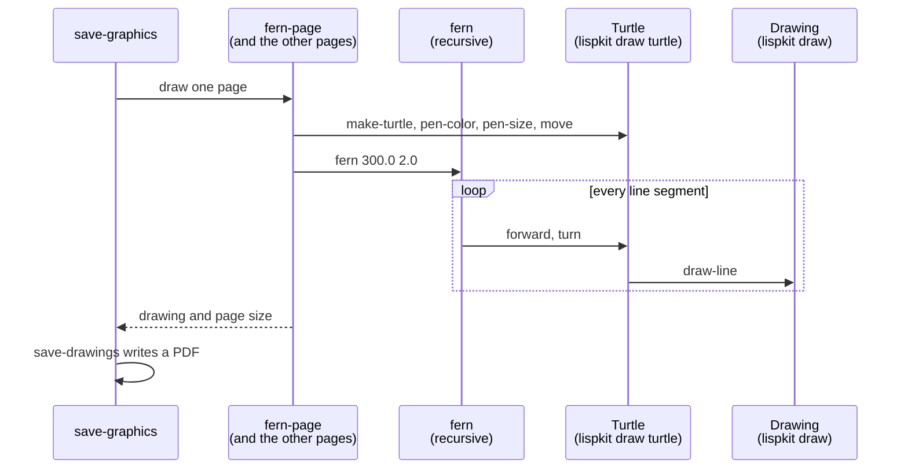

# Turtle

Turtle graphics is a classic way of drawing with a program: a _turtle_ sits on a plane, walks forward, turns, and leaves a line behind as long as its pen is down. This example uses a turtle to draw three famous fractal curves, a fern, the C-curve, and the dragon curve, with three short recursive procedures. Each curve is drawn onto its own page of a PDF file. The program is based on sample code for [LILA](http://zenger.org/lila/), a historic Lisp interpreter for Mac OS 8; the original code dates from 1994.

:::info

**Program:** [`Turtle.scm`](https://github.com/objecthub/swift-lispkit/blob/master/Sources/LispKit/Resources/Examples/Turtle.scm), in the `Examples` folder of LispKit\
**Libraries:** `(lispkit base)`, `(lispkit draw)`, `(lispkit draw turtle)`\
**Techniques:** recursion, turtle graphics, parameter objects, PDF output

:::

## What the program draws

<div class="gallery"><figure><figcaption><p>The fern</p></figcaption></figure> <figure><figcaption><p>The C-curve</p></figcaption></figure> <figure><figcaption><p>The dragon curve</p></figcaption></figure></div>

The curves look intricate, but they are made of nothing but straight lines. The number of times procedure `forward` is called to draw a page shows how much detail the recursion produces:

| Curve | Call | Calls of `forward` |
| --- | --- | --- |
| Fern | `(fern 300.0 2.0)` | 47,144 |
| C-curve | `(ccurve 120.0 0 1.0)` | 16,384 |
| Dragon curve | `(dragon 180.0 90 1.0)` | 32,768 |

## Running the program

Build LispKit from a clone of the [GitHub repository](https://github.com/objecthub/swift-lispkit) and load the program into the LispKit REPL:

```
swift build -c release -Xswiftc "-D" -Xswiftc "SPM"
.build/release/LispKitRepl -r Sources/LispKit/Resources -d LispKit \
    -p Sources/LispKit/Resources/Examples/Turtle.scm
```

The option `-p` runs the program as the _prelude_ of the REPL. The REPL stays open afterwards, and the definitions of the program are available at the prompt. Without `-p`, `LispKitRepl` runs the program and ends. Leave the REPL with `(exit)`.

The program only defines procedures, so nothing happens yet. At the prompt, call `save-graphics` with the name of the PDF file to create:

```scheme
(save-graphics "turtle-demo.pdf")
```

```
Drawing fern page
Drawing c-curve page
Drawing dragon page
Saving drawings in PDF file turtle-demo.pdf
```

A relative file name refers to the directory the REPL was started in; `(file-path "turtle-demo.pdf")` returns the absolute path. The PDF file has three pages, one per curve, each 610 × 460 points large.

## Turtle graphics in a nutshell

A turtle has a position, a heading, a pen that is either up or down, a pen color, and a line width. Library `(lispkit draw turtle)` provides procedures to create turtles and to move them around. The program uses the following ones:

| Procedure | Effect |
| --- | --- |
| `(make-turtle x y scale)` | Creates a turtle with an empty drawing. The _home_ of the turtle, its position `(0, 0)`, is placed at `(x, y)` in the drawing, and everything the turtle draws is magnified by `scale`. |
| `(move x y)` | Puts the turtle at `(x, y)`, measured from its home, without drawing a line. |
| `(heading angle)` | Sets the direction of the turtle. Angles are in degrees; 0 points to the right. |
| `(turn angle)` | Turns the turtle by `angle` degrees. Positive angles turn clockwise as seen on the page. |
| `(forward distance)` | Moves the turtle and draws a line if the pen is down. A negative distance moves the turtle backwards. |
| `(pen-color color)`, `(pen-size width)` | Set the color and the width of the lines. |
| `(turtle-drawing turtle)` | Returns the drawing the turtle has recorded. |
| `current-turtle` | A parameter object holding the turtle that is used by all the other procedures. |

The library has more, e.g. `backward`, `left`, `right`, `pen-up`, `pen-down`, `home`, and `arc`, which the program does not need.

As a first example, a turtle that repeats _go forward by 100, turn by 144 degrees_ five times draws a five-pointed star. The turns add up to 720 degrees, two full rotations, so the turtle ends up where it started, facing the same direction:

```scheme
(define star
  (parameterize ((current-turtle (make-turtle 20 60 1.0)))
    (pen-color (color 0.7 0.0 0.0))
    (pen-size 1.5)
    (do ((i 0 (+ i 1)))
        ((= i 5))
      (forward 100)
      (turn 144))
    (turtle-drawing (current-turtle))))

(save-drawing "star.pdf" star (size 140 140))
```

<figure><figcaption><p>The star drawn by five times <code>forward</code> and <code>turn</code></p></figcaption></figure>

## Libraries

| Library | Used for |
| --- | --- |
| [`(lispkit base)`](../../libraries/lispkit/lispkit-base.md) | The language itself: `define`, `if`, `cond`, `begin`, `parameterize`, arithmetic, and the output procedures `display` and `newline`. |
| [`(lispkit draw)`](../../libraries/lispkit/lispkit-draw.md) | Colors (`color`), page sizes (`size`), and `save-drawings`, which writes drawings into a PDF file. The turtle records what it draws as a _drawing_ of this library. |
| [`(lispkit draw turtle)`](../../libraries/lispkit/lispkit-draw-turtle.md) | The turtle: `make-turtle`, `current-turtle`, `move`, `heading`, `turn`, `forward`, `pen-color`, `pen-size`, and `turtle-drawing`. |

The turtle library is small: fewer than 100 lines of Scheme code in `Sources/LispKit/Resources/Libraries/lispkit/draw/turtle.sld`. A turtle is a record with a drawing, a position, a heading, and a pen flag. `forward` computes the new position from the heading with `cos` and `sin` and, if the pen is down, calls `draw-line` on the drawing of the turtle. A turtle never draws onto a screen. It only records lines into a drawing, a data structure that can later be saved, shown, or combined with other drawings.

## Design

### How a page gets drawn

The program is organized in three layers. `save-graphics` collects one page for each curve. Each page procedure prepares a fresh turtle and starts the recursive procedure of its curve. The recursive procedures contain the actual geometry and talk to the turtle only via `forward`, `turn`, and `heading`:



### The main ideas

**One recursive procedure per curve.** A fractal curve is defined by a rule that replaces a segment with a number of smaller segments. The rule applies to the smaller segments again, until they are shorter than a threshold. Each procedure has such a threshold, `min`, as its last parameter. A smaller `min` leads to more recursion and a more detailed curve.

**The heading is managed locally.** The turns in each recursive step of the fern and the dragon curve add up to zero, so a recursive call returns with the heading it was called with; the fern even walks back to its starting position. The C-curve sets the heading explicitly for each segment. This way, recursive calls can follow each other without any bookkeeping, and the end of one piece is the start of the next.

**Turtles are passed implicitly.** The page procedures bind the parameter object `current-turtle` with `parameterize`. All procedures called in its body use that turtle, which is why the curve procedures do not need a turtle argument.

**Pages are plain data.** A page is a list of a drawing and a size. `save-drawings` writes a list of pages into a PDF file, one page after the other.

## Walkthrough

The following sections go through the program from top to bottom. Together, the code blocks make up the complete source of `Turtle.scm`.

### Header and imports

<details>

<summary>Description, credits, and license</summary>

```scheme
;;; Turtle graphics
;;;
;;; This is a demo of library (lispkit draw turtle). Three different
;;; fractal curves are drawn and saved as individual pages in a PDF
;;; document. These examples are based on the sample code for LILA,
;;; a historic Lisp interpreter for Mac OS 8.
;;; (see http://zenger.org/lila/).
;;;
;;; Usage: (save-graphics "turtle-demo.pdf")
;;;
;;; Author: Matthias Zenger
;;; Copyright © 2018 Matthias Zenger. All rights reserved.
;;; Original copyright © 1994-03-06, Matthias Zenger.
;;;
;;; Licensed under the Apache License, Version 2.0 (the "License"); you may
;;; not use this file except in compliance with the License. You may obtain
;;; a copy of the License at
;;;
;;;   http://www.apache.org/licenses/LICENSE-2.0
;;;
;;; Unless required by applicable law or agreed to in writing, software
;;; distributed under the License is distributed on an "AS IS" BASIS,
;;; WITHOUT WARRANTIES OR CONDITIONS OF ANY KIND, either express or implied.
;;; See the License for the specific language governing permissions and
;;; limitations under the License.
```

</details>

```scheme
(import (lispkit base)
        (lispkit draw)
        (lispkit draw turtle))
```

### The fern

```scheme
(define (fern size min)
   (if (>= size min)
       (begin
         (forward (* 0.18 size))
         (turn 4)
         (fern (* 0.82 size) min)
         (turn 58)
         (fern (* 0.40 size) min)
         (turn -122)
         (fern (* 0.40 size) min)
         (turn 60)
         (forward (* -0.18 size)))))
```

`fern` draws a frond with a stem of length `size`. It stops when `size` has become smaller than `min`. Otherwise, it works in these steps:

1. Walk forward by 18% of `size`. This is a piece of the stem.
2. Turn by 4 degrees, so that the stem curls slightly, and draw the rest of the stem: a smaller fern with 82% of `size`.
3. Turn by 58 degrees and draw a branch to the right of the stem, a fern with 40% of `size`.
4. Turn by -122 degrees, which points 64 degrees to the left of the stem, and draw a second branch, another fern with 40% of `size`.
5. Turn by 60 degrees: 4 + 58 - 122 + 60 = 0, so the turtle has the heading it started with. Walk backwards by the length of the first step. The negative distance of `forward` draws the line a second time, which is why the fern consists of twice as many calls of `forward` as it has stem pieces. The turtle is back at its starting point.

```scheme
(define (fern-page)
  (display "Drawing fern page")
  (newline)
  (parameterize ((current-turtle (make-turtle 200 200 2.0)))
    (pen-color (color 0.0 0.5 0.0))
    (pen-size 0.3)
    (move -60 100)
    (heading -50)
    (fern 300.0 2.0)
    (list (turtle-drawing (current-turtle)) (size 610 460))))
```

`parameterize` makes a new turtle the current turtle while the body is evaluated. The turtle is created with its home at `(200, 200)` of the drawing and a scale of 2.0. The pen is set to a dark green and a thin line. `(move -60 100)` places the turtle to the left of and below its home. The y axis of a drawing points downwards, so these coordinates end up at `(80, 400)` on a page of 610 × 460 points, near its bottom left corner. `(heading -50)` points the turtle 50 degrees counterclockwise from the right, i.e. up and to the right, and `(fern 300.0 2.0)` draws the fern.

The result of the page procedure is the format `save-drawings` expects for a page: a list with the drawing of the turtle and the size of the page.

### The C-curve

```scheme
(define (ccurve len angle min)
  (cond ((< len min)
          (heading angle)
          (forward len))
        (else
          (ccurve (* len 0.7071) (+ angle 45) min)
          (ccurve (* len 0.7071) (- angle 45) min))))
```

The C-curve replaces a segment of length `len` pointing in direction `angle` with two segments that form a right angle. They are shorter by a factor of 0.7071, about 1/√2, and point in directions `angle + 45` and `angle - 45`, so that the original segment is the hypotenuse of a right-angled triangle. This rule is applied again to each of the two segments. Segments shorter than `min` are drawn: the procedure sets the heading and walks forward. Since the heading is set explicitly at every leaf, `ccurve` does not need to turn the turtle back.

```scheme
(define (ccurve-page)
  (display "Drawing c-curve page")
  (newline)
  (parameterize ((current-turtle (make-turtle 200 200 2.0)))
    (pen-color (color 0.0 0.0 0.5))
    (pen-size 0.3)
    (move -5 -25)
    (ccurve 120.0 0 1.0)
    (list (turtle-drawing (current-turtle)) (size 610 460))))
```

The page has the same shape as the fern page, only with a blue pen and different coordinates. The curve starts at the position given by `move`; `(ccurve 120.0 0 1.0)` starts with a segment of length 120 pointing to the right. The length of the segments shrinks from 120 to 0.94 in 14 steps, which is below the threshold `min` of 1.0. So the recursion is 14 levels deep and the curve consists of 2<sup>14</sup> = 16,384 line segments.

### The dragon curve

```scheme
(define (dragon len angle min)
  (define ang2 (- 90 angle))
  (define (sdragon size positive)
    (cond ((< size min)
            (forward size))
          (positive
            (turn angle)
            (sdragon (* size 0.7071) #t)
            (turn -90)
            (sdragon (* size 0.7071) #f)
            (turn ang2))
          (else
            (turn (- ang2))
            (sdragon (* size 0.7071) #t)
            (turn 90)
            (sdragon (* size 0.7071) #f)
            (turn (- angle)))))
  (heading angle)
  (sdragon len #t))
```

The dragon curve works like the C-curve: every segment is replaced by two segments at a right angle, which are shorter by the factor 0.7071. The difference is that the two halves are not treated the same. Local procedure `sdragon` has a flag `positive`. The corner between the two halves turns left in a positive dragon and right in a negative one, and the first half is always positive while the second half is always negative. This alternation produces the characteristic folded shape.

`dragon` defines `ang2` as `90 - angle` and `sdragon` as local procedures. `sdragon` uses `min`, `angle`, and `ang2` of the enclosing procedure. As in the fern, the turns of each case add up to zero, so `sdragon` returns the turtle to the heading it had when it was called. Only segments shorter than `min` are drawn. With the arguments used by the page, `angle` is 90 and `ang2` is 0, so the last turn of each case has no effect. The drawing starts with `(heading angle)`, i.e. with the turtle pointing down.

```scheme
(define (dragon-page)
  (display "Drawing dragon page")
  (newline)
  (parameterize ((current-turtle (make-turtle 200 200 2.0)))
    (pen-color (color 0.7 0.0 0.0))
    (pen-size 0.3)
    (move 10 -47)
    (dragon 180.0 90 1.0)
    (list (turtle-drawing (current-turtle)) (size 610 460))))
```

The length of the segments shrinks from 180 to 0.99 in 15 steps. So the recursion is 15 levels deep and the curve consists of 2<sup>15</sup> = 32,768 line segments.

### Saving the pages

```scheme
(define (save-graphics filename)
  (let ((pages (list (fern-page) (ccurve-page) (dragon-page))))
    (display "Saving drawings in PDF file ")
    (display filename)
    (newline)
    (save-drawings filename pages "Demo of library (lispkit draw turtle)")))
```

`save-graphics` creates the three pages, prints a message, and writes all pages into one PDF file. The third argument of `save-drawings` is the title of the PDF document. Since the page procedures are independent of each other, it is easy to draw one curve only, e.g. `(save-drawings "fern.pdf" (list (fern-page)) "Fern")`.

## Variations

**More or less detail.** The last argument of each curve procedure decides how deep the recursion goes. Calling `ccurve` with four different values of `min` and moving the turtle between the calls draws the same curve with 2, 16, 128, and 1,024 line segments:

```scheme
(define refinement
  (parameterize ((current-turtle (make-turtle 70 60 1.0)))
    (pen-color (color 0.0 0.0 0.5))
    (pen-size 0.6)
    (for-each (lambda (i min)
                (move (* i 270) 0)
                (ccurve 120.0 0 min))
              '(0 1 2 3)
              '(100.0 35.0 12.0 4.5))
    (turtle-drawing (current-turtle))))

(save-drawing "ccurve-refinement.pdf" refinement (size 1090 210))
```

<figure><figcaption><p>The C-curve with 2, 16, 128, and 1,024 line segments</p></figcaption></figure>

**More ideas.** Draw the curves in other colors or with different line widths. Change the angles and the factors of the fern, e.g. the curl of 4 degrees, to get different plants. Draw several fronds into one drawing, using `move` and `heading` between the calls, or use `pen-up` and `pen-down` to jump to a new place without drawing a line. Replace `turn` by `left` and `right`, or draw circles and arcs with `arc`.

## Further reading

* [`(lispkit draw turtle)`](../../libraries/lispkit/lispkit-draw-turtle.md): reference documentation of the turtle library
* [`(lispkit draw)`](../../libraries/lispkit/lispkit-draw.md): drawings, colors, and PDF output
* [`(lisppad turtle)`](../../libraries/lisppad/turtle.md): a turtle with a graphics pane for interactive use in LispPad. According to its documentation, its angles are measured in radians.
* [LILA](http://zenger.org/lila/): the Lisp interpreter whose sample code this program is based on
