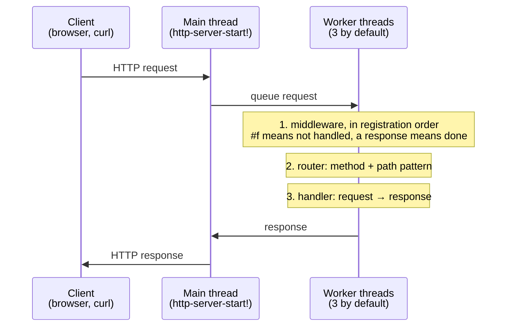

# Webserver

This example turns a LispKit program into a web server. Request handlers are ordinary Scheme procedures: they receive a request object and return a response object. The pages they produce are written as Scheme data (_SXML_) rather than as strings of HTML. The program is a guided tour through library [`(lispkit http server)`](../../libraries/lispkit/lispkit-http-server.md): routing with path parameters and wildcards, middleware, forms and file uploads, redirects, error responses, file downloads, and a clean shutdown.

:::info

**Program:** [`Webserver.scm`](https://github.com/objecthub/swift-lispkit/blob/master/Sources/LispKit/Resources/Examples/Webserver.scm), in the `Examples` folder of LispKit\
**Requires:** LispKit 2.6.3 or later\
**Libraries:** `(lispkit base)`, `(lispkit box)`, `(lispkit thread)`, `(lispkit http server)`\
**Techniques:** routing, middleware, SXML and quasiquotation, atomic boxes, threads

:::

## Running the program

Build LispKit from a clone of the [GitHub repository](https://github.com/objecthub/swift-lispkit) and run the program with the LispKit REPL:

```
swift build -c release -Xswiftc "-D" -Xswiftc "SPM"
.build/release/LispKitRepl -r Sources/LispKit/Resources -d LispKit \
    Sources/LispKit/Resources/Examples/Webserver.scm
```

The program lists its routes, prints the address of the server, and then keeps serving requests:

```
server routes: (/close /login /foo/bar /magic /error /upload /not/implemented /wildcard/*/test/*/:param /path /files/::path /public/::path /test/:param1/:param2 /redirect/permanently /redirect/temporarily /long / /upload /login)
server url: http://localhost:8090
[http/server] server started for port 8090; try connecting at http://127.0.0.1:8090
```

Open [http://localhost:8090](http://localhost:8090) in a browser. The start page links to every route. For routes with parameters, such as `/test/:param1/:param2`, replace the parameters with values, e.g. `/test/one/two?x=1`. Visiting `/close` stops the server. The program then prints the number of requests it has served and ends.

The routes `/public` and `/files` share the `Downloads` folder of the current user, so they show your own files. To share another folder, change the two routes as described in [Sharing and browsing directories](#sharing-and-browsing-directories).

## What the server offers

| Route | Methods | Demonstrates |
| --- | --- | --- |
| `/` | all | A page listing all routes, generated from the registered routes |
| `/magic`, `/foo/bar` | GET | Plain text responses |
| `/path` | all | A custom response header and an HTML fragment |
| `/test/:param1/:param2` | all | A request inspector: address, path, method, query parameters, path parameters, headers |
| `/wildcard/*/test/*/:param` | GET | Wildcard path segments |
| `/upload` | GET, POST | A multipart form for file uploads and the inspection of the uploaded parts |
| `/login` | GET, POST | A complete HTML page with a form; the POST handler echoes the form attributes |
| `/redirect/permanently`, `/redirect/temporarily` | all | Redirect responses |
| `/public/::path` | all | Downloading files from the `Downloads` folder |
| `/files/::path` | all | Browsing the `Downloads` folder |
| `/long` | all | A response with a body of several kilobytes |
| `/not/implemented` | GET | A _501 Not Implemented_ response |
| `/error` | GET | A handler that fails; the server turns the error into a _500_ response |
| `/close` | GET | Stops the server, after the response has been sent |
| everything else | all | A _404 Not Found_ response from the default handler |

Routes registered with a method (`GET`, `POST`) only handle requests with that method. Routes registered without a method handle all methods.

## Libraries

The program imports four libraries:

| Library | Used for |
| --- | --- |
| [`(lispkit base)`](../../libraries/lispkit/lispkit-base.md) | The language itself: `define`, `lambda`, `let`, `do`, quasiquotation, `map`, `apply`, `error`, `thunk`, `display*`, and `string-append!`. The library aggregates many others, e.g. [`(lispkit core)`](../../libraries/lispkit/lispkit-core.md) and [`(lispkit system)`](../../libraries/lispkit/lispkit-system.md), which provides `available-network-interfaces` and `system-directory`. |
| [`(lispkit box)`](../../libraries/lispkit/lispkit-box.md) | _Atomic boxes_ for sharing a counter between threads: `make-atomic-box`, `atomic-box-inc+mul!`, and `atomic-box-ref`. `(lispkit base)` re-exports this library, so importing it explicitly just makes the dependency visible. |
| [`(lispkit thread)`](../../libraries/lispkit/lispkit-thread.md) | Threads: `spawn`, `thread-sleep!`, and `wait-threads-terminated`. |
| [`(lispkit http server)`](../../libraries/lispkit/lispkit-http-server.md) | The web server: servers, routes, requests, responses, and the handlers for sharing directories. |

`(lispkit http server)` builds on more libraries without the program having to import them: [`(lispkit sxml)`](../../libraries/lispkit/lispkit-sxml.md) turns SXML into HTML, and [`(lispkit markdown)`](../../libraries/lispkit/lispkit-markdown.md) and [`(lispkit json)`](../../libraries/lispkit/lispkit-json.md) make it possible to send Markdown and JSON documents as responses. Sockets and the HTTP protocol are handled by the Swift framework [NanoHTTP](https://github.com/objecthub/swift-nanohttp).

## Design

### How a request is processed

The thread that calls `http-server-start!` accepts connections, reads requests, and writes responses. It hands each request over to one of several worker threads (three by default), which run the program's code:



### The main ideas

**Handlers are functions.** A handler is a procedure from a request to a response. Registering a handler associates a method and a route pattern with it. Handlers are closures, so they can use whatever state is in scope. There are no controller classes or configuration files.

**Routes are patterns.** A route is a path whose segments are matched one by one:

| Segment | Matches |
| --- | --- |
| `abc` | exactly the segment `abc` |
| `:name` | any single segment, which is assigned to path parameter `name` |
| `*` | any single segment |
| `::name` | any sequence of segments, assigned to path parameter `name` |
| `**` | any sequence of segments |

The program uses `/test/:param1/:param2`, `/wildcard/*/test/*/:param`, and `/public/::path`.

**Responses are made from data.** `(make-srv-response status headers body)` derives the content of a response from the type of `body`: a string becomes `text/plain`, a list is interpreted as SXML and becomes `text/html`, and Markdown and JSON objects, styled text, images, and bytevectors are supported as well. SXML that is not a complete `html` document is wrapped into `html` and `body` elements. Headers are an association list of string pairs, or `#f`. Procedures such as `srv-response-ok`, `srv-response-not-found`, and `srv-response-moved-permanently` cover the common cases.

**HTML is data.** SXML represents HTML as nested lists: `(p (b "Hi") " there")` stands for `<p><b>Hi</b> there</p>`, and attributes are written as an `(@ ...)` element, as in `(a (@ (href "/")) "home")`. Together with quasiquotation, this makes it easy to build pages from data: write the fixed parts as a template and splice in computed parts with `,` and `,@`. Text is escaped when SXML is converted to HTML, so values from a request can be inserted without letting them inject markup.

**Concurrency is explicit.** Handlers and middleware run on several worker threads at the same time. State shared between requests, such as the counter of requests, therefore needs synchronization; the program uses an atomic box. The main thread blocks inside `http-server-start!` until the server is stopped, so stopping the server has to be done from another thread.

**The protocol details are the server's job.** The program does not handle `HEAD` and `OPTIONS` requests, requests with an unsupported method (answered with _405_ and an `Allow` header), persistent connections, timeouts, or oversized and malformed requests. The server does.

## Walkthrough

The following sections go through the program from top to bottom. Together, the code blocks make up the complete source of `Webserver.scm`.

### Header and imports

<details>

<summary>Description, credits, and license</summary>

```scheme
;;; Webserver
;;;
;;; This program implements a simple web server (only the HTTP protocol is
;;; supported) with the framework of library `(lispkit http server)`. HTML
;;; gets generated from SXML, which the various request handlers are
;;; generating. Alternatively, plain text HTML in string form, Markdown,
;;; and JSON is supported to generate the content of HTTP responses. Headers
;;; are represented as association lists, where each header is represented
;;; as a pair of strings.
;;;
;;; This code was inspired by the demo for Swifter, written by Damian
;;; Kołakowski. See: https://github.com/httpswift/swifter
;;;
;;; Author: Matthias Zenger
;;; Copyright © 2024-2026 Matthias Zenger. All rights reserved.
;;;
;;; Licensed under the Apache License, Version 2.0 (the "License"); you may
;;; not use this file except in compliance with the License. You may obtain
;;; a copy of the License at
;;;
;;;   http://www.apache.org/licenses/LICENSE-2.0
;;;
;;; Unless required by applicable law or agreed to in writing, software
;;; distributed under the License is distributed on an "AS IS" BASIS,
;;; WITHOUT WARRANTIES OR CONDITIONS OF ANY KIND, either express or implied.
;;; See the License for the specific language governing permissions and
;;; limitations under the License.
```

</details>

The program was inspired by the demo of [Swifter](https://github.com/httpswift/swifter), a web server for Swift written by Damian Kołakowski.

```scheme
(import (lispkit base)
        (lispkit box)
        (lispkit thread)
        (lispkit http server))
```

### A helper for the local address

```scheme
;; Returns the local IP address
(define (local-ip-address . args)
  (let ((intf (apply available-network-interfaces args)))
    (and (pair? intf) (cadar intf))))
```

`available-network-interfaces` returns an association list describing the network interfaces of the machine. The helper passes its optional arguments on (`#t` restricts the list to IPv4 addresses) and returns the address of the first interface. The program used to print this address when the server started. It does not call the helper anymore: since the server only listens on the loopback address by default, `localhost` is the address to use. The helper becomes useful again when the server is started for all network interfaces (see [Variations](#variations)).

### The server and its default handler

```scheme
;; Create a new HTTP server
(define server (make-http-server))

;; Register a default handler
(http-server-register-default! server
  (lambda (request) (srv-response-not-found)))
```

`make-http-server` creates the server object. Nothing is listening yet: routes, middleware, and the log level are all configured on this object before the server is started.

The default handler is used for every request that matches no route. Here, it responds with _404 Not Found_ and the text `not found`. `srv-response-not-found` is one of a family of procedures for common statuses, including `srv-response-ok`, `srv-response-bad-request`, `srv-response-forbidden`, and `srv-response-internal-server-error`.

### The start page

```scheme
;; Serve a page under path "/" that lists all routes
(http-server-register! server "/"
  (lambda (request)
    (make-srv-response 200 #f
      `(p (b "Available routes:")
          (ul . ,(map (lambda (x) `(li (a (@ (href ,x)) ,x))) (http-server-routes server)))))))
```

`http-server-register!` takes a route and a handler. Without a method, as here, the handler responds to all methods. The handler builds a response with status 200 and no additional headers (`#f`), and the body is a list, so it is interpreted as SXML. It is a fragment and not a complete document, so the server wraps it into `html` and `body` elements.

`http-server-routes` returns the registered route patterns as strings. The expression `(ul . ,(map ... ))` is a compact way of building `(ul item1 item2 ...)`: the result of `map` becomes the tail of the list. The routes are listed in no particular order, and a route registered for two methods appears twice, e.g. `/upload` and `/login`.

### Plain text routes

```scheme
;; Register handlers for all supported routes

(http-server-register! server "GET" "/magic"
  (lambda (request)
    (make-srv-response 200 #f "let the magic happen")))

(http-server-register! server "GET" "/foo/bar"
  (lambda (request)
    (make-srv-response 200 #f "this triggered /foo/bar")))
```

When a string is used as the body, it is sent as `text/plain`. These routes are registered for `GET` only. A `POST` request for `/magic` is answered by the server itself with _405 Method Not Allowed_ and the header `Allow: GET, HEAD, OPTIONS`.

### Stopping the server

```scheme
(http-server-register! server "GET" "/close"
  (lambda (request)
    ;; Stop the server with a delay on a separate thread, such that the response gets sent
    (spawn (thunk (thread-sleep! 1.0) (http-server-stop! (srv-request-server request))))
    (make-srv-response 200 #f "this closed the server")))
```

`http-server-stop!` closes all connections of the server, including the one over which the response to the current request is about to be sent. The handler therefore does not stop the server directly. It starts a new thread with `spawn`, which waits for a second before stopping the server, and returns the response right away. `thunk` creates a procedure without parameters, and `srv-request-server` returns the server that received the request.

### A handler that fails

```scheme
(http-server-register! server "GET" "/error"
  (lambda (request)
    (error "Something really bad has happened ($0)" request server)))
```

An error raised by a handler does not crash the server. The server catches it, logs it, and answers the request with _500 Internal Server Error_. The body of that response describes the error: `$0` in the message is replaced by the first irritant, the request. This is helpful during development; a production server would return a generic message instead.

### A custom header

```scheme
(http-server-register! server "/path"
  (lambda (request)
    (make-srv-response 200
      '(("XXX-Custom-Header" . "value"))
      `(p "You asked for " ,(srv-request-path request)))))
```

Headers are an association list of string pairs. `srv-request-path` returns the path of the request as the client sent it, i.e. percent-encoded. The body is an HTML fragment. The response has the content type `text/html`, and the fragment is wrapped into a document (see [Try it](#try-it)).

### Inspecting a request

```scheme
(http-server-register! server "/test/:param1/:param2"
  (lambda (req)
    (make-srv-response 200 #f
      `((h3 "Address: " ,(or (srv-request-address req) "unknown"))
        (h3 "URL: " ,(srv-request-path req))
        (h3 "URL (decoded): " ,(srv-request-path req #t))
        (h3 "Method: " ,(srv-request-method req))
        (h3 "Query params:")
        (table
          ,(map (lambda (x) `(tr (td ,(car x)) (td ,(cdr x)))) (srv-request-query-params req)))
        (h3 "Query params (decoded):")
        (table
          ,(map (lambda (x) `(tr (td ,(car x)) (td ,(cdr x)))) (srv-request-query-params req #t)))
        (h3 "Path params:")
        (table
          ,(map (lambda (x) `(tr (td ,(car x)) (td ,(cdr x)))) (srv-request-path-params req)))
        (h3 "Path params (decoded):")
        (table
          ,(map (lambda (x) `(tr (td ,(car x)) (td ,(cdr x)))) (srv-request-path-params req #t)))
        (h3 "Headers:")
        (table
          ,(map (lambda (x) `(tr (td ,(car x)) (td ,(cdr x)))) (srv-request-headers req)))))))
```

This handler shows everything the server knows about a request. The route has two path parameters, `param1` and `param2`. Its response is a list of SXML elements, which `make-srv-response` accepts as well.

The request accessors return values as sent by the client by default. An optional last argument `#t` returns the decoded values instead, which is why every section appears twice. For `/test/caf%C3%A9/b?x=1&y=%C3%A9`:

| | as sent | decoded |
| --- | --- | --- |
| path | `/test/caf%C3%A9/b` | `/test/café/b` |
| `param1` | `caf%C3%A9` | `café` |
| query `y` | `%C3%A9` | `é` |

`srv-request-address` is the address of the client or `#f`, `srv-request-method` the method, and `srv-request-headers` an association list. Header names are lower case. The table rows are built with `map` and a quasiquoted `tr` element, and the resulting list of rows is spliced into the `table` element. The order of the query parameters is not guaranteed.

### Uploading files

```scheme
(http-server-register! server "GET" "/upload"
  (lambda (req)
    (make-srv-response 200 #f
      `(form (@ (method "POST")
                 (action "/upload")
                 (enctype "multipart/form-data"))
         (input (@ (name "my_file1")(type "file")))
         (input (@ (name "my_file2")(type "file")))
         (input (@ (name "my_file3")(type "file")))
         (button (@ (type "submit")) "Upload")))))
```

The first handler returns a page with a form. A form with `enctype="multipart/form-data"` sends its fields and files as separate _parts_ of the request.

```scheme
(http-server-register! server "POST" "/upload"
  (lambda (req)
    (make-srv-response 200 #f
      `(table
         ,(map (lambda (x)
                 `((tr (td (@ (colspan 2)) (b "Part"))) .
                   ,(map (lambda (y)
                           `(tr (td ,(car y)) (td ,(cdr y)))) (srv-multipart-headers x))))
               (srv-request-form-multiparts req))))))
```

`srv-request-form-multiparts` returns the parts of the request as a list. For every part, the handler creates a row with the title `Part` followed by a row for each header of the part, e.g. `content-disposition`, which contains the field name and the file name, and `content-type`. The content of a part is available with `srv-multipart-body` and `srv-multipart-body->string`; the program does not use it.

### A form with a login page

```scheme
(http-server-register! server "GET" "/login"
  (lambda (req)
    (srv-response-ok
      `(html
         (head
           (script (@ (src "http://cdn.staticfile.org/jquery/2.1.4/jquery.min.js")))
           (link (@ (rel "stylesheet")
                    (href "http://cdn.staticfile.org/twitter-bootstrap/3.3.0/css/bootstrap.min.css"))))
         (body
           (h3 "Sign In")
           (form (@ (method "POST")
                    (action "/login"))
             (fieldset
               (input (@ (name "email")(type "email")(placeholder "E-mail")(autofocus "")))
               (input (@ (name "password")(type "password")(placeholder "Password")(autofocus "")))
               (a (@ (href "/login"))
                  (button (@ (type "submit")) "Login"))))
          (script (@ (src "http://cdn.staticfile.org/twitter-bootstrap/3.3.0/js/bootstrap.min.js"))))))))
```

This handler returns a complete HTML document: `html` with `head` and `body`. Since the outermost element is `html`, the document is sent as it is, whereas fragments are wrapped automatically. The `link` and `script` elements load Bootstrap and jQuery from a CDN. `srv-response-ok` is a shortcut for a response with status 200; it accepts the headers as an optional first argument.

```scheme
(http-server-register! server "POST" "/login"
  (lambda (req)
    (srv-response-ok
      '(("XXX-Custom-Header" . "value"))
      `(p ,@(map (lambda (x) `(,(car x) " = " ,(cdr x) (br))) (srv-request-form-attributes req))))))
```

`srv-request-form-attributes` returns the fields of a submitted form as an association list. The values are decoded. Each field is shown as `name = value`, followed by a line break. The expression `,@(map ...)` splices the list of fields into the paragraph. The values are escaped when the page is generated, so a field value like `<b>x</b>` is displayed as text. A real login handler would, of course, never echo a password.

### Redirects

```scheme
(http-server-register! server "/redirect/permanently"
  (lambda (req)
    (srv-response-moved-permanently "http://www.google.com")))

(http-server-register! server "/redirect/temporarily"
  (lambda (req)
    (srv-response-moved-temporarily "http://www.google.com")))
```

The handlers for redirects do not need the request. `srv-response-moved-permanently` answers with _301_, and `srv-response-moved-temporarily` with _307_, both with a `Location` header.

### Sharing and browsing directories

```scheme
(http-server-register! server "/public/::path"
  (share-directory-handler (car (system-directory 'downloads))))

(http-server-register! server "/files/::path"
  (browse-directory-handler (car (system-directory 'downloads))))
```

`share-directory-handler` and `browse-directory-handler` do not handle a request themselves; they _return_ a handler for a directory. The route has to end in a path variable like `::path`, which stands for the file or directory below the shared folder. `/public` downloads files with `ETag` and `Last-Modified` headers and supports conditional and range requests. `/files` also lists the content of directories.

Both routes share the `Downloads` folder of the current user. `(system-directory 'downloads)` returns a list with the paths of that folder; `system-directory` supports further system folders, e.g. `documents` and `desktop`. The list usually has a single element, which is why the program takes its `car`. To share any other folder, pass its path as a string instead, e.g. `"/Users/me/Public"`.

Requests that try to leave the shared folder, e.g. with `..` segments (also percent-encoded) or via symbolic links, are refused with _403 Forbidden_.

### Larger and special responses

```scheme
(http-server-register! server "/long"
  (lambda (request)
    (do ((str "")
         (i 0 (+ i 1)))
        ((>= i 1000) (srv-response-ok '(("XXX-Custom-Header" . "value")) str))
      (string-append! str "(" (number->string i) "),->"))))
```

The `do` loop creates a string of 7,890 characters with `string-append!`, which appends to the string in place, and returns it with a custom header.

```scheme
(http-server-register! server "GET" "/wildcard/*/test/*/:param"
  (lambda (request)
    (make-srv-response 200 '(("XXX-Custom-Header" . "value")) (srv-request-path request))))

(http-server-register! server "GET" "/not/implemented"
  (lambda (request) (srv-response-not-implemented)))
```

The wildcard route matches paths like `/wildcard/a/test/b/c`; the handler responds with the path itself. The last route shows `srv-response-not-implemented`, which answers with _501_.

### Counting requests with middleware

```scheme
;; Counter for processed requests
(define requests-served (make-atomic-box 0))

;; Use this middleware processor to count served requests with an atomic box (needed
;; because middleware is executed concurrently on potentially many different threads)
(http-server-register-middleware! server
  (lambda (request)
    (atomic-box-inc+mul! requests-served 1)
    #f))
```

Middleware is code that runs for requests before the handlers do. A middleware processor receives the request and returns either `#f`, which means that the request is not handled and processing continues, or a response, which ends the processing. This processor never responds. It counts the requests.

Since several worker threads run the processor at the same time, the counter cannot be a plain variable. An atomic box makes the update safe. `(atomic-box-inc+mul! box 1)` adds one to the value in the box as a single atomic step.

Requests that the server answers by itself, e.g. requests with an unsupported method or `OPTIONS` requests, never reach the middleware and are not counted. The final count can therefore be lower than the number of requests in the log.

### Starting the server and waiting for its end

```scheme
;; Print all log messages
; (http-server-log-severity-set! server 0)

;; Display all supported server routes
(display* "server routes: " (http-server-routes server) "\n")
(display* "server url: http://localhost:8090\n")

;; Start the server. This procedure only terminates when the server is shut down
;; (e.g. via a GET request for path "/close"). By default, the server listens on the
;; loopback address, i.e. it is only reachable from this machine. Pass `#t` as a third
;; argument to make it available on all network interfaces.
(http-server-start! server 8090)
```

Debug logging is disabled in the program. Setting the log severity to `0` prints all log messages, including those of the worker threads. `display*` prints all its arguments without the need for converting them to strings first.

`http-server-start!` takes the port and three optional arguments: the address to listen on (default `#f`, the loopback address; `#t` for all network interfaces, or an address as a string), the number of worker threads (default 3), and a name prefix for the worker threads. It returns only after the server has been stopped, e.g. by a request for `/close`.

```scheme
;; Wait for all threads to be terminated, but not longer than 10s
(wait-threads-terminated 10)

;; Display the number of requests served
(display* (atomic-box-ref requests-served) " requests served.\n")
```

The closing thread of `/close` may still be running when the server stops. `wait-threads-terminated` waits until all other threads have ended, but not longer than ten seconds. Finally, the program reads the counter and prints it.

## Try it

With the program running, `curl` shows what the server sends. Some headers, e.g. `Date`, are omitted in the output below. A plain text route:

```
$ curl -i http://localhost:8090/magic
HTTP/1.1 200 OK
Content-Length: 20
Content-Type: text/plain; charset=utf-8

let the magic happen
```

A request with the wrong method is answered by the server itself:

```
$ curl -i -X POST http://localhost:8090/magic
HTTP/1.1 405 Method Not Allowed
Content-Length: 0
Allow: GET, HEAD, OPTIONS
```

The handler of `/path` adds a custom header and returns an HTML fragment, which the server wraps into a document:

```
$ curl -i http://localhost:8090/path
HTTP/1.1 200 OK
Content-Length: 74
XXX-Custom-Header: value
Content-Type: text/html; charset=utf-8

<html><meta charset="UTF-8"><body><p>You asked for /path</p></body></html>
```

Submitting a form to `/login`. The special characters in the values are escaped in the HTML:

```
$ curl --data-urlencode 'email=<b>x</b> & "q"' -d 'password=secret' http://localhost:8090/login
<html><meta charset="UTF-8"><body><p>password = secret<br/>email = &lt;b&gt;x&lt;/b&gt; &amp; &quot;q&quot;<br/></p></body></html>
```

Uploading a file and a text field to `/upload`:

```
$ curl -F my_file1=@up1.txt -F note=hi http://localhost:8090/upload
<html><meta charset="UTF-8"><body><table><tr><td colspan="2"><b>Part</b></td></tr><tr><td>content-type</td><td>text/plain</td></tr><tr><td>content-disposition</td><td>form-data; name=&quot;my_file1&quot;; filename=&quot;up1.txt&quot;</td></tr><tr><td colspan="2"><b>Part</b></td></tr><tr><td>content-disposition</td><td>form-data; name=&quot;note&quot;</td></tr></table></body></html>
```

A request that tries to leave the shared directory:

```
$ curl -i --path-as-is http://localhost:8090/public/../../etc/passwd
HTTP/1.1 403 Forbidden
Content-Length: 9
Content-Type: text/plain; charset=utf-8

Forbidden
```

A failing handler:

```
$ curl -i http://localhost:8090/error
HTTP/1.1 500 Internal Server Error
Content-Type: text/plain; charset=utf-8

request handler: [error] Something really bad has happened (#<srv-request: GET /error, params=(), headers=3>)
...
```

Finally, `curl http://localhost:8090/close` stops the server. The REPL, which ran the program, shows the end of the log and the result of the middleware:

```
[http/req] GET /close (127.0.0.1)
[http/server] server stopped for port 8090
7 requests served.
```

Eight requests were made in this session. The `POST` request for `/magic` was answered by the server itself and is not part of the count.

## Variations

**Send JSON.** A list is always interpreted as SXML, so a JSON document has to be created explicitly with `json` from library [`(lispkit json)`](../../libraries/lispkit/lispkit-json.md). This route reports the counter and the routes of the server. The routes in this section use the counter, so they have to be added after the middleware and before the call of `http-server-start!`:

```scheme
(import (lispkit json))

(http-server-register! server "GET" "/status"
  (lambda (request)
    (make-srv-response 200 #f
      (json `((requests . ,(atomic-box-ref requests-served))
              (routes . ,(list->vector (http-server-routes server))))))))
```

```
$ curl -i http://localhost:8090/status
HTTP/1.1 200 OK
Content-Type: application/json

{"routes":["\/path","\/files\/::path","\/redirect\/permanently", ... ],"requests":1}
```

**Send Markdown.** A Markdown object created with library [`(lispkit markdown)`](../../libraries/lispkit/lispkit-markdown.md) is sent as a complete HTML page:

```scheme
(import (lispkit markdown))

(http-server-register! server "GET" "/about"
  (lambda (request)
    (make-srv-response 200 #f
      (markdown "# About\n\nThis page is written in *Markdown*.\n"))))
```

**Serve other machines.** By default, the server can only be reached from the machine it runs on. Passing `#t` as third argument to `http-server-start!` makes it available on all network interfaces; this is also where `local-ip-address` is of use for printing an address for other machines to connect to. Keep in mind that `/files`, `/public`, and `/error` then give everybody on the network access to your `Downloads` folder and to error details.

**More ideas.** Show the log by lowering the log severity. Write a procedure that turns an association list into an SXML `table`, and use it in `/test/:param1/:param2` instead of repeating the same expression five times. Handle the body of `POST` requests with `srv-request-body->string`. Run the server on another port, or with more worker threads.

## Further reading

* [`(lispkit http server)`](../../libraries/lispkit/lispkit-http-server.md): reference documentation of the library
* [`(lispkit sxml)`](../../libraries/lispkit/lispkit-sxml.md): converting SXML to HTML and XML
* [`(lispkit box)`](../../libraries/lispkit/lispkit-box.md) and [`(lispkit thread)`](../../libraries/lispkit/lispkit-thread.md): atomic boxes and threads
* [Swifter](https://github.com/httpswift/swifter): the web server that inspired the demo
